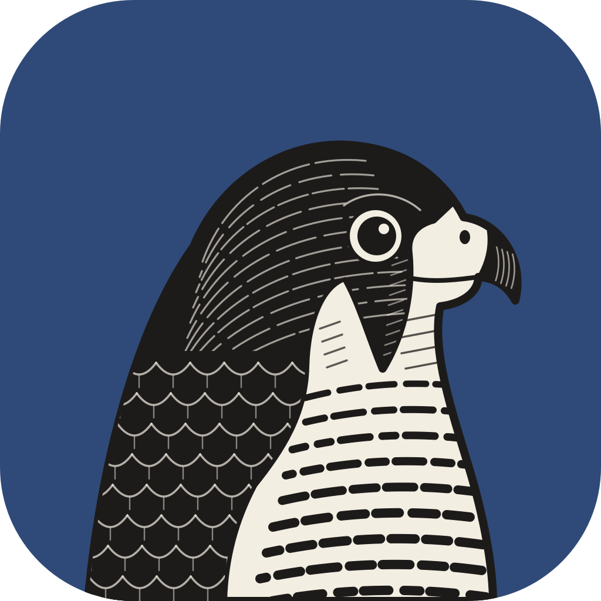

  

<h1 align="center">CFDCraft</h1>

  An open-source, industry-strength, general purpose CFD solver, written in Rust and built for modern GPUs.

---

> **Status: requirements engineering.** There is no solver code yet. The
> requirements are being worked out step by step in
> [docs/requirements.md](docs/requirements.md).

## Goal

CFDCraft aims to be a general purpose computational fluid dynamics solver of
industry strength: the class of tool that engineers rely on every day for
fluid flow, heat and mass transfer, species transport and combustion, on real
geometries and at real problem sizes. It is free and open source under the MIT
licence.

The guiding targets are:

- **General purpose.** Arbitrary polyhedral meshes in 3D, with a physics
  roadmap that reaches from incompressible flow to conjugate heat transfer,
  reacting flow, multiphase flow, moving meshes and scale-resolving
  turbulence.
- **Performance first.** Modern parallel GPUs are the primary platform, with
  a design target of more than 100 million cells on several GPUs and on
  clusters. The same solver runs on any CPU.
- **Accuracy that can be checked.** Double precision, numerics taken from the
  published literature, and every development stage verified against analytic
  solutions and published reference data.
- **Solver first.** A case file and a command line; meshes from established
  open tools, results to established open post-processors.

## First milestone

Incompressible flow on unstructured meshes, with two or three RANS turbulence
models, run from a text case file. Everything after that follows the roadmap
in the [requirements](docs/requirements.md).

## How it is built

CFDCraft follows the paradigm of the
[ArtCraft Crafting Apps](https://getartcraft.com/apps/craft-anything): open
source software in Rust, one engine with thin front ends on top, and
development carried out together with a coding agent in a loop of exploring,
building, checking and refining. The falcon joins the animals of that family.

What the agent builds is decided by a person. The development is driven by the
expert knowledge of the maintainer, Andreas Ennemoser, from 40 years in
computational fluid dynamics: the requirements, the choice of methods, the
test cases and the judgement of every result come from that experience. The
agent writes and checks code; it does not decide what a CFD solver has to be.

Three rules follow from this:

1. **Requirements before code.** Each decision is recorded with its reason in
   [docs/requirements.md](docs/requirements.md) before anything is implemented.
2. **Every stage ends with results that can be tested.** No stage is done
   until its verification cases pass.
3. **Clean-room numerics.** Methods come from the published literature, with
   references; no code is taken from other solvers.

## Why a falcon

The peregrine falcon is the fastest animal there is, and its shape is the work
of the flow around it.

## Contributing

The project is at the requirements stage and has one maintainer. Comments on
the requirements are welcome as GitHub issues. Contribution guidelines will
follow with the first code.

## Licence

Distributed under the MIT licence. See [LICENSE](LICENSE) for more information.

<!-- year:start -->2026<!-- year:end --> Andreas Ennemoser – andreas.ennemoser@aon.at
