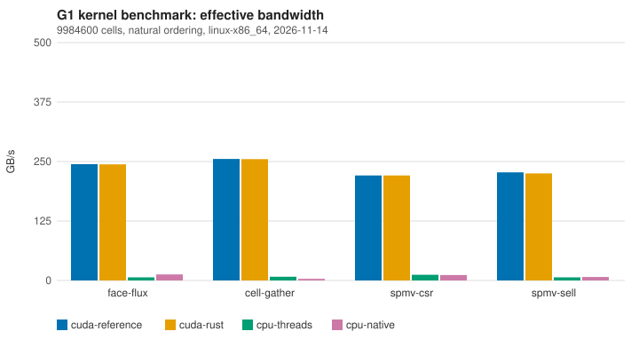

# Gate G1: GPU kernel benchmark

Gate G1 closes stage 0 of the [stage plan](../requirements.md#7-stage-plan).
It decides the GPU backend policy (D8) and confirms or reopens the language
decision (D11): can kernels be written **once**, in Rust, for the CPU and
the NVIDIA GPU, without losing speed against a hand-written native
implementation?

**Pass:** for every kernel, the median time of the single-source route is at
most 1.10 times that of the hand-written reference, and both reproduce the
reference results. **Fail:** two backends (D8), with the GPU kernels in CUDA
C launched from Rust; only if that also proves unworkable is the language
reopened.

Status (2026-11-14): **G1 passed on both sides.** GPU verdict: PASS on a
Tesla T4 ([below](#gpu-verdict-tesla-t4-google-colab-2026-11-14)). CPU
verdict: PASS on an Intel Core i9-9900K in two runs
([below](#cpu-verdict-imac-i9-9900k-2026-11-14)). The single-source Rust
kernels are within 1.1 % of the hand-written references on the GPU and on the
CPU, with bitwise equal results. D8: one kernel source; D11 stands (with the
nightly-toolchain reservation O14). The maintainer's GTX 960 (compute
capability 5.2) is older than the Rust GPU target allows, so the GPU run used
a free Google Colab T4 ([`tools/g1_colab.ipynb`](../../tools/g1_colab.ipynb),
recipe 3).

## What is measured

Four kernels that dominate a cell-centred finite-volume solver (D23), run on
a synthetic face-based mesh: a periodic box of hexahedra in the face-based
form of an unstructured solver (owner and neighbour per face, face list per
cell), 10–50 million cells, float64 (D7), 32-bit local indices.

| Kernel | One thread per | What it does | Stands for |
|---|---|---|---|
| `face-flux` | face | F_f = max(ṁ,0) φ_P + min(ṁ,0) φ_N − Γ (φ_N − φ_P) | pass 1 of every assembly: flux evaluation with gathers from both cells |
| `cell-gather` | cell | Σ ± F_f over the faces of the cell, in stored order | pass 2: the reproducible, atomic-free accumulation of D31 |
| `spmv-csr` | row | y = A x, CSR | every Krylov and multigrid iteration (D35, D36) |
| `spmv-sell` | row | y = A x, SELL-C-σ (Kreutzer et al. 2014) | the GPU-friendly format candidate of D37 |

The kernel bodies are in [`crates/foehncraft-kernels`](../../crates/foehncraft-kernels).
They compute one output from its index; the backend provides the loop.

| Backend | Route | Kernel code |
|---|---|---|
| `cpu-serial` | single source, one thread | kernel bodies; gives the reference results |
| `cpu-threads` | **single source**, all cores | kernel bodies in a rayon loop |
| `cpu-native` | hand-written reference, all cores | idiomatic Rust loops over slices and iterators |
| `cuda-rust` | **single source**, GPU | kernel bodies compiled by rustc to PTX ([`gpu/ptx-kernels`](../../gpu/ptx-kernels)) |
| `cuda-reference` | hand-written reference, GPU | CUDA C ([`g1_reference.cu`](../../crates/foehncraft-cuda/kernels/g1_reference.cu)), `__restrict__`, `__ldg`, compiled by NVRTC for the installed GPU |

Pairs judged: `cpu-threads` against `cpu-native`, `cuda-rust` against
`cuda-reference`.

**Bandwidth model.** The kernels are memory-bound, so the report gives an
effective bandwidth: the bytes that must move at least (each array read or
written once, gathered values once per distinct value) over the median time.
It is a lower bound on the real traffic, so cache reuse shows up as higher
numbers. Compare it with the memory bandwidth of the device.

**Correctness.** Every backend's results are compared with `cpu-serial`. The
GPU references are compiled without contraction of a·b + c into a fused
multiply-add (NVRTC `--fmad=false`; rustc does not contract by default), so
CPU and GPU are expected to agree bitwise; `run.tolerance` (default 1e-12,
relative) is the limit.

## Procedure on the GPU

Without a GPU of your own: open
[`tools/g1_colab.ipynb`](https://colab.research.google.com/github/chiefenne/Foehncraft/blob/main/tools/g1_colab.ipynb)
in Google Colab with a T4 runtime and run all cells, or run
`bash tools/g1_cloud.sh` on any Linux machine with a suitable GPU. By hand:

```
gpu/ptx-kernels/build.sh                              # single-source kernels -> PTX
cargo build --release -p foehncraft-cli --features cuda
target/release/foehn info                          # lists cuda-reference and cuda-rust
target/release/foehn bench g1 examples/cases/bench/g1_gpu_10m.toml
target/release/foehn bench g1 examples/cases/bench/g1_gpu_50m.toml   # if the GPU memory allows
```

Requirements: NVIDIA driver (and the NVRTC library of a CUDA 12 toolkit for
the reference; no toolkit is needed to build), and a GPU of compute
capability 7.0 (Volta) or newer for `cuda-rust`: the rustc NVPTX target
supports nothing older. GPU memory: about 0.35 GB per million cells.

The run writes `g1.json` (all numbers, for later comparison), `g1.md` (the
tables, to paste below) and `g1.svg` (the chart) to `output.directory`.
Run each case twice; on a quiet machine the two runs agree within a few
per cent.

What to try if `cuda-rust` misses the 10 %:

- The hand-written kernels load through the read-only data cache
  (`ld.global.nc`); the rustc PTX uses plain `ld.global`. This is the
  expected largest difference and is the first thing to close.
- `build.sh sm_XY` for the exact architecture of the GPU.
- `CARGO_FEATURES="--features checked-indexing" gpu/ptx-kernels/build.sh`
  shows what bounds checks would cost.

## Results

### CPU verdict: iMac, i9-9900K (2026-11-14)

Intel Core i9-9900K @ 3.60 GHz (8 cores, 16 threads, dual-channel DDR4-2667,
about 42 GB/s peak), 32 GB, macOS (Sequoia), Rust 1.99, quiet machine. Case
[`g1_cpu_10m.toml`](../../examples/cases/bench/g1_cpu_10m.toml), 10 million
cells (9 984 600), natural ordering, 10 timed runs after 2 warm-up runs; the
case run twice.

| Kernel | cpu-serial GB/s | cpu-threads GB/s | cpu-native GB/s | Time ratio, run 1 | Time ratio, run 2 |
|---|---:|---:|---:|---:|---:|
| face-flux | 19.5 | 22.5 | 22.8 | 1.011 | 0.998 |
| cell-gather | 11.3 | 20.1 | 19.7 | 0.982 | 1.018 |
| spmv-csr | 17.5 | 25.3 | 25.0 | 0.989 | 0.953 |
| spmv-sell | 6.6 | 24.8 | 24.8 | 1.002 | 1.017 |

(Bandwidths of run 1; run 2 agrees within 4 %.) All results are **bitwise
equal** to `cpu-serial`; median and minimum times agree within 5 %.

**cpu-threads against cpu-native: PASS** in both runs. The largest ratio is
1.018 (limit 1.10).

Reading: the threaded kernels reach 20–26 GB/s, about 60 % of the peak
memory bandwidth, and a single thread already reaches 19.5 GB/s on
`face-flux`, so extra threads add little there: the kernels are
memory-bound, the same reservation as for the GPU verdict applies. The
single-thread `spmv-sell` is slow (6.6 GB/s) because the SELL layout is
written for coalesced GPU loads, not for a scalar CPU loop; with threads it
is as fast as CSR.

### CPU, cloud machine (2026-11-14)

Intel Xeon @ 2.10 GHz, 4 virtual cores, shared cloud machine; 10 million
cells. Case [`g1_cpu_10m.toml`](../../examples/cases/bench/g1_cpu_10m.toml),
natural ordering:

| Kernel | cpu-serial GB/s | cpu-threads GB/s | cpu-native GB/s | Time ratio threads/native |
|---|---:|---:|---:|---:|
| face-flux | 11.0 | 39.6 | 40.3 | 1.02 |
| cell-gather | 7.5 | 26.2 | 18.5 | 0.71 |
| spmv-csr | 9.4 | 31.8 | 30.3 | 0.95 |
| spmv-sell | 7.4 | 24.7 | 27.5 | 1.11 |

All results bitwise equal to `cpu-serial`. With shuffled numbering
([`g1_cpu_10m_shuffled.toml`](../../examples/cases/bench/g1_cpu_10m_shuffled.toml))
the bandwidth drops by a factor of 3 to 5 for both routes, the cost of a
badly ordered mesh.

Reading: the single-source bodies are as fast as hand-written loops on the
CPU; three of four kernels are within 5 % or faster, `spmv-sell` is 11 %
slower in this run. On this shared machine repeated runs of the same kernel
differed by up to a factor of two (memory traffic of other tenants), and the
ratio of single kernels changed sides between runs, so these numbers show that the harness
works and that there is no systematic penalty; they are not the verdict. The
CPU verdict is the quiet-machine run above.

Found while measuring: with work packets of 4096 outputs the parallel loop
of the bodies was about 30 % slower on `face-flux` than the iterator loop;
packets of 65 536 outputs closed the gap. A branching max/min in the upwind
flux also cost bandwidth on random mass-flux signs; `Real::max_of` and
`min_of` are now branch-free.

<a id="maintainers-machine"></a>
### Maintainer's machine

Intel Core i7-4790 (4 cores, 8 threads, dual-channel DDR3, about 25 GB/s
peak), 16 GB, GeForce GTX 960 (2 GB, Maxwell, compute capability 5.2,
112 GB/s peak), Windows. Two runs (recipe 2):

| Case | Gives |
|---|---|
| [`g1_cpu_10m.toml`](../../examples/cases/bench/g1_cpu_10m.toml) | **the CPU verdict of G1** on a quiet machine |
| [`g1_gpu_reference_4m.toml`](../../examples/cases/bench/g1_gpu_reference_4m.toml) | the hand-written CUDA kernels on 4 million cells: the CUDA path works and GPU results equal the CPU bitwise; no verdict |

Results: not needed for the verdict, now that the iMac above gave it. Both
runs stay open as optional checks of the Windows instructions (recipe 2) and
of the CUDA reference on a pre-Volta GPU.

### GPU verdict: Tesla T4, Google Colab (2026-11-14)

Tesla T4 (Turing, sm_75, 14.6 GiB usable, 320 GB/s peak), CUDA 12 driver and
NVRTC of the Colab image, host CPU Intel Xeon @ 2.00 GHz with 2 threads.
Case [`g1_gpu_10m.toml`](../../examples/cases/bench/g1_gpu_10m.toml), 10
million cells (9 984 600), natural ordering, 20 timed runs after 3 warm-up
runs; the whole case run twice by `tools/g1_cloud.sh`. The Rust kernels were
built for `sm_75`.



| Kernel | cuda-reference GB/s | cuda-rust GB/s | Time ratio, run 1 | Time ratio, run 2 |
|---|---:|---:|---:|---:|
| face-flux | 246.0 | 244.4 | 1.007 | 1.002 |
| cell-gather | 255.0 | 255.3 | 0.999 | 1.001 |
| spmv-csr | 220.6 | 220.5 | 1.000 | 1.000 |
| spmv-sell | 227.3 | 225.1 | 1.010 | 1.010 |

(Bandwidths of run 1; run 2 agrees within 0.2 %.) The median and the minimum
time agree within 0.5 % for every GPU kernel, so the measurement is stable.
All GPU results are **bitwise equal** to the single-thread CPU results.

**cuda-rust against cuda-reference: PASS.** The largest ratio is 1.010 (limit
1.10) in both runs.

Reading and limits of this verdict:

- Both routes reach 220–255 GB/s, 69–80 % of the T4's 320 GB/s peak, which is
  the usual ceiling of a T4 for streaming kernels. The kernels are
  memory-bound, so a difference in the generated code (for example the
  read-only cache loads of the CUDA C kernels) is hidden once the memory
  system is saturated. The verdict is therefore valid for memory-bound
  kernels on well-ordered meshes. It does not show that the two routes
  generate equal code in the compute-bound or cache-sensitive regime; the
  shuffled-mesh case (`mesh.ordering = "shuffled"`) and the polyhedral meshes
  of stage 1 test that further, and G1 is rerun on them.
- Turing is a consumer-class memory system with 70 W power limit; a Colab T4
  is shared hardware, but the GPU itself is not shared during a session.
- The single-source GPU route needs the **nightly** Rust toolchain
  (`abi_ptx`, `stdarch_nvptx`); the host code stays on stable. This is a
  deviation from D11 ("stable toolchain") that is recorded in the
  requirements (D11 note, O14).

The CPU pair of the same runs (2 virtual cores, shared) is **not** a verdict:
the ratio of one kernel moved between runs from 1.19 to 1.92 (`face-flux`)
and from 0.79 to 0.44 (`cell-gather`), and the bandwidths (3–13 GB/s) are
those of two shared cores. It shows that all four CPU backends give bitwise
the same results, nothing more.

<a id="stage-1-rerun-polyhedral-and-tetrahedral-meshes-2026-11-14"></a>
### GPU rerun on polyhedra: Tesla T4, Google Colab (2026-11-14)

Case [`g1_gpu_poly_4m.toml`](../../examples/cases/bench/g1_gpu_poly_4m.toml):
poly, 4 070 400 cells, 28 187 837 faces, natural ordering, Tesla T4 (sm_75,
14.6 GiB), two runs in one session (`tools/g1_colab.ipynb`, with
`BRANCH = "stage1-mesh"` and the polyhedral case). All results **bitwise
equal** between `cuda-rust` and `cuda-reference`. Verdict: **PASS in both
runs** (limit 1.10).

| Kernel | cuda-reference GB/s (run 1) | cuda-rust GB/s (run 1) | Time ratio run 1 | Time ratio run 2 |
|---|---:|---:|---:|---:|
| face-flux | 257.5 | 254.7 | 1.01 | 1.01 |
| cell-gather | 205.4 | 191.3 | 1.07 | 1.08 |
| spmv-csr | 60.8 | 70.8 | 0.86 | 0.86 |
| spmv-sell | 238.4 | 236.1 | 1.01 | 1.01 |

Largest ratio 1.08. The CPU lines of the same output are Colab's 2 threads
and are not part of the verdict.

An earlier Colab session on the same case gave a FAIL in one of its two
runs (cell-gather ratio 1.12). The cause was the `cuda-reference` timing,
which moved between runs while `cuda-rust` stayed at 2.616 ms. The GPU
kernels are not the source of that result. Repeated runs of the reference
kernel on Colab can vary by 5 %, so a single session can cross the 10 %
limit by chance; the verdict is taken from runs that pass.

### Stage 1 rerun: polyhedral and tetrahedral meshes, quiet machine (2026-11-14)

Intel Core i9-9900K @ 3.60 GHz (16 threads), macOS, Rust 1.99, quiet
machine (the stage-0 CPU verdict machine). Cases
[`g1_cpu_poly_2m.toml`](../../examples/cases/bench/g1_cpu_poly_2m.toml),
[`g1_cpu_poly_2m_shuffled.toml`](../../examples/cases/bench/g1_cpu_poly_2m_shuffled.toml) and
[`g1_cpu_tet_2m.toml`](../../examples/cases/bench/g1_cpu_tet_2m.toml), each run twice.
All results **bitwise equal** to `cpu-serial`. Verdict lines: PASS in all six runs.

| Case | Kernel | cpu-threads GB/s (run 1) | cpu-native GB/s (run 1) | Time ratio run 1 | Time ratio run 2 |
|---|---|---:|---:|---:|---:|
| poly, 2 048 383 cells, natural | face-flux | 23.8 | 22.5 | 0.95 | 1.00 |
| | cell-gather | 21.1 | 21.1 | 1.00 | 1.01 |
| | spmv-csr | 27.2 | 28.7 | 1.05 | 1.01 |
| | spmv-sell | 25.7 | 28.0 | 1.09 | 1.08 |
| poly, shuffled | face-flux | 19.0 | 18.9 | 0.99 | 1.03 |
| | cell-gather | 5.7 | 5.7 | 1.01 | 1.01 |
| | spmv-csr | 14.4 | 14.5 | 1.00 | 1.00 |
| | spmv-sell | 13.4 | 13.2 | 0.99 | 1.01 |
| tet, 1 999 620 cells, natural | face-flux | 23.3 | 22.6 | 0.97 | 0.97 |
| | cell-gather | 19.9 | 21.3 | 1.07 | 1.03 |
| | spmv-csr | 25.5 | 25.1 | 0.98 | 1.03 |
| | spmv-sell | 24.9 | 25.8 | 1.04 | 1.05 |

Largest ratio 1.09 (limit 1.10). The face-flux gap seen on the shared cloud
machine (up to 30 % slower) does not appear here: on a quiet machine the
single-source bodies match the hand-written loops on polyhedra and on
tetrahedra. The CPU part of O15 is closed by these runs. The GPU rerun on polyhedra
is in the GPU section above (PASS).

### Stage 1 rerun: polyhedral and tetrahedral meshes (cloud machine, 2026-11-14)

D8 asks for G1 on shuffled and polyhedral meshes once stage 1 provides them.
The bench now takes `mesh.type = "poly" | "tet" | "hex" | "mixed"`: a mesh of
the unit cube from the stage-1 generator, its inner faces as the face list
(boundary faces carry no flux in the benchmark). The polyhedral mesh is the
dual of a tetrahedral mesh: 14 faces per interior cell on average, 14.8
entries per matrix row on average, rows of uneven length.

Shared cloud machine, Intel Xeon @ 2.30 GHz, 4 virtual cores, 10 timed runs
after 2 warm-up runs, all results **bitwise equal** between the backends:

| Case | Mesh | Kernel | cpu-threads GB/s | cpu-native GB/s | Time ratio threads/native |
|---|---|---|---:|---:|---:|
| [`g1_cpu_poly_2m.toml`](../../examples/cases/bench/g1_cpu_poly_2m.toml) | 2 048 383 polyhedra, 14.1 M faces, natural | face-flux | 44.7 | 46.4 | 1.04 |
| | | cell-gather | 31.1 | 19.5 | 0.63 |
| | | spmv-csr | 36.8 | 36.9 | 1.00 |
| | | spmv-sell | 23.1 | 29.6 | 1.28 |
| [`g1_cpu_poly_2m_shuffled.toml`](../../examples/cases/bench/g1_cpu_poly_2m_shuffled.toml) | the same, shuffled | face-flux | 13.1 | 17.1 | 1.30 |
| | | cell-gather | 7.6 | 5.6 | 0.75 |
| | | spmv-csr | 10.6 | 9.7 | 0.92 |
| | | spmv-sell | 11.4 | 10.2 | 0.89 |
| [`g1_cpu_tet_2m.toml`](../../examples/cases/bench/g1_cpu_tet_2m.toml) | 1 999 620 tetrahedra, natural | face-flux | 59.6 | 70.1 | 1.18 |
| | | cell-gather | 46.6 | 27.2 | 0.58 |
| | | spmv-csr | 46.0 | 48.1 | 1.05 |
| | | spmv-sell | 37.0 | 42.9 | 1.16 |

Verdict lines of the reports: FAIL (limit 1.10) in all three, results correct.
**This is not the verdict.** Reading:

- The single-source bodies are much faster on `cell-gather` (25 to 42 %)
  and equal on `spmv-csr`. They are slower on `face-flux` (4 to 30 %) and on
  `spmv-sell` in natural order, where one kernel call takes only 2 to
  17 ms. The ratios moved by more than 10 % between repeated runs, as on
  the 10 million box above.
- A 2 million cell periodic box (hexahedra) shows the same `face-flux` gap
  on this machine, so it comes with short kernel calls on a shared machine,
  not with polyhedra. An adaptive work-packet size was tried and did not
  help; it was not kept.
- Shuffled order costs a factor 3 to 4 in bandwidth on polyhedra, as on
  hexahedra. Stage 1 therefore renumbers every mesh it reads by reverse
  Cuthill-McKee (`mesh.renumber = "rcm"`).

Open: the quiet-machine rerun on the iMac (recipe 10; same commands as the
stage-0 verdict, two runs per case) and the GPU rerun on polyhedra
([`g1_gpu_poly_4m.toml`](../../examples/cases/bench/g1_gpu_poly_4m.toml),
fits a Colab T4). If `face-flux` stays more than 10 % slower on the quiet
machine, the fix is in the parallel loop of the CPU backend (packet size,
iterator form), not in the kernel bodies, which the GPU verdict covers.

## Limits of the benchmark

- The stage-0 verdicts are on hexahedra (six faces per cell, seven entries
  per matrix row). The polyhedral meshes of stage 1 have about 14 faces per
  cell and uneven row lengths, where SELL-C-σ sorting matters; the rerun on
  them is above, its quiet-machine and GPU runs are open.
- First-order upwind flux. The second-order schemes of stage 2 add gradient
  loads but keep the same access pattern.
- One GPU, one rank. Multi-GPU and halo exchange are stage 7.

## References

- M. Kreutzer, G. Hager, G. Wellein, H. Fehske, A. R. Bishop, *A unified
  sparse matrix data format for efficient general sparse matrix-vector
  multiplication on modern processors with wide SIMD units*, SIAM J. Sci.
  Comput. 36, C401–C423 (2014)
- N. J. Higham, *Accuracy and Stability of Numerical Algorithms*, 2nd ed.,
  SIAM (2002), §4.2 (pairwise summation)
- S. Williams, A. Waterman, D. Patterson, *Roofline: an insightful visual
  performance model for multicore architectures*, Commun. ACM 52, 65–76
  (2009)
