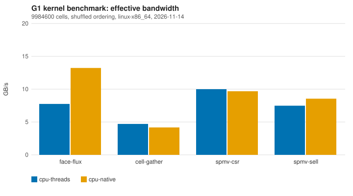

# Example gallery

What CFDCraft computes, one picture per case, with the commands that
reproduce it. Command sequences for everyday tasks are in
[Recipes](recipes.md); all case files are listed in the
[Case catalogue](cases.md).

All commands run from the repository root. Case files are in
`examples/cases/`.

| # | Example | Stage | Feature |
|---|---|---|---|
| 1 | [Kernel benchmark G1 on the CPU](#g1-cpu) | 0 | gate G1, reproducible kernels |

---

<a id="g1-cpu"></a>
## 1. Kernel benchmark G1 on the CPU


The four kernels that dominate a finite-volume solver — face flux, cell
gather and the sparse matrix-vector product in CSR and SELL-C-σ form — on a
periodic box of 10 million hexahedra in face-based form. The single-source
kernel bodies (`cpu-threads`) run as fast as hand-written Rust loops
(`cpu-native`) and give bitwise the same results as the single-thread run
(`cpu-serial`), for any number of threads. The bars are effective bandwidth:
bytes that must move over the median time. Procedure, numbers and reading:
[G1](benchmarks/g1.md).

| | |
|---|---|
| Mesh | periodic box 215 × 215 × 216 = 9 984 600 cells, 29 953 800 faces, natural numbering |
| Machine | Intel Xeon @ 2.10 GHz, 4 virtual cores (shared cloud machine) |
| Case file | `bench/g1_cpu_10m.toml` |

```
cargo build --release -p cfdcraft-cli
target/release/cfdcraft bench g1 examples/cases/bench/g1_cpu_10m.toml
# picture: output/g1_cpu_10m/g1.svg, numbers: g1.md and g1.json
```

The same run with a randomly numbered mesh (`bench/g1_cpu_10m_shuffled.toml`)
shows what a badly ordered mesh costs: three to five times less bandwidth.



[↑ back to top](#example-gallery)
