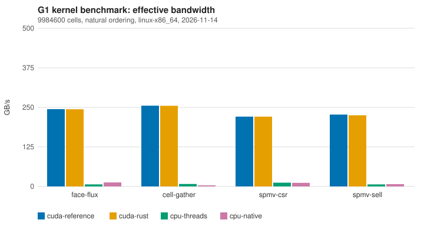
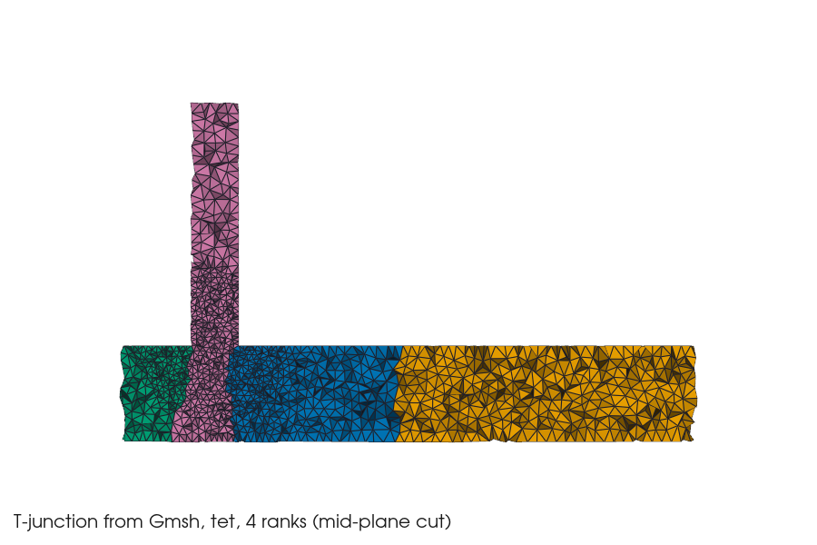
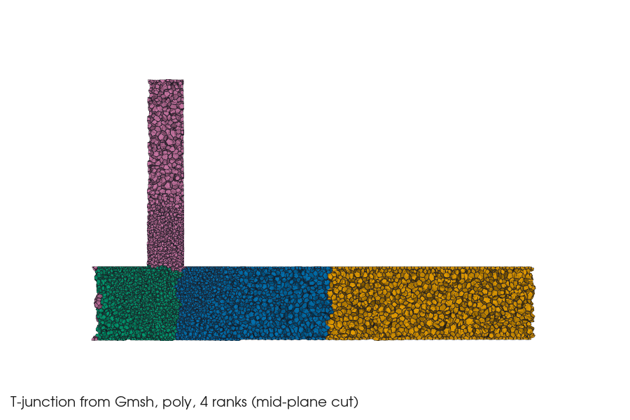
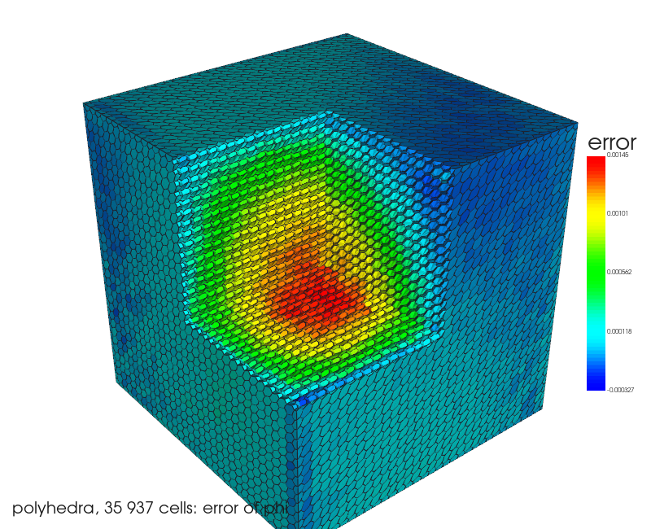
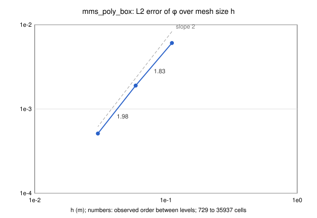
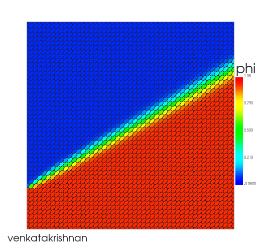
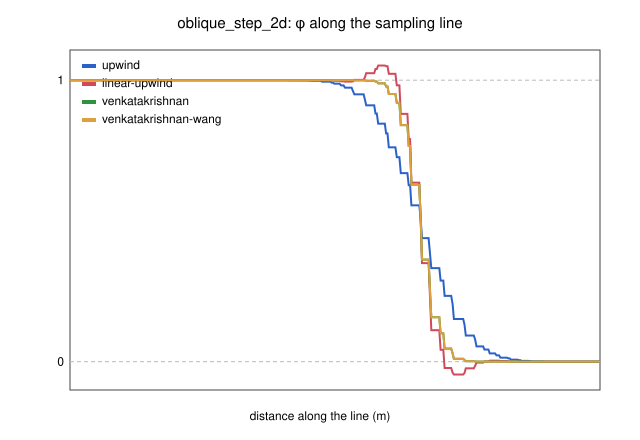
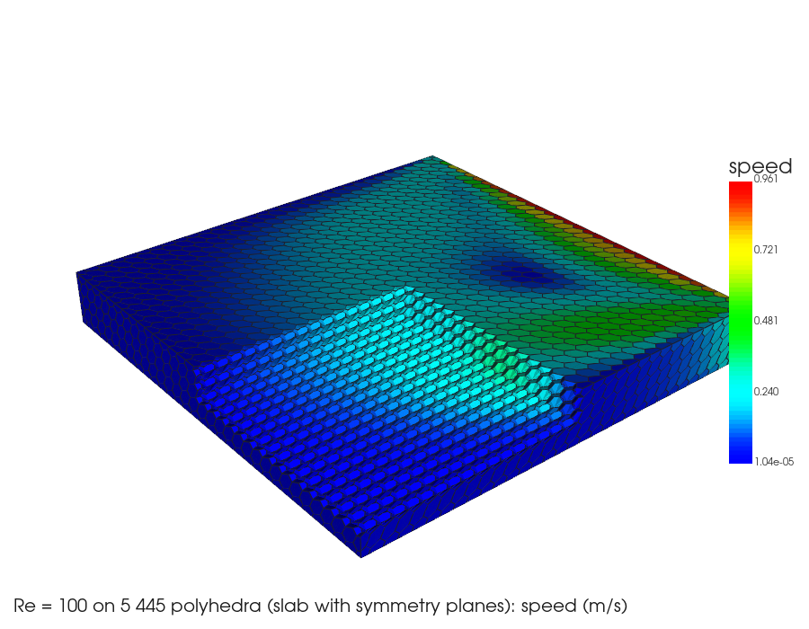
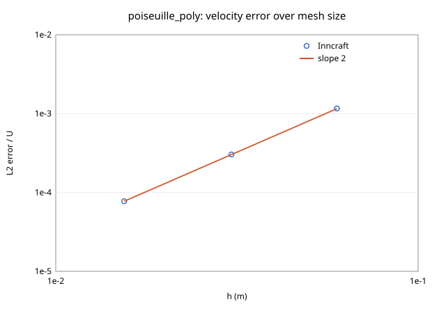
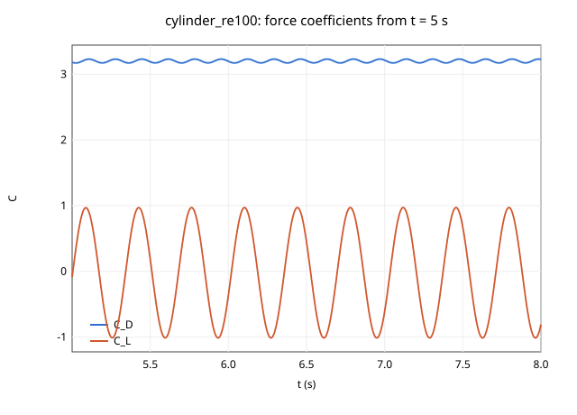

# Example gallery

What CFDCraft computes, one picture per case, with the commands that
reproduce it. Command sequences for everyday tasks are in
[Recipes](recipes.md); all case files are listed in the
[Case catalogue](cases.md).

All commands run from the repository root. Case files are in
`examples/cases/`.

| # | Example | Stage | Feature |
|---|---|---|---|
| 1 | [Kernel benchmark G1 on the CPU](#g1-cpu) | 0 | gate G1, reproducible kernels |
| 2 | [Kernel benchmark G1 on a Tesla T4](#g1-gpu) | 0 | gate G1, single-source Rust on the GPU |
| 3 | [The four test-mesh types in 3D](#mesh-types-3d) | 1 | built-in mesher, grading, perturbation, quality report |
| 4 | [A polyhedral mesh in four parts](#poly-partition) | 1 | partitioning, halo layout, point location |
| 5 | [The four test-mesh types in 2D](#mesh-types-2d) | 1 | one-cell-thick 2D meshes, patch renaming |
| 6 | [T-junction from Gmsh](#tjunction) | 1 | Gmsh reader, conversion to polyhedra, renumbering |
| 7 | [G1 on polyhedral and tetrahedral meshes](#g1-stage1) | 1 | G1 rerun on stage-1 meshes, natural and shuffled order |
| 8 | [Convection–diffusion, manufactured solution](#scalar-mms) | 2 | least-squares gradients, linear upwind, non-orthogonal diffusion, BiCGStab, order of accuracy |
| 9 | [Oblique step: four convection schemes](#oblique-step) | 2 | Venkatakrishnan and Venkatakrishnan–Wang limiters, bounded solutions |
| 10 | [Pressure solver: iterations over the mesh size](#poisson-iterations) | 3 | CG with smoothed-aggregation AMG, mixed precision, hypre reference |
| 11 | [Poisson manufactured solution with the multigrid](#poisson-amg-mms) | 3 | CG + AMG inside the outer iterations, non-orthogonal correction |
| 12 | [Lid-driven cavity against Ghia et al.](#cavity) | 4 | SIMPLEC, Rhie–Chow, reference cell, centre-line comparison, 2D and 3D cells |
| 13 | [Poiseuille flow: order of accuracy of the flow solver](#poiseuille) | 4 | second order on all mesh types, velocity inlet with the exact profile, pressure outlet |
| 14 | [Taylor–Green vortex: second order in time and space](#taylor-green) | 5 | PISO, variable-step BDF2, Crank–Nicolson, extrapolation, outer iterations at large steps |
| 15 | [Cylinder in a channel: the Schäfer & Turek benchmark](#cylinder) | 5 | built-in O-grid, steady Re 20, vortex street at Re 100, adaptive time step, force coefficients |

---

<a id="g1-cpu"></a>
## 1. Kernel benchmark G1 on the CPU


The four kernels that dominate a finite-volume solver — face flux, cell
gather and the sparse matrix-vector product in CSR and SELL-C-σ form — on a
periodic box of 10 million hexahedra in face-based form. The single-source
kernel bodies (`cpu-threads`) run as fast as hand-written Rust loops
(`cpu-native`) and give bitwise the same results as the single-thread run
(`cpu-serial`), for any number of threads. The bars are effective bandwidth:
bytes that must move over the median time. Procedure, numbers and reading:
[G1](benchmarks/g1.md).

| | |
|---|---|
| Mesh | periodic box 215 × 215 × 216 = 9 984 600 cells, 29 953 800 faces, natural numbering |
| Machine | chart: Intel Xeon @ 2.10 GHz, 4 virtual cores (shared cloud machine); the verdict run on a quiet i9-9900K is in [G1](benchmarks/g1.md#cpu-verdict-imac-i9-9900k-2026-11-14) |
| Case file | `bench/g1_cpu_10m.toml` |

```
cargo build --release -p cfdcraft-cli
target/release/cfdcraft bench g1 examples/cases/bench/g1_cpu_10m.toml
# picture: output/g1_cpu_10m/g1.svg, numbers: g1.md and g1.json
```

The same run with a randomly numbered mesh (`bench/g1_cpu_10m_shuffled.toml`)
shows what a badly ordered mesh costs: three to five times less bandwidth.


[↑ back to top](#example-gallery)

---

<a id="g1-gpu"></a>
## 2. Kernel benchmark G1 on a Tesla T4



The same four kernels on a Tesla T4 (Google Colab, free tier). Blue: the
hand-written CUDA C kernels; orange: the single-source Rust kernels compiled
to PTX. Both reach 220–255 GB/s of the T4's 320 GB/s, the Rust kernels are
within 1.0 % of the CUDA C kernels (gate limit: 10 %), and all results are
bitwise equal to the CPU. The two short bars per group are the CPU backends
of the Colab machine (2 virtual cores). Reading and limits:
[G1](benchmarks/g1.md#gpu-verdict-tesla-t4-google-colab-2026-11-14).

| | |
|---|---|
| Mesh | periodic box 215 × 215 × 216 = 9 984 600 cells, natural numbering |
| Machine | Tesla T4 (sm_75, 16 GB), Intel Xeon @ 2.00 GHz, 2 threads |
| Case file | `bench/g1_gpu_10m.toml` |

```
bash tools/g1_cloud.sh      # on any Linux machine with an NVIDIA GPU of compute capability 7.0+
# or open tools/g1_colab.ipynb in Google Colab (recipe 3)
```

[↑ back to top](#example-gallery)

---

<a id="mesh-types-3d"></a>
## 3. The four test-mesh types in 3D


The built-in test mesher (D34) makes four mesh types of the same box
2 × 1 × 1: hexahedra, tetrahedra (six per hexahedron), polyhedra (the dual
of the tetrahedral mesh, one cell per node) and a mixed mesh of hexahedra,
prisms and tetrahedra, with polyhedra where a hexahedron meets the
triangles of its neighbours. All four are clustered towards the walls
y = 0 and y = 1 (middle-to-wall ratio 4) and have perturbed nodes (15 % of
the local interval), so the geometry is never trivially orthogonal. Every
run writes the quality report (`mesh_report.md` and `.json`): closure of
every cell, total volume against the enclosed volume, non-orthogonality,
skewness, face warp, aspect and volume ratio, inverted faces and negative
volumes. All four meshes have the exact volume 2 and closure below 1e-15.

| | |
|---|---|
| Meshes | hex 576, tet 3 456, poly 819, mixed 1 728 cells |
| Case files | `mesh/hex_box.toml`, `mesh/tet_box.toml`, `mesh/poly_box.toml`, `mesh/mixed_box.toml` |

```
cargo build --release -p cfdcraft-cli
for t in hex tet poly mixed; do
  target/release/cfdcraft mesh examples/cases/mesh/${t}_box.toml
done
# output/<case>/mesh_report.md, mesh_report.json, mesh.vtkhdf (open in ParaView)
python3 tools/render_mesh.py output/poly_box/mesh.vtkhdf poly_box.png --cut
```

[↑ back to top](#example-gallery)

---

<a id="poly-partition"></a>
## 4. A polyhedral mesh in four parts


A polyhedral mesh of the unit cube (2 197 cells, nodes perturbed by 20 %)
split into four parts with METIS (D32), one colour per rank. Each part is
laid out as solver ranks will see it: inner cells, then cells touching the
halo, then the halo cells by source rank, each group in reverse
Cuthill-McKee order; faces inner, processor, then boundary by patch. The
report lists the cells, halo cells, processor faces and neighbours of each
rank (imbalance 1.001, 1 230 cut faces). The point-location test of D47
throws 5 000 random points and finds each one by walking from a random cell
through the faces; all 5 000 are found in the right cell.

| | |
|---|---|
| Mesh | poly, 12 × 12 × 12 base grid, 2 197 cells |
| Case file | `mesh/poly_partition.toml` |

```
target/release/cfdcraft mesh examples/cases/mesh/poly_partition.toml
target/release/cfdcraft mesh examples/cases/mesh/poly_partition.toml --method rcb --parts 6
python3 tools/render_mesh.py output/poly_partition/mesh.vtkhdf part.png --cut --field rank --categorical
```

[↑ back to top](#example-gallery)

---

<a id="mesh-types-2d"></a>
## 5. The four test-mesh types in 2D


2D meshes are one cell thick in z (D3): quadrilaterals become hexahedra,
triangles become prisms, polygons become prismatic polyhedra. The mixed
mesh combines both. Clustering towards x = 0 and towards the walls, nodes
perturbed in x and y. The case files rename the generator's patches
(`xmin` to `inlet` and so on) with a `[mesh.patches]` table; `zmin` and
`zmax` take the symmetry condition in a 2D case.

| | |
|---|---|
| Meshes | hex 160, tet 320, poly 187, mixed 240 cells |
| Case files | `mesh/hex_2d.toml`, `mesh/tet_2d.toml`, `mesh/poly_2d.toml`, `mesh/mixed_2d.toml` |

```
for t in hex tet poly mixed; do
  target/release/cfdcraft mesh examples/cases/mesh/${t}_2d.toml
done
python3 tools/render_mesh.py output/poly_2d/mesh.vtkhdf poly_2d.png --top
```

[↑ back to top](#example-gallery)

---

<a id="tjunction"></a>
## 6. T-junction from Gmsh





The T-junction mixer of stage 7 (D45) meshed with Gmsh
(`examples/meshes/tjunction.geo`, main pipe 100 mm diameter, branch 50 mm)
and read by the Gmsh v4 reader (D33). Physical groups become patches
(`inlet_main`, `inlet_branch`, `outlet`, `wall`) and the cell zone `fluid`.
The second case converts the 77 776 tetrahedra into 15 927 polyhedra, one
per node; on the curved wall the boundary faces follow the triangles of
the tetrahedral mesh, so both meshes have the same volume to the last
digit (8.310580753620e-3 m³). Both are renumbered by reverse
Cuthill-McKee and split into four parts. The point-location walk stops at
the curved, non-convex wall for some points (176 of 1 195); the bin search
finds those, none lands in a wrong cell.

| | |
|---|---|
| Meshes | tet 77 776 cells, poly 15 927 cells (7 to 23 faces, mean 15) |
| Case files | `mesh/tjunction_tet.toml`, `mesh/tjunction_poly.toml` |

```
gmsh -3 examples/meshes/tjunction.geo -format msh41 -o examples/meshes/tjunction.msh
target/release/cfdcraft mesh examples/cases/mesh/tjunction_tet.toml
target/release/cfdcraft mesh examples/cases/mesh/tjunction_poly.toml
python3 tools/render_mesh.py output/tjunction_poly/mesh.vtkhdf tj.png \
    --field rank --categorical --half --top --crop 0.2 0.8 -0.06 0.31
```

[↑ back to top](#example-gallery)

---

<a id="g1-stage1"></a>
## 7. G1 on polyhedral and tetrahedral meshes


The G1 kernels rerun on the stage-1 meshes, as D8 asks: 2 million
polyhedra (14 faces per interior cell, uneven rows) in the generator's
order and shuffled, and 2 million tetrahedra. All results are bitwise
equal between the backends. On this shared 4-core cloud machine the
single-source bodies beat the hand-written loops on cell gather (by 25 to
40 %), tie on SpMV-CSR and lose 4 to 30 % on face flux, where one kernel
call takes only 2 to 10 ms; the same gap appears on a 2 million periodic
box, so it is a small-kernel effect, not a polyhedral one. The verdict
needs a quiet machine (recipe 10); the numbers are in
[G1](benchmarks/g1.md#stage-1-rerun-polyhedral-and-tetrahedral-meshes-2026-11-14).


A shuffled polyhedral mesh costs a factor 3 to 4 in bandwidth: the reason
the mesh is renumbered by reverse Cuthill-McKee on input (example 6).


| | |
|---|---|
| Meshes | poly 2 048 383 cells, 14 145 894 faces; tet 1 999 620 cells |
| Machine | Intel Xeon @ 2.30 GHz, 4 virtual cores (shared cloud machine) |
| Case files | `bench/g1_cpu_poly_2m.toml`, `bench/g1_cpu_poly_2m_shuffled.toml`, `bench/g1_cpu_tet_2m.toml`, `bench/g1_gpu_poly_4m.toml` |

```
target/release/cfdcraft bench g1 examples/cases/bench/g1_cpu_poly_2m.toml
target/release/cfdcraft bench g1 examples/cases/bench/g1_cpu_poly_2m_shuffled.toml
target/release/cfdcraft bench g1 examples/cases/bench/g1_cpu_tet_2m.toml
```

[↑ back to top](#example-gallery)

---

<a id="scalar-mms"></a>
## 8. Convection–diffusion, manufactured solution



Steady convection–diffusion of a scalar with a manufactured solution
(Roache 2002) on perturbed polyhedral meshes: φ = 1 + sin(πx + 0.5)
cos(πy + 0.3) cos(πz/2 + 0.2), u = (1, 0.6, 0.3) m/s, Γ = 0.2 kg/(m s),
fixed values of the exact solution on all six patches. The operators of
stage 2 at work: weighted least-squares gradients, linear upwind as a
deferred correction, diffusion with the over-relaxed non-orthogonal
correction, gather-based assembly into a sliced-ELL matrix, BiCGStab with
Jacobi. The picture is the error φ − φ_exact on the finest level; it is
largest in the interior, where the solution has its largest curvature.



The same case on hexahedra, tetrahedra, mixed cells and 2D polygons gives
observed orders between 1.87 and 2.08 on the finest pair; table and
discussion in [Stage 2 verification](verification/stage2.md#order-of-accuracy).
On an NVIDIA GPU the operators give bitwise the CPU result: the 912 673-cell
case `mms_poly_gpu` on a Tesla T4 runs at 311 ns per cell and iteration
([GPU against CPU](verification/stage2.md#gpu-against-cpu-tesla-t4-2026-11-14),
recipe 14).

| | |
|---|---|
| Meshes | generated poly 3D, base 4³ intervals, refine 1–3: 729, 4 913, 35 937 cells, perturb 0.15 |
| Machine | Intel Xeon @ 2.10 GHz, 4 virtual cores; 2.8 s for the three levels |
| Case files | `scalar/mms_poly_box.toml`, `mms_hex_box.toml`, `mms_tet_box.toml`, `mms_mixed_box.toml`, `mms_poly_2d.toml` |

```
cargo build --release -p cfdcraft-cli
target/release/cfdcraft scalar examples/cases/scalar/mms_poly_box.toml
# report: output/mms_poly_box/scalar.md, plot: convergence.svg, fields: fields.vtkhdf
python3 tools/render_mesh.py output/mms_poly_box/fields.vtkhdf mms_poly_error.png --field error --cut
```

[↑ back to top](#example-gallery)

---

<a id="oblique-step"></a>
## 9. Oblique step: four convection schemes

| first-order upwind | linear upwind, no limiter | linear upwind, Venkatakrishnan (K = 0) |
|---|---|---|
|  |  |  |



Pure convection of a step at 30° to the x axis across 2 401 polygonal
prisms. Upwind is bounded but smears the step over many cells. Linear
upwind without a limiter is sharp but over- and undershoots by 7 % and
5 %. With the Venkatakrishnan limiter (and with Venkatakrishnan–Wang) at
K = 0 the step is as sharp as with linear upwind and φ stays in [0, 1].
The run checks the bounds of every limited variant and fails if one leaves
[0, 1].

| | |
|---|---|
| Mesh | generated poly 2D, 48 × 48 intervals, perturb 0.1: 2 401 cells |
| Case file | `scalar/oblique_step_2d.toml` (four `[[variants]]`) |

```
target/release/cfdcraft scalar examples/cases/scalar/oblique_step_2d.toml
# report: output/oblique_step_2d/scalar.md, profiles: profile.svg,
# fields per variant: output/oblique_step_2d/<variant>/fields.vtkhdf
python3 tools/render_mesh.py output/oblique_step_2d/venkatakrishnan/fields.vtkhdf step.png --field phi --top --range -0.08 1.08
```

[↑ back to top](#example-gallery)

---

<a id="poisson-iterations"></a>
## 10. Pressure solver: iterations over the mesh size


The Poisson equation −∇·(Γ∇φ) = s, the model of the pressure equation, on
perturbed polyhedral meshes from 729 to 274 625 cells, each solved from
φ = 0 to ‖b − Aφ‖ ≤ 1e-10 ‖b‖. CG with the smoothed-aggregation multigrid
of stage 3 needs 10 to 11 iterations on every level, in mixed precision
(float32 hierarchy) as in float64; hypre's BoomerAMG-PCG needs 8 to 14;
plain aggregation grows from 10 to 34 and Jacobi-CG from 33 to 223, the
growth of a method without a coarse-grid correction. All solutions agree
with hypre's to 1.3e-9 (relative), and each in-house solver gives bitwise
the same solution on 4 threads and on 1. The same holds on hexahedra,
tetrahedra and mixed meshes (10 to 13 iterations; table in
[Stage 3 verification](verification/stage3.md#iterations-over-the-mesh-size)).

| | |
|---|---|
| Meshes | generated poly 3D, base 4³ intervals, refine 1–4: 729, 4 913, 35 937, 274 625 cells, perturb 0.15 |
| Machine | Intel Xeon @ 2.30 GHz, 4 virtual cores; about 25 s with hypre and both backends |
| Case files | `poisson/poisson_poly_box.toml`, `poisson_hex_box.toml`, `poisson_tet_box.toml`, `poisson_mixed_box.toml` |

```
cargo build --release -p cfdcraft-cli
target/release/cfdcraft poisson examples/cases/poisson/poisson_poly_box.toml
# report: output/poisson_poly_box/poisson.md, plot: iterations.svg
# with hypre as the reference (recipe 17):
tools/build_hypre.sh target/hypre
HYPRE_DIR=$PWD/target/hypre cargo build --release -p cfdcraft-cli --features hypre
target/release/cfdcraft poisson examples/cases/poisson/poisson_poly_box.toml \
    --solvers amg,amg-double,amg-plain,jacobi,hypre
```

[↑ back to top](#example-gallery)

---

<a id="poisson-amg-mms"></a>
## 11. Poisson manufactured solution with the multigrid

The pressure solver inside the outer iterations of `cfdcraft scalar`: the
Poisson equation with the manufactured solution of gallery 8, Γ = 1, on
polyhedra with the non-orthogonal correction as a deferred correction,
solved with `linear_solver = "cg"` and `preconditioner = "amg"` and, as a
second variant, with BiCGStab and Jacobi. Both reach the same solution and
the same observed order (1.75, 1.90); on 35 937 polyhedra the multigrid
needs 110 linear iterations in 23 outer iterations against 944 for
BiCGStab with Jacobi, and the time per outer iteration drops from 2 357 to
933 ns per cell.

| Variant | Cells | Outer it. | Linear it. | L2 error | ns/cell/it. |
|---|---:|---:|---:|---:|---:|
| cg-amg | 729 | 17 | 64 | 3.772e-3 | 4 511 |
| bicgstab-jacobi | 729 | 17 | 149 | 3.772e-3 | 5 807 |
| cg-amg | 4 913 | 21 | 99 | 1.239e-3 | 2 238 |
| bicgstab-jacobi | 4 913 | 21 | 409 | 1.239e-3 | 3 250 |
| cg-amg | 35 937 | 23 | 110 | 3.517e-4 | 933 |
| bicgstab-jacobi | 35 937 | 23 | 944 | 3.517e-4 | 2 357 |

| | |
|---|---|
| Meshes | generated poly 3D, base 4³ intervals, refine 1–3, perturb 0.15 |
| Case file | `scalar/poisson_amg_poly_box.toml` (two `[[variants]]`) |

```
target/release/cfdcraft scalar examples/cases/scalar/poisson_amg_poly_box.toml
# report: output/poisson_amg_poly_box/scalar.md (linear iterations, time per phase incl. multigrid setup)
```

[↑ back to top](#example-gallery)

---

<a id="cavity"></a>
## 12. Lid-driven cavity against Ghia et al.


The first flow of CFDCraft: the unit cavity with the lid sliding at 1 m/s,
steady and laminar, solved with SIMPLEC and the relaxation-independent
Rhie–Chow interpolation of stage 4. No boundary fixes the pressure, so a
reference cell holds its level. At Re = 1000 the primary vortex moves
towards the centre and the two corner vortices at the bottom grow; the
velocity on the two centre lines matches the tabulated multigrid solution
of Ghia, Ghia & Shin (1982) to 0.4 % (u) and 1.4 % (v) of the lid speed.


The same flow on fully three-dimensional cells, a slab with symmetry planes
front and back: 0.7 % / 1.3 % at Re = 100 on 5 445 polyhedra, 2.0 % / 2.4 %
at Re = 1000 on 28 227 polyhedra, 2.5 % / 2.2 % at Re = 100 on 24 576
tetrahedra. Re = 100 on 64 × 64 hexahedra: 0.44 % / 0.95 %
([u](figures/gallery/cavity_re100_u.svg), [v](figures/gallery/cavity_re100_v.svg)).



| | |
|---|---|
| Mesh | generated hex 2D, 128 × 128 cells, one layer with symmetry planes |
| Physics | ρ = 1 kg/m³, μ = 0.001 Pa s, lid 1 m/s: Re = 1 000 |
| Solver | SIMPLEC, linear upwind, α_u = 0.9, CG + AMG for the pressure correction; 1 397 outer iterations to 1e-8, 54 s on a shared 4-core cloud machine |
| Case files | `flow/cavity_re1000.toml`, `cavity_re100.toml`, `cavity_re100_poly3d.toml`, `cavity_re100_tet3d.toml`, `cavity_re1000_poly3d.toml` |

```
cargo build --release -p cfdcraft-cli
target/release/cfdcraft flow examples/cases/flow/cavity_re1000.toml
# report: output/cavity_re1000/flow.md, charts: centreline_u.svg, centreline_v.svg, residuals.svg
python3 tools/render_mesh.py output/cavity_re1000/fields.vtkhdf cavity.png --field speed --top --no-edges
```

[↑ back to top](#example-gallery)

---

<a id="poiseuille"></a>
## 13. Poiseuille flow: order of accuracy of the flow solver



Plane channel flow between walls at rest, the exact parabola at the inlet
(`profile = "analytic"`), a static-pressure outlet, Re = 10, on three nested
meshes per cell type. The velocity error falls with the square of the mesh
size on every type, the check of stage 4 (1.8–2.2 on the finest pair);
Couette flow (`couette_*.toml`) comes out at the iteration error, as a
linear profile must.

| Mesh | Cells (finest) | L2 error (finest) | Observed order |
|---|---:|---:|---:|
| hex, perturbed 15 % | 8 192 | 1.10e-4 | 1.98, 1.89 |
| tet (prisms) | 16 384 | 6.70e-5 | 1.93, 1.80 |
| poly, perturbed 15 % | 8 385 | 7.74e-5 | 2.01, 2.00 |
| mixed | 12 288 | 9.05e-5 | 1.94, 1.88 |

| | |
|---|---|
| Meshes | generated 2D, 32 × 16 to 128 × 64 intervals in a 2 × 1 channel |
| Case files | `flow/poiseuille_hex.toml`, `poiseuille_tet.toml`, `poiseuille_poly.toml`, `poiseuille_mixed.toml` |

```
target/release/cfdcraft flow examples/cases/flow/poiseuille_poly.toml
# report: output/poiseuille_poly/flow.md, plot: convergence.svg
```

[↑ back to top](#example-gallery)

---

<a id="taylor-green"></a>
## 14. Taylor–Green vortex: second order in time and space


The decaying vortex on the unit square, Re = 100, the exact velocity on
the four sides at each time level. Five runs on the same 64 × 64 mesh
with time steps from 0.01 to 0.000625 s: the change of the solution when
the step is halved falls with Δt², for BDF2 and for Crank–Nicolson, with
one outer iteration per step (plain PISO with two correctors). That needs
the convecting flux and the deferred corrections extrapolated to the new
time; without it the lag of these terms makes PISO first order.

| Scheme | Observed time order (pairs of steps) |
|---|---|
| BDF2 | 2.35, 2.42, 2.21 |
| Crank–Nicolson | 2.40, 2.41, 2.00 |
| BDF2, Courant 1.3 to 9, outer iterations to 1e-9 | 1.97, 2.00 |


In space, at a fixed small step, the error falls from 2.6e-2 on 16² to
1.3e-4 on 128² cells, order 2.09 on the finest pair.

| | |
|---|---|
| Mesh | generated hex 2D, 64 × 64 (time), 16² to 128² (space) |
| Physics | ρ = 1 kg/m³, μ = 0.01 Pa s, U = 1 m/s, L = 1 m: Re = 100, t = 0 to 0.4 s |
| Solver | PISO, two correctors, BDF2 or Crank–Nicolson, linear solves to 1e-8 |
| Case files | `flow/taylor_green_bdf2.toml`, `taylor_green_cn.toml`, `taylor_green_space.toml`, `taylor_green_cfl10.toml` |

```
cargo build --release -p cfdcraft-cli
target/release/cfdcraft flow examples/cases/flow/taylor_green_bdf2.toml
# report: output/taylor_green_bdf2/flow.md, plot: time_convergence.svg
target/release/cfdcraft flow examples/cases/flow/taylor_green_space.toml
# report: output/taylor_green_space/flow.md, plot: convergence.svg
```

[↑ back to top](#example-gallery)

---

<a id="cylinder"></a>
## 15. Cylinder in a channel: the Schäfer & Turek benchmark


The laminar cylinder benchmark of Schäfer & Turek (1996): a cylinder of
0.1 m in a 2.2 × 0.41 m channel, slightly off the centre line, with a
parabolic inflow. At Re = 20 the flow is steady with two attached
vortices; on 98 304 cells the drag and lift coefficients and the pressure
difference across the cylinder lie inside the reference ranges
(C_D 5.5800, C_L 0.01060, Δp 0.11751 Pa).


At Re = 100 a vortex street forms. The time step follows a Courant number
of 0.8; from t = 5 s the run evaluates the largest drag and lift, the
Strouhal number of the lift and the pressure difference half a period
after the lift maximum.



| Case | Cells | C_D (max) | C_L (max) | St | Δp (Pa) |
|---|---:|---:|---:|---:|---:|
| Re 20, reference | | 5.57–5.59 | 0.0104–0.0110 | | 0.1172–0.1176 |
| Re 20 | 24 576 | 5.5808 | 0.01036 | | 0.11750 |
| Re 20 | 98 304 | 5.5800 | 0.01060 | | 0.11751 |
| Re 100, reference | | 3.22–3.24 | 0.99–1.01 | 0.295–0.305 | 2.46–2.50 |
| Re 100 | 6 144 | 3.2319 | 0.9712 | 0.2955 | 2.4819 |
| Re 100 | 24 576 | TBD_R1_CD | TBD_R1_CL | TBD_R1_ST | TBD_R1_DP |


| | |
|---|---|
| Mesh | built in (`[mesh.cylinder]`): O-grid around the cylinder, graded wake block; refine 0, 1, 2: 6 144, 24 576, 98 304 hexahedra in one layer |
| Physics | ρ = 1 kg/m³, μ = 0.001 Pa s, Ū = 0.2 m/s (Re 20) or 1 m/s (Re 100), D = 0.1 m |
| Solver | Re 20 steady SIMPLEC; Re 100 PISO with BDF2, adaptive Δt (Courant 0.8), t = 0 to 8 s |
| Case files | `flow/cylinder_re20.toml`, `cylinder_re100.toml` |

```
target/release/cfdcraft flow examples/cases/flow/cylinder_re20.toml
target/release/cfdcraft flow examples/cases/flow/cylinder_re100.toml
# report: output/cylinder_re100/flow.md, chart: coefficients.svg, histories: forces.csv, probes.csv
python3 tools/render_mesh.py output/cylinder_re20/fields.vtkhdf cylinder.png --field speed --top --no-edges --size 1800x420 --zoom 2.9
```

[↑ back to top](#example-gallery)
