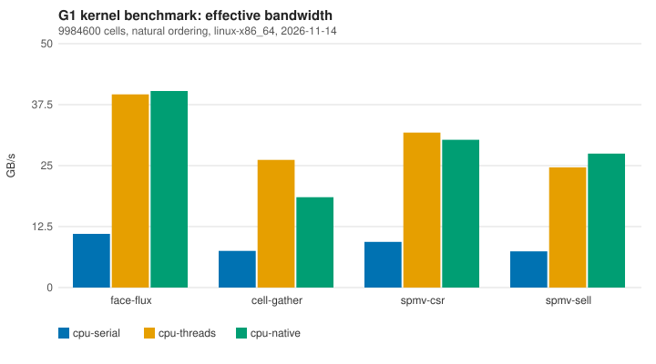
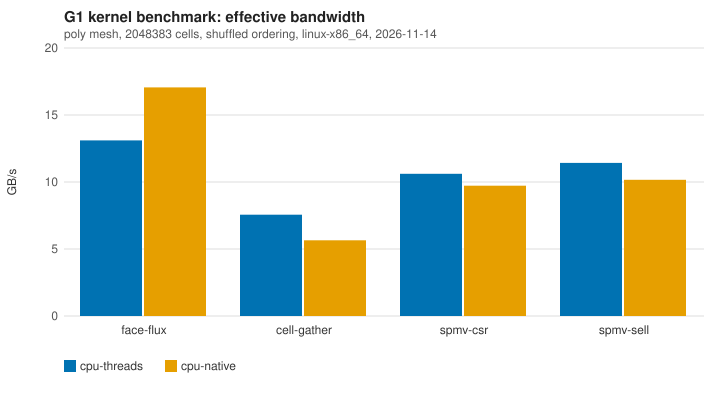
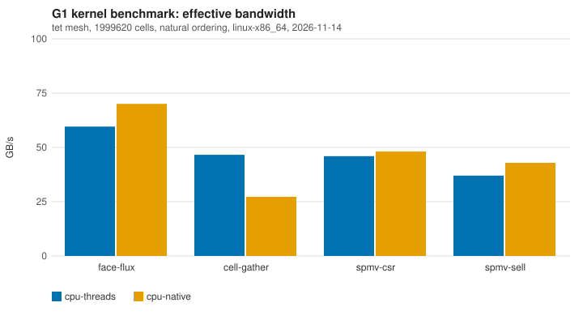

# Example gallery

What CFDCraft computes, one picture per case, with the commands that
reproduce it. Command sequences for everyday tasks are in
[Recipes](recipes.md); all case files are listed in the
[Case catalogue](cases.md).

All commands run from the repository root. Case files are in
`examples/cases/`.

| # | Example | Stage | Feature |
|---|---|---|---|
| 1 | [Kernel benchmark G1 on the CPU](#g1-cpu) | 0 | gate G1, reproducible kernels |
| 2 | [Kernel benchmark G1 on a Tesla T4](#g1-gpu) | 0 | gate G1, single-source Rust on the GPU |
| 3 | [The four test-mesh types in 3D](#mesh-types-3d) | 1 | built-in mesher, grading, perturbation, quality report |
| 4 | [A polyhedral mesh in four parts](#poly-partition) | 1 | partitioning, halo layout, point location |
| 5 | [The four test-mesh types in 2D](#mesh-types-2d) | 1 | one-cell-thick 2D meshes, patch renaming |
| 6 | [T-junction from Gmsh](#tjunction) | 1 | Gmsh reader, conversion to polyhedra, renumbering |
| 7 | [G1 on polyhedral and tetrahedral meshes](#g1-stage1) | 1 | G1 rerun on stage-1 meshes, natural and shuffled order |

---

<a id="g1-cpu"></a>
## 1. Kernel benchmark G1 on the CPU



The four kernels that dominate a finite-volume solver — face flux, cell
gather and the sparse matrix-vector product in CSR and SELL-C-σ form — on a
periodic box of 10 million hexahedra in face-based form. The single-source
kernel bodies (`cpu-threads`) run as fast as hand-written Rust loops
(`cpu-native`) and give bitwise the same results as the single-thread run
(`cpu-serial`), for any number of threads. The bars are effective bandwidth:
bytes that must move over the median time. Procedure, numbers and reading:
[G1](benchmarks/g1.md).

| | |
|---|---|
| Mesh | periodic box 215 × 215 × 216 = 9 984 600 cells, 29 953 800 faces, natural numbering |
| Machine | chart: Intel Xeon @ 2.10 GHz, 4 virtual cores (shared cloud machine); the verdict run on a quiet i9-9900K is in [G1](benchmarks/g1.md#cpu-verdict-imac-i9-9900k-2026-11-14) |
| Case file | `bench/g1_cpu_10m.toml` |

```
cargo build --release -p cfdcraft-cli
target/release/cfdcraft bench g1 examples/cases/bench/g1_cpu_10m.toml
# picture: output/g1_cpu_10m/g1.svg, numbers: g1.md and g1.json
```

The same run with a randomly numbered mesh (`bench/g1_cpu_10m_shuffled.toml`)
shows what a badly ordered mesh costs: three to five times less bandwidth.


[↑ back to top](#example-gallery)

---

<a id="g1-gpu"></a>
## 2. Kernel benchmark G1 on a Tesla T4


The same four kernels on a Tesla T4 (Google Colab, free tier). Blue: the
hand-written CUDA C kernels; orange: the single-source Rust kernels compiled
to PTX. Both reach 220–255 GB/s of the T4's 320 GB/s, the Rust kernels are
within 1.0 % of the CUDA C kernels (gate limit: 10 %), and all results are
bitwise equal to the CPU. The two short bars per group are the CPU backends
of the Colab machine (2 virtual cores). Reading and limits:
[G1](benchmarks/g1.md#gpu-verdict-tesla-t4-google-colab-2026-11-14).

| | |
|---|---|
| Mesh | periodic box 215 × 215 × 216 = 9 984 600 cells, natural numbering |
| Machine | Tesla T4 (sm_75, 16 GB), Intel Xeon @ 2.00 GHz, 2 threads |
| Case file | `bench/g1_gpu_10m.toml` |

```
bash tools/g1_cloud.sh      # on any Linux machine with an NVIDIA GPU of compute capability 7.0+
# or open tools/g1_colab.ipynb in Google Colab (recipe 3)
```

[↑ back to top](#example-gallery)

---

<a id="mesh-types-3d"></a>
## 3. The four test-mesh types in 3D


The built-in test mesher (D34) makes four mesh types of the same box
2 × 1 × 1: hexahedra, tetrahedra (six per hexahedron), polyhedra (the dual
of the tetrahedral mesh, one cell per node) and a mixed mesh of hexahedra,
prisms and tetrahedra, with polyhedra where a hexahedron meets the
triangles of its neighbours. All four are clustered towards the walls
y = 0 and y = 1 (middle-to-wall ratio 4) and have perturbed nodes (15 % of
the local interval), so the geometry is never trivially orthogonal. Every
run writes the quality report (`mesh_report.md` and `.json`): closure of
every cell, total volume against the enclosed volume, non-orthogonality,
skewness, face warp, aspect and volume ratio, inverted faces and negative
volumes. All four meshes have the exact volume 2 and closure below 1e-15.

| | |
|---|---|
| Meshes | hex 576, tet 3 456, poly 819, mixed 1 728 cells |
| Case files | `mesh/hex_box.toml`, `mesh/tet_box.toml`, `mesh/poly_box.toml`, `mesh/mixed_box.toml` |

```
cargo build --release -p cfdcraft-cli
for t in hex tet poly mixed; do
  target/release/cfdcraft mesh examples/cases/mesh/${t}_box.toml
done
# output/<case>/mesh_report.md, mesh_report.json, mesh.vtkhdf (open in ParaView)
python3 tools/render_mesh.py output/poly_box/mesh.vtkhdf poly_box.png --cut
```

[↑ back to top](#example-gallery)

---

<a id="poly-partition"></a>
## 4. A polyhedral mesh in four parts


A polyhedral mesh of the unit cube (2 197 cells, nodes perturbed by 20 %)
split into four parts with METIS (D32), one colour per rank. Each part is
laid out as solver ranks will see it: inner cells, then cells touching the
halo, then the halo cells by source rank, each group in reverse
Cuthill-McKee order; faces inner, processor, then boundary by patch. The
report lists the cells, halo cells, processor faces and neighbours of each
rank (imbalance 1.001, 1 230 cut faces). The point-location test of D47
throws 5 000 random points and finds each one by walking from a random cell
through the faces; all 5 000 are found in the right cell.

| | |
|---|---|
| Mesh | poly, 12 × 12 × 12 base grid, 2 197 cells |
| Case file | `mesh/poly_partition.toml` |

```
target/release/cfdcraft mesh examples/cases/mesh/poly_partition.toml
target/release/cfdcraft mesh examples/cases/mesh/poly_partition.toml --method rcb --parts 6
python3 tools/render_mesh.py output/poly_partition/mesh.vtkhdf part.png --cut --field rank --categorical
```

[↑ back to top](#example-gallery)

---

<a id="mesh-types-2d"></a>
## 5. The four test-mesh types in 2D


2D meshes are one cell thick in z (D3): quadrilaterals become hexahedra,
triangles become prisms, polygons become prismatic polyhedra. The mixed
mesh combines both. Clustering towards x = 0 and towards the walls, nodes
perturbed in x and y. The case files rename the generator's patches
(`xmin` to `inlet` and so on) with a `[mesh.patches]` table; `zmin` and
`zmax` take the symmetry condition in a 2D case.

| | |
|---|---|
| Meshes | hex 160, tet 320, poly 187, mixed 240 cells |
| Case files | `mesh/hex_2d.toml`, `mesh/tet_2d.toml`, `mesh/poly_2d.toml`, `mesh/mixed_2d.toml` |

```
for t in hex tet poly mixed; do
  target/release/cfdcraft mesh examples/cases/mesh/${t}_2d.toml
done
python3 tools/render_mesh.py output/poly_2d/mesh.vtkhdf poly_2d.png --top
```

[↑ back to top](#example-gallery)

---

<a id="tjunction"></a>
## 6. T-junction from Gmsh


The T-junction mixer of stage 7 (D45) meshed with Gmsh
(`examples/meshes/tjunction.geo`, main pipe 100 mm diameter, branch 50 mm)
and read by the Gmsh v4 reader (D33). Physical groups become patches
(`inlet_main`, `inlet_branch`, `outlet`, `wall`) and the cell zone `fluid`.
The second case converts the 77 776 tetrahedra into 15 927 polyhedra, one
per node; on the curved wall the boundary faces follow the triangles of
the tetrahedral mesh, so both meshes have the same volume to the last
digit (8.310580753620e-3 m³). Both are renumbered by reverse
Cuthill-McKee and split into four parts. The point-location walk stops at
the curved, non-convex wall for some points (176 of 1 195); the bin search
finds those, none lands in a wrong cell.

| | |
|---|---|
| Meshes | tet 77 776 cells, poly 15 927 cells (7 to 23 faces, mean 15) |
| Case files | `mesh/tjunction_tet.toml`, `mesh/tjunction_poly.toml` |

```
gmsh -3 examples/meshes/tjunction.geo -format msh41 -o examples/meshes/tjunction.msh
target/release/cfdcraft mesh examples/cases/mesh/tjunction_tet.toml
target/release/cfdcraft mesh examples/cases/mesh/tjunction_poly.toml
python3 tools/render_mesh.py output/tjunction_poly/mesh.vtkhdf tj.png \
    --field rank --categorical --half --top --crop 0.2 0.8 -0.06 0.31
```

[↑ back to top](#example-gallery)

---

<a id="g1-stage1"></a>
## 7. G1 on polyhedral and tetrahedral meshes


The G1 kernels rerun on the stage-1 meshes, as D8 asks: 2 million
polyhedra (14 faces per interior cell, uneven rows) in the generator's
order and shuffled, and 2 million tetrahedra. All results are bitwise
equal between the backends. On this shared 4-core cloud machine the
single-source bodies beat the hand-written loops on cell gather (by 25 to
40 %), tie on SpMV-CSR and lose 4 to 30 % on face flux, where one kernel
call takes only 2 to 10 ms; the same gap appears on a 2 million periodic
box, so it is a small-kernel effect, not a polyhedral one. The verdict
needs a quiet machine (recipe 9); the numbers are in
[G1](benchmarks/g1.md#stage-1-rerun-polyhedral-and-tetrahedral-meshes-2026-11-14).



A shuffled polyhedral mesh costs a factor 3 to 4 in bandwidth: the reason
the mesh is renumbered by reverse Cuthill-McKee on input (example 6).



| | |
|---|---|
| Meshes | poly 2 048 383 cells, 14 145 894 faces; tet 1 999 620 cells |
| Machine | Intel Xeon @ 2.30 GHz, 4 virtual cores (shared cloud machine) |
| Case files | `bench/g1_cpu_poly_2m.toml`, `bench/g1_cpu_poly_2m_shuffled.toml`, `bench/g1_cpu_tet_2m.toml`, `bench/g1_gpu_poly_4m.toml` |

```
target/release/cfdcraft bench g1 examples/cases/bench/g1_cpu_poly_2m.toml
target/release/cfdcraft bench g1 examples/cases/bench/g1_cpu_poly_2m_shuffled.toml
target/release/cfdcraft bench g1 examples/cases/bench/g1_cpu_tet_2m.toml
```

[↑ back to top](#example-gallery)
