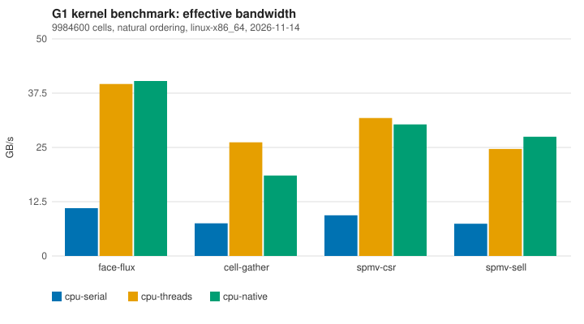
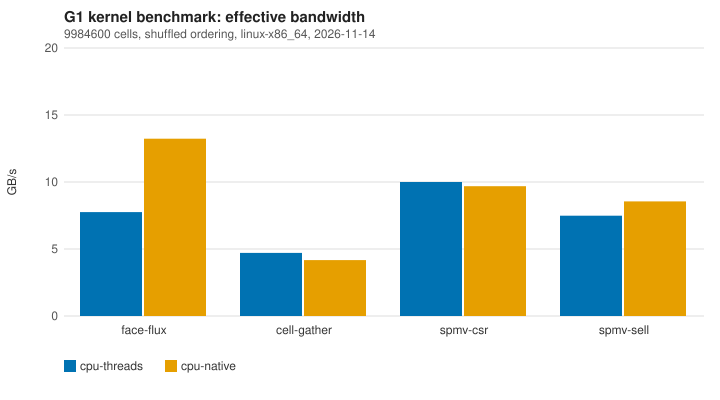
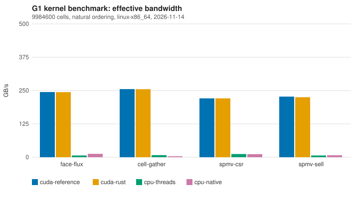
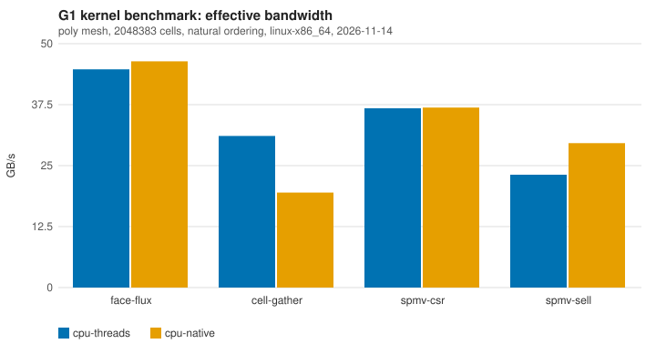
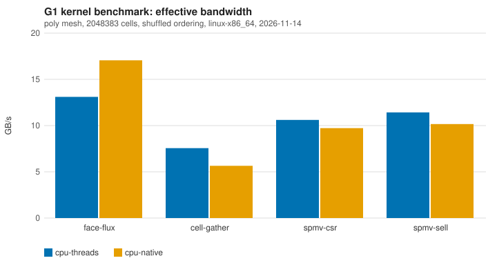
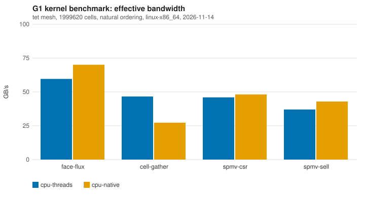
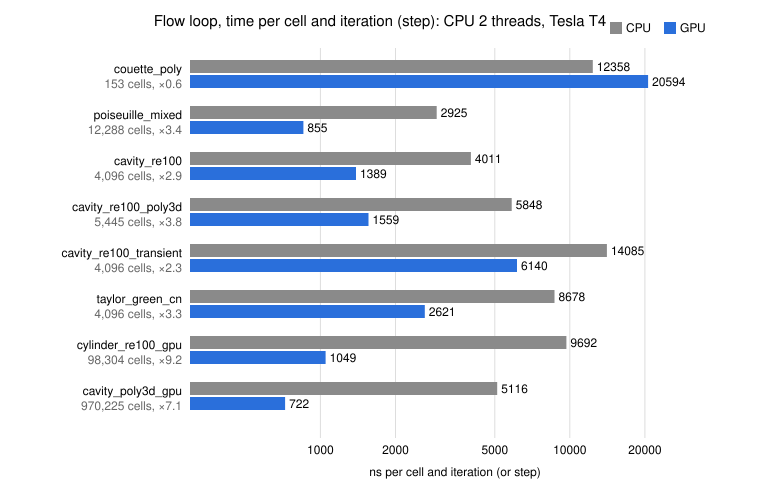

# Kernel benchmarks and GPU runs

Part of the [Example gallery](../gallery.md): gate G1 on CPUs and GPUs, on box, polyhedral and tetrahedral meshes, and the flow loop on a GPU.

| # | Example | Stage | Feature |
|---|---|---|---|
| 1 | [Kernel benchmark G1 on the CPU](#g1-cpu) | 0 | gate G1, reproducible kernels |
| 2 | [Kernel benchmark G1 on a Tesla T4](#g1-gpu) | 0 | gate G1, single-source Rust on the GPU |
| 7 | [G1 on polyhedral and tetrahedral meshes](#g1-stage1) | 1 | G1 rerun on stage-1 meshes, natural and shuffled order |
| 16 | [The flow loop on a GPU](#gpu-flow) | 5 | single-source flow kernels, CPU = GPU bitwise, time per cell on a Tesla T4 |

---

<a id="g1-cpu"></a>
## 1. Kernel benchmark G1 on the CPU



The four kernels that dominate a finite-volume solver — face flux, cell
gather and the sparse matrix-vector product in CSR and SELL-C-σ form — on a
periodic box of 10 million hexahedra in face-based form. The single-source
kernel bodies (`cpu-threads`) run as fast as hand-written Rust loops
(`cpu-native`) and give bitwise the same results as the single-thread run
(`cpu-serial`), for any number of threads. The bars are effective bandwidth:
bytes that must move over the median time. Procedure, numbers and reading:
[G1](../benchmarks/g1.md).

| | |
|---|---|
| Mesh | periodic box 215 × 215 × 216 = 9 984 600 cells, 29 953 800 faces, natural numbering |
| Machine | chart: Intel Xeon @ 2.10 GHz, 4 virtual cores (shared cloud machine); the verdict run on a quiet i9-9900K is in [G1](../benchmarks/g1.md#cpu-verdict-imac-i9-9900k-2026-11-14) |
| Case file | `bench/g1_cpu_10m.toml` |

```
cargo build --release -p foehncraft-cli
target/release/foehn bench g1 examples/cases/bench/g1_cpu_10m.toml
# picture: output/g1_cpu_10m/g1.svg, numbers: g1.md and g1.json
```

The same run with a randomly numbered mesh (`bench/g1_cpu_10m_shuffled.toml`)
shows what a badly ordered mesh costs: three to five times less bandwidth.



[↑ back to top](#kernel-benchmarks-and-gpu-runs)

---

<a id="g1-gpu"></a>
## 2. Kernel benchmark G1 on a Tesla T4



The same four kernels on a Tesla T4 (Google Colab, free tier). Blue: the
hand-written CUDA C kernels; orange: the single-source Rust kernels compiled
to PTX. Both reach 220–255 GB/s of the T4's 320 GB/s, the Rust kernels are
within 1.0 % of the CUDA C kernels (gate limit: 10 %), and all results are
bitwise equal to the CPU. The two short bars per group are the CPU backends
of the Colab machine (2 virtual cores). Reading and limits:
[G1](../benchmarks/g1.md#gpu-verdict-tesla-t4-google-colab-2026-11-14).

| | |
|---|---|
| Mesh | periodic box 215 × 215 × 216 = 9 984 600 cells, natural numbering |
| Machine | Tesla T4 (sm_75, 16 GB), Intel Xeon @ 2.00 GHz, 2 threads |
| Case file | `bench/g1_gpu_10m.toml` |

```
bash tools/g1_cloud.sh      # on any Linux machine with an NVIDIA GPU of compute capability 7.0+
# or open tools/g1_colab.ipynb in Google Colab (recipe 3)
```

[↑ back to top](#kernel-benchmarks-and-gpu-runs)

---

<a id="g1-stage1"></a>
## 7. G1 on polyhedral and tetrahedral meshes



The G1 kernels rerun on the stage-1 meshes, as D8 asks: 2 million
polyhedra (14 faces per interior cell, uneven rows) in the generator's
order and shuffled, and 2 million tetrahedra. All results are bitwise
equal between the backends. On this shared 4-core cloud machine the
single-source bodies beat the hand-written loops on cell gather (by 25 to
40 %), tie on SpMV-CSR and lose 4 to 30 % on face flux, where one kernel
call takes only 2 to 10 ms; the same gap appears on a 2 million periodic
box, so it is a small-kernel effect, not a polyhedral one. The verdict
needs a quiet machine (recipe 10); the numbers are in
[G1](../benchmarks/g1.md#stage-1-rerun-polyhedral-and-tetrahedral-meshes-2026-11-14).



A shuffled polyhedral mesh costs a factor 3 to 4 in bandwidth: the reason
the mesh is renumbered by reverse Cuthill-McKee on input (example 6).



| | |
|---|---|
| Meshes | poly 2 048 383 cells, 14 145 894 faces; tet 1 999 620 cells |
| Machine | Intel Xeon @ 2.30 GHz, 4 virtual cores (shared cloud machine) |
| Case files | `bench/g1_cpu_poly_2m.toml`, `bench/g1_cpu_poly_2m_shuffled.toml`, `bench/g1_cpu_tet_2m.toml`, `bench/g1_gpu_poly_4m.toml` |

```
target/release/foehn bench g1 examples/cases/bench/g1_cpu_poly_2m.toml
target/release/foehn bench g1 examples/cases/bench/g1_cpu_poly_2m_shuffled.toml
target/release/foehn bench g1 examples/cases/bench/g1_cpu_tet_2m.toml
```

[↑ back to top](#kernel-benchmarks-and-gpu-runs)

---

<a id="gpu-flow"></a>
## 16. The flow loop on a GPU



The same flow cases run on the CPU and on an NVIDIA GPU
(`run.backend = "cuda"`). The operations of the flow loop are written once
in Rust and run as CPU loops and as PTX; fields, matrices and old time
levels stay in GPU memory, and the pressure and momentum solves run on the
GPU backend. On a free Colab Tesla T4 (sm_75) against the two CPU threads
of the VM, **all eight cases give bitwise the same fields, residual
histories, forces, reports and restart files** (D31: gather-based
assembly, no fused multiply-adds, no atomics, fixed reduction tree).

| Case | Cells | CPU ns/cell | GPU ns/cell | CPU s | GPU s |
|---|---:|---:|---:|---:|---:|
| couette_poly | 153 | 12 358 | 20 594 | 0.2 | 1.5 |
| poiseuille_mixed | 12 288 | 2 925 | 855 | 43.1 | 15.3 |
| cavity_re100 | 4 096 | 4 011 | 1 389 | 7.3 | 2.9 |
| cavity_re100_poly3d | 5 445 | 5 848 | 1 559 | 6.4 | 2.3 |
| cavity_re100_transient | 4 096 | 14 085 | 6 140 | 28.9 | 13.0 |
| taylor_green_cn | 4 096 | 8 678 | 2 621 | 46.4 | 15.1 |
| cylinder_re100_gpu | 98 304 | 9 692 | 1 049 | 191.8 | 22.2 |
| cavity_poly3d_gpu | 970 225 | 5 116 | 722 | 200.1 | 136.4 |

Time per cell and SIMPLEC iteration (steady cases) or PISO step
(transient cases); the wall times include mesh generation and output, which
is why the million-cell case gains less in wall time (1.5 times, 30
iterations) than per iteration. Small meshes do not fill the GPU: the
153-cell case is slower on the GPU. The Krylov solvers still read a dot
product back per iteration (D76 follows later).

| | |
|---|---|
| Mesh | generated cavity (hexahedra, polyhedra, 3D polyhedra up to 970 225 cells), built-in cylinder mesh, refine 2 |
| Solver | SIMPLEC (steady) and PISO with BDF2 or Crank–Nicolson (transient), CG + AMG and BiCGStab on the GPU |
| Case files | `flow/cavity_poly3d_gpu.toml`, `flow/cylinder_re100_gpu.toml`, and the catalogue cases of the table |
| Report | `docs/benchmarks/stage5_gpu_t4.md` |

```
cargo build --release --features cuda   # nightly Rust, PTX: gpu/ptx-kernels/build.sh
python3 tools/stage5_cloud.py           # eight cases on cpu and cuda, bitwise comparison, report.md
target/release/foehn flow examples/cases/flow/cylinder_re100_gpu.toml --backend cuda
python3 tools/gpu_chart.py output/stage5_gpu/report.md gpu_flow_times.svg
```

Without a GPU of your own: `tools/stage5_colab.ipynb` on a free Colab T4
(recipe 24).

[↑ back to top](#kernel-benchmarks-and-gpu-runs)
