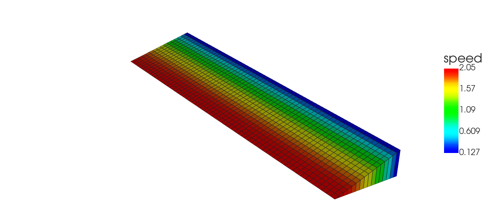
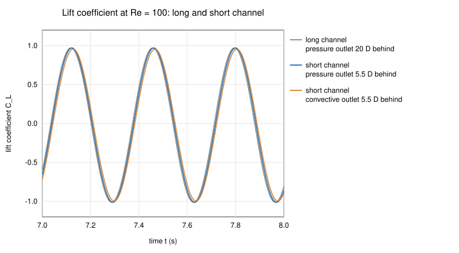

# Boundary conditions of the flow solver

Part of the [Example gallery](../gallery.md): slip walls, axisymmetric wedges, inlet profiles from tables, backflow treatment at pressure outlets and the convective outlet (D29).

| # | Example | Stage | Feature |
|---|---|---|---|
| 21 | [Boundary conditions: slip walls, wedges, tables, backflow, convective outlets](#boundary-conditions) | 5 | slip wall, axisymmetric wedge mesh, inlet profile from a table, backflow treatment at pressure outlets, convective outlet |

---

<a id="boundary-conditions"></a>
## 21. Boundary conditions: slip walls, wedges, tables, backflow, convective outlets



**Axisymmetric flow on a wedge.** A 2D mesh of the half plane y ≥ 0 is
revolved about the x axis into a wedge one cell thick
(`mesh.generate.wedge`); the nodes on the axis merge, so the cells next to
it are prisms with an edge on the axis and the mesh has no axis patch. The
picture is the pipe at 20° to show the shape; the verification runs at
0.5°, where Hagen–Poiseuille flow converges at second order (2.07 and 2.04
on 256 to 4 096 cells). Every cell type of the box generator revolves,
perturbed or not. The planar faces make a wedge of θ a slice of a
polygonal pipe of 360°/θ sides; its result differs from the round pipe by
about θ²/8 (9e-4 at 5°), so applications take 2–5° and a convergence
study 0.5–1°.



**The outlet close behind a body.** The cylinder of [gallery 15](flow.md#cylinder) at Re = 100
with the outlet 5.5 D behind the cylinder instead of 20 D: the vortices
cross the outlet, so fluid enters through it in parts of every period.
A static pressure outlet with the default backflow treatment (the
prescribed pressure taken as the total pressure of the entering fluid)
gives the lift of the long channel on the same near-wake cells; a
convective outlet (∂u/∂t + U_c ∂u/∂n = 0, U_c the mean outflow speed)
gives C_L,max 1.6 % lower. Drag, Strouhal number and Δp stay inside the
reference ranges with both.

| Case | Cells | C_D,max | C_L,max | St | Δp (Pa) |
|---|---:|---:|---:|---:|---:|
| reference | | 3.22–3.24 | 0.99–1.01 | 0.295–0.305 | 2.46–2.50 |
| long channel ([gallery 15](flow.md#cylinder)) | 6 144 | 3.2319 | 0.9712 | 0.2955 | 2.4819 |
| short, pressure outlet, `backflow = "total-pressure"` | 4 928 | 3.2336 | 0.9713 | 0.2951 | 2.4825 |
| short, convective outlet | 4 928 | 3.2261 | 0.9555 | 0.2952 | 2.4779 |

| Check | Result |
|---|---|
| Slip walls, uniform flow on hex, tet, poly and mixed cells perturbed by 20 % | velocity error 1.5e-11, pressure 1.0e-11 (exact to the solver tolerance) |
| Inlet profile from a table (rows at the face centres) | the run with the exact parabola, velocity error 1.592e-3 for both |
| Reversed flow through a pressure outlet, `backflow = "total-pressure"` | uniform flow and the static pressure p − ½ρU² exact to 3e-11 |
| A side outlet above the channel pressure, `backflow = "suppress"` | the faces close, act as a slip wall, no mass crosses (exactly 0), uniform flow exact to 1e-11 |
| Convective outlet, no pressure boundary | outlet flow = inflow to round-off in every step; the start-up disturbance leaves (error 4e-5 after two flow-through times) |
| Convective outlet, restart and rejected steps | bit-identical continuation, the old boundary levels in the restart file |

| | |
|---|---|
| Code | `foehncraft_mesh::wedge`, `foehncraft_flow::bc` (`Backflow`, `ProfileTable`, the new condition types and checks), `simplec::Convective`, kernels `flow::close_backflow`, `UB_OUTLET`, `UB_CONVECTIVE`, `UB_NO_BACKFLOW`, `PB_OUTLET`, `PB_NO_BACKFLOW` |
| Tests | `tests/bcs.rs`, `tests/stage5.rs` (`convective_outlet_restarts_bit_identically`), `wedge.rs` (`wedges_of_every_type`) |
| Case files | `flow/channel_slip.toml`, `poiseuille_table.toml`, `pipe_wedge.toml`, `cylinder_re100_short.toml`, `cylinder_re100_convective.toml` |
| Recipe | [29](../recipes/boundary-conditions.md#boundary-conditions) |

```
target/release/foehn flow examples/cases/flow/pipe_wedge.toml
target/release/foehn flow examples/cases/flow/pipe_wedge.toml --set mesh.generate.wedge=20.0 --set 'verification.levels=[1]' --set mesh.generate.perturb=0.0 --set output.vtkhdf=true --out output/wedge20
python3 tools/render_mesh.py output/wedge20/fields.vtkhdf pipe_wedge.png --field speed --size 1400x600 --zoom 1.6
target/release/foehn flow examples/cases/flow/cylinder_re100.toml
target/release/foehn flow examples/cases/flow/cylinder_re100_short.toml
target/release/foehn flow examples/cases/flow/cylinder_re100_convective.toml
python3 tools/outlet_chart.py cylinder_outlets.svg
```

[↑ back to top](#boundary-conditions-of-the-flow-solver)
