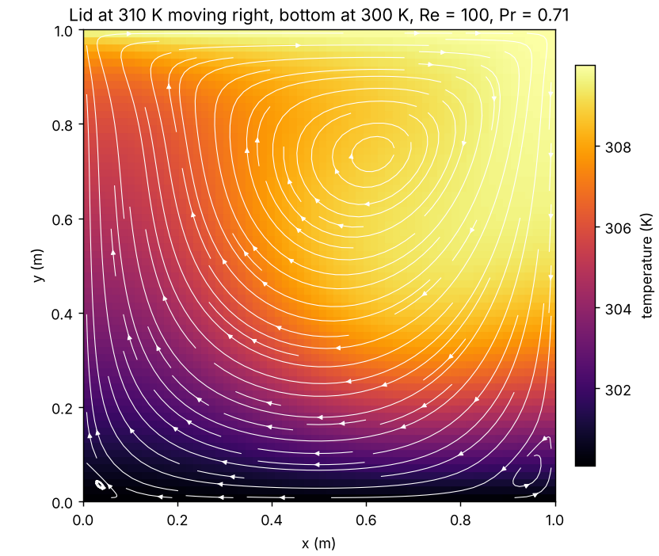
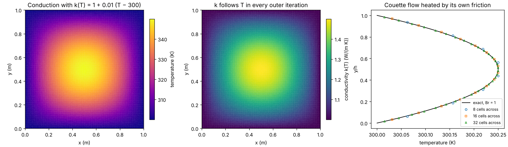

# Energy equation and heat transfer

Part of the [Example gallery](../gallery.md): the energy equation of the fluid (stage 7, D150) with temperature-dependent c_p, k and μ, viscous heating and the thermal wall conditions, checked by manufactured and exact solutions ([specification](../requirements/stage7-energy-buoyancy-cht.md)).

| # | Example | Stage | Feature |
|---|---|---|---|
| 154 | [A heated cavity, conduction with k(T) and a Couette flow heated by its friction](#energy-fluid) | 7 | `[energy]`, `[boundary.<name>.energy]`, `[fluid] specific_heat`, `conductivity`, `viscous_heating`, `temperature_dependent`, `[solver.energy]` |

---

<a id="energy-fluid"></a>
## 154. A heated cavity, conduction with k(T) and a Couette flow heated by its friction



**The heated cavity.** `cavity_heated.toml` is the Re = 100 cavity of
`cavity_re100.toml` with the lid held at 310 K, the bottom at 300 K and
adiabatic side walls; Pr = μ c_p/k = 0.71. The lid drags warm fluid down
the right-hand wall, the primary vortex wraps it around its core and the
heat leaves through the bottom. The run converges in 439 outer iterations
on 64 × 64 cells. The report gives the heat flow of each wall: 288.5 W/m²
enter at the lid and leave at the bottom, the mean Nusselt number is
Nu = q L/(k ΔT) = 2.05, and the heat balance closes to 7·10⁻¹² of the
largest flow. The temperature does not act on the flow yet (buoyancy is
PR 7b1).



**Conduction with k(T) (check V7.1).** `conduction_mms.toml` solves
∇·(k(T)∇T) + q''' = 0 in the unit square, perturbed by 15 %, with
k(T) = 1 + 0.01 (T − 300) W/(m K), the manufactured solution
T = 300 + 50 sin(πx) sin(πy) K and the source that belongs to it. The
conductivity is refreshed from the temperature in every outer iteration,
here from 1.0 at the walls to 1.5 in the centre. The L2 error is 0.112,
0.0258 and 0.00668 K on 16², 32² and 64² cells, observed orders 2.11 and
1.95 (the case requires 1.8 to 2.2); on the finest mesh 20.000 W of source leave through the four walls, with a
reported imbalance of 2·10⁻⁴ (the reported wall flux takes the orthogonal
part of the gradient, so the perturbed mesh shows a small gap).

**Couette flow heated by its friction (check V7.2).** In
`couette_viscous_heating.toml` the upper wall moves at U = 1 m/s over a
gap of h = 1 m (μ = 0.1 Pa s, k = 0.05 W/(m K)), both walls are held at
300 K and `viscous_heating = true` adds Φ = μ (∂u/∂y)². The temperature is
the parabola T = T₀ + μU²/(2k) η(1 − η), 0.25 K above the walls on the
centre line (Brinkman number 1):

| Cells across | L2 error of T (K) | Wall heat flux (W/m²) | Balance |
|---|---|---|---|
| 8 | 3.906e-3 | −0.0500 | 1e-9 |
| 16 | 9.766e-4 | −0.0500 | 3e-9 |
| 32 | 2.441e-4 | −0.0500 | 1e-8 |

The observed order is 2.000. Each wall takes half of the friction power
μU²/h = 0.1 W/m², and the conduction out of the walls equals the viscous
heating of the report.

**Properties that follow the temperature.** With a `material` the
specific heat, the conductivity and the viscosity come from the database
as functions of T (`temperature_dependent = true`, the default); μ(T)
reaches the momentum equation in every outer iteration. A Couette flow of
air between walls at 300 K and 600 K bends its velocity profile by 4 %
against the linear one, which comes back to below 10⁻⁶ with
`temperature_dependent = false` (`tests/energy.rs`). The convection
condition h (T∞ − T_w) gives the exact series resistance of a slab and a
film, and a `heat_flow` in W is spread over its boundary.

```
cargo build --release -p foehncraft-cli
target/release/foehn flow examples/cases/flow/cavity_heated.toml --out output/cavity_heated
target/release/foehn flow examples/cases/flow/conduction_mms.toml --out output/conduction \
    --set 'verification.levels=[2]' --set output.vtkhdf=true
for l in 0 1 2; do
  target/release/foehn flow examples/cases/flow/couette_viscous_heating.toml \
      --out output/couette_$l --set "verification.levels=[$l]" \
      --set 'output.lines=[{name="across",from=[1.0,0.0,0.05],to=[1.0,1.0,0.05],points=64}]'
done
python3 -m tools.plot.energy_fields docs/figures/gallery output/cavity_heated \
    output/conduction output/couette
```
