# Incompressible flow

Part of the [Example gallery](../gallery.md): steady and transient laminar verification and benchmarks: cavity, Poiseuille, Taylor–Green, cylinder, time-step control.

| # | Example | Stage | Feature |
|---|---|---|---|
| 12 | [Lid-driven cavity against Ghia et al.](#cavity) | 4 | SIMPLEC, Rhie–Chow, reference cell, centre-line comparison, 2D and 3D cells |
| 13 | [Poiseuille flow: order of accuracy of the flow solver](#poiseuille) | 4 | second order on all mesh types, velocity inlet with the exact profile, pressure outlet |
| 14 | [Taylor–Green vortex: second order in time and space](#taylor-green) | 5 | PISO, variable-step BDF2, Crank–Nicolson, extrapolation, outer iterations at large steps |
| 15 | [Cylinder in a channel: the Schäfer & Turek benchmark](#cylinder) | 5 | built-in O-grid, steady Re 20, vortex street at Re 100, adaptive time step, force coefficients |
| 20 | [Time step from the error, output at exact times, potential-flow start](#time-control) | 5 | BDF2 error estimate with rejected steps, output in simulated time, potential flow from the pressure multigrid |

---

<a id="cavity"></a>
## 12. Lid-driven cavity against Ghia et al.

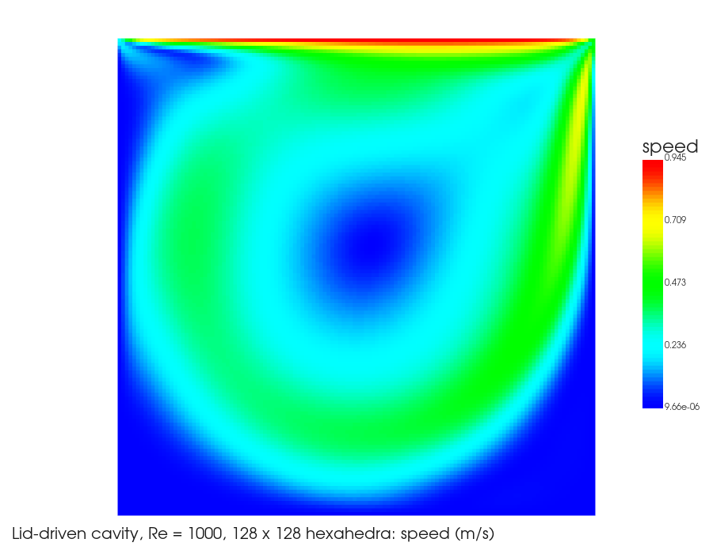

The first flow of Foehncraft: the unit cavity with the lid sliding at 1 m/s,
steady and laminar, solved with SIMPLEC and the relaxation-independent
Rhie–Chow interpolation of stage 4. No boundary fixes the pressure, so a
reference cell holds its level. At Re = 1000 the primary vortex moves
towards the centre and the two corner vortices at the bottom grow; the
velocity on the two centre lines matches the tabulated multigrid solution
of Ghia, Ghia & Shin (1982) to 0.4 % (u) and 1.4 % (v) of the lid speed.


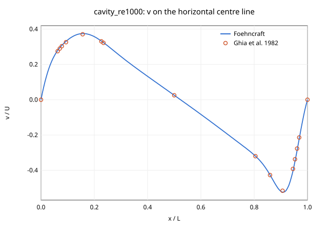

The same flow on fully three-dimensional cells, a slab with symmetry planes
front and back: 0.7 % / 1.3 % at Re = 100 on 5 445 polyhedra, 2.0 % / 2.4 %
at Re = 1000 on 28 227 polyhedra, 2.5 % / 2.2 % at Re = 100 on 24 576
tetrahedra. Re = 100 on 64 × 64 hexahedra: 0.44 % / 0.95 %
([u](../figures/gallery/cavity_re100_u.svg), [v](../figures/gallery/cavity_re100_v.svg)).

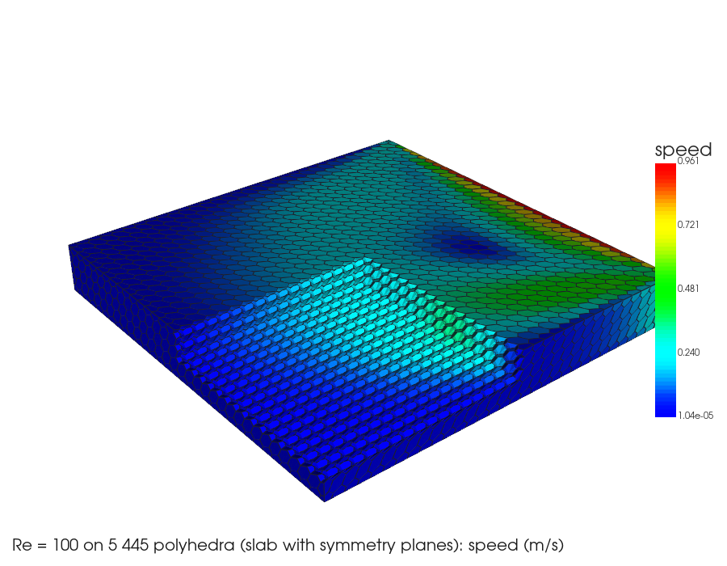

| | |
|---|---|
| Mesh | generated hex 2D, 128 × 128 cells, one layer with symmetry planes |
| Physics | ρ = 1 kg/m³, μ = 0.001 Pa s, lid 1 m/s: Re = 1 000 |
| Solver | SIMPLEC, linear upwind, α_u = 0.9, CG + AMG for the pressure correction; 1 397 outer iterations to 1e-8, 54 s on a shared 4-core cloud machine |
| Case files | `flow/cavity_re1000.toml`, `cavity_re100.toml`, `cavity_re100_poly3d.toml`, `cavity_re100_tet3d.toml`, `cavity_re1000_poly3d.toml` |

```
cargo build --release -p foehncraft-cli
target/release/foehn flow examples/cases/flow/cavity_re1000.toml
# report: output/cavity_re1000/flow.md, charts: centreline_u.svg, centreline_v.svg, residuals.svg
python3 -m tools.mesh.render_mesh output/cavity_re1000/fields.vtkhdf cavity.png --field speed --top --no-edges
```

[↑ back to top](#incompressible-flow)

---

<a id="poiseuille"></a>
## 13. Poiseuille flow: order of accuracy of the flow solver

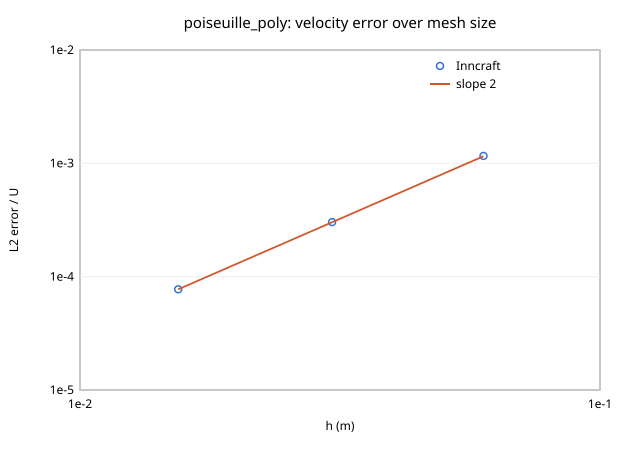

Plane channel flow between walls at rest, the exact parabola at the inlet
(`profile = "analytic"`), a static-pressure outlet, Re = 10, on three nested
meshes per cell type. The velocity error falls with the square of the mesh
size on every type, the check of stage 4 (1.8–2.2 on the finest pair);
Couette flow (`couette_*.toml`) comes out at the iteration error, as a
linear profile must.

| Mesh | Cells (finest) | L2 error (finest) | Observed order |
|---|---:|---:|---:|
| hex, perturbed 15 % | 8 192 | 1.10e-4 | 1.98, 1.89 |
| tet (prisms) | 16 384 | 6.70e-5 | 1.93, 1.80 |
| poly, perturbed 15 % | 8 385 | 7.74e-5 | 2.01, 2.00 |
| mixed | 12 288 | 9.05e-5 | 1.94, 1.88 |

| | |
|---|---|
| Meshes | generated 2D, 32 × 16 to 128 × 64 intervals in a 2 × 1 channel |
| Case files | `flow/poiseuille_hex.toml`, `poiseuille_tet.toml`, `poiseuille_poly.toml`, `poiseuille_mixed.toml` |

```
target/release/foehn flow examples/cases/flow/poiseuille_poly.toml
# report: output/poiseuille_poly/flow.md, plot: convergence.svg
```

[↑ back to top](#incompressible-flow)

---

<a id="taylor-green"></a>
## 14. Taylor–Green vortex: second order in time and space

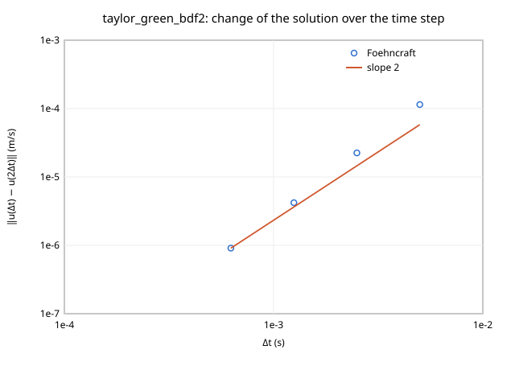

The decaying vortex on the unit square, Re = 100, the exact velocity on
the four sides at each time level. Five runs on the same 64 × 64 mesh
with time steps from 0.01 to 0.000625 s: the change of the solution when
the step is halved falls with Δt², for BDF2 and for Crank–Nicolson, with
one outer iteration per step (plain PISO with two correctors). That needs
the convecting flux and the deferred corrections extrapolated to the new
time; without it the lag of these terms makes PISO first order.

| Scheme | Observed time order (pairs of steps) |
|---|---|
| BDF2 | 2.35, 2.42, 2.21 |
| Crank–Nicolson | 2.40, 2.41, 2.00 |
| BDF2, Courant 1.3 to 9, outer iterations to 1e-9 | 1.97, 2.00 |

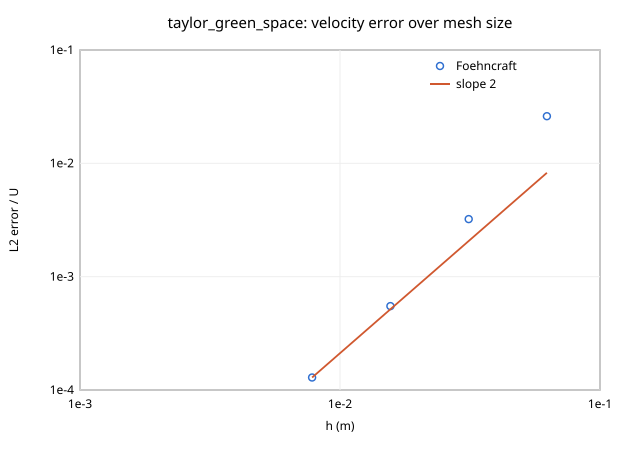

In space, at a fixed small step, the error falls from 2.6e-2 on 16² to
1.3e-4 on 128² cells, order 2.09 on the finest pair.

| | |
|---|---|
| Mesh | generated hex 2D, 64 × 64 (time), 16² to 128² (space) |
| Physics | ρ = 1 kg/m³, μ = 0.01 Pa s, U = 1 m/s, L = 1 m: Re = 100, t = 0 to 0.4 s |
| Solver | PISO, two correctors, BDF2 or Crank–Nicolson, linear solves to 1e-8 |
| Case files | `flow/taylor_green_bdf2.toml`, `taylor_green_cn.toml`, `taylor_green_space.toml`, `taylor_green_cfl10.toml` |

```
cargo build --release -p foehncraft-cli
target/release/foehn flow examples/cases/flow/taylor_green_bdf2.toml
# report: output/taylor_green_bdf2/flow.md, plot: time_convergence.svg
target/release/foehn flow examples/cases/flow/taylor_green_space.toml
# report: output/taylor_green_space/flow.md, plot: convergence.svg
```

[↑ back to top](#incompressible-flow)

---

<a id="cylinder"></a>
## 15. Cylinder in a channel: the Schäfer & Turek benchmark

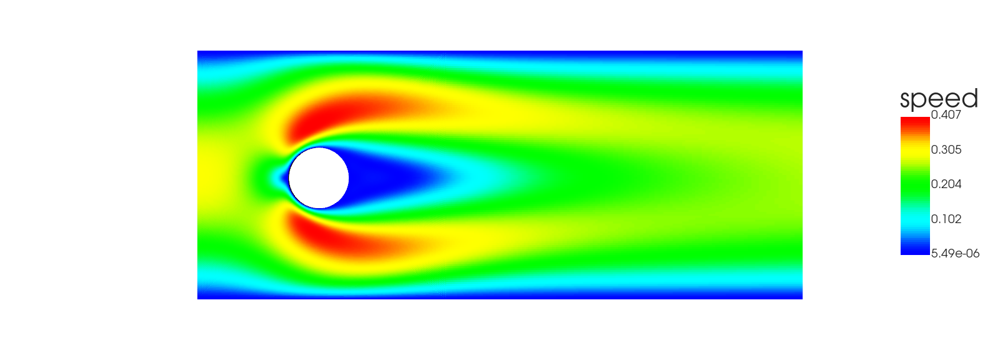

The laminar cylinder benchmark of Schäfer & Turek (1996): a cylinder of
0.1 m in a 2.2 × 0.41 m channel, slightly off the centre line, with a
parabolic inflow. At Re = 20 the flow is steady with two attached
vortices; on 98 304 cells the drag and lift coefficients and the pressure
difference across the cylinder lie inside the reference ranges
(C_D 5.5800, C_L 0.01060, Δp 0.11751 Pa).

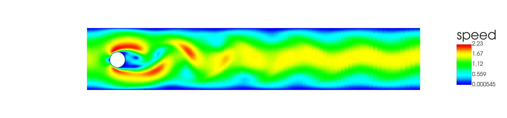

At Re = 100 a vortex street forms. The time step follows a Courant number
of 0.8; from t = 5 s the run evaluates the largest drag and lift, the
Strouhal number of the lift and the pressure difference half a period
after the lift maximum.

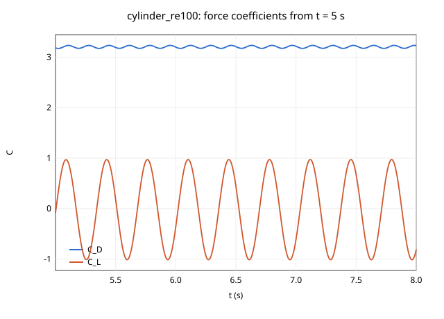

| Case | Cells | C_D (max) | C_L (max) | St | Δp (Pa) |
|---|---:|---:|---:|---:|---:|
| Re 20, reference | | 5.57–5.59 | 0.0104–0.0110 | | 0.1172–0.1176 |
| Re 20 | 24 576 | 5.5808 | 0.01036 | | 0.11750 |
| Re 20 | 98 304 | 5.5800 | 0.01060 | | 0.11751 |
| Re 100, reference | | 3.22–3.24 | 0.99–1.01 | 0.295–0.305 | 2.46–2.50 |
| Re 100 | 6 144 | 3.2319 | 0.9712 | 0.2955 | 2.4819 |
| Re 100 | 24 576 | 3.2305 | 0.9847 | 0.3008 | 2.4854 |

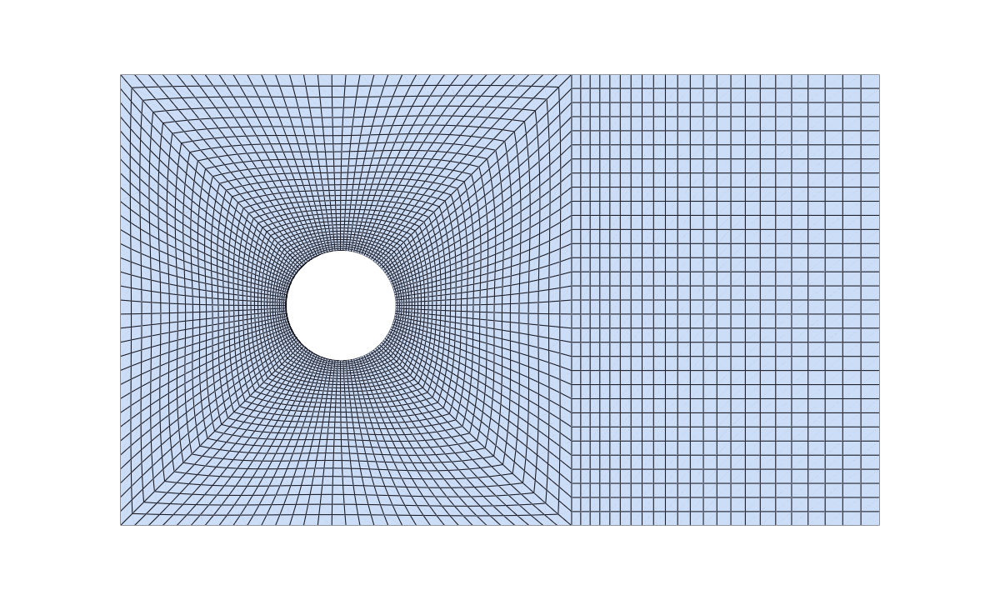

| | |
|---|---|
| Mesh | built in (`[mesh.cylinder]`): O-grid around the cylinder, graded wake block; refine 0, 1, 2: 6 144, 24 576, 98 304 hexahedra in one layer |
| Physics | ρ = 1 kg/m³, μ = 0.001 Pa s, Ū = 0.2 m/s (Re 20) or 1 m/s (Re 100), D = 0.1 m |
| Solver | Re 20 steady SIMPLEC; Re 100 PISO with BDF2, adaptive Δt (Courant 0.8), t = 0 to 8 s |
| Case files | `flow/cylinder_re20.toml`, `cylinder_re100.toml` |

```
target/release/foehn flow examples/cases/flow/cylinder_re20.toml
target/release/foehn flow examples/cases/flow/cylinder_re100.toml
# report: output/cylinder_re100/flow.md, chart: coefficients.svg, histories: forces.csv, probes.csv
python3 -m tools.mesh.render_mesh output/cylinder_re20/fields.vtkhdf cylinder.png --field speed --top --no-edges --size 1800x420 --zoom 2.9
```

[↑ back to top](#incompressible-flow)

---

<a id="time-control"></a>
## 20. Time step from the error, output at exact times, potential-flow start

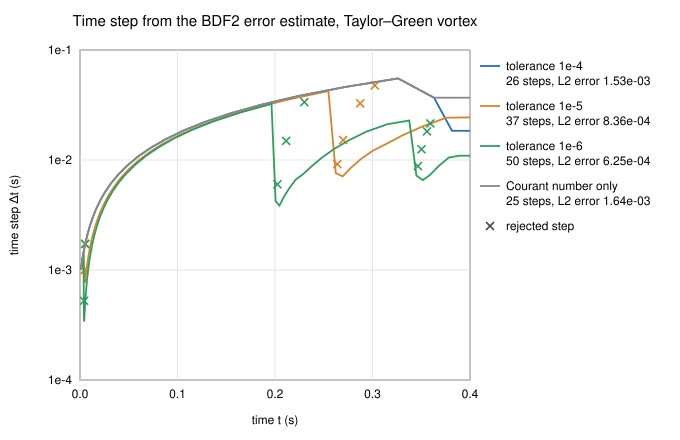

The Taylor–Green vortex with the step chosen by the error of BDF2 (D65):
from the fourth step on, the local error is estimated from the difference
between the step and the quadratic extrapolation of the last three levels,
and the next step is the one that meets the tolerance, at most 1.2 times
the last and below Courant number 5. With 1e-4 the error never limits and
the run follows the growth limit like the Courant control alone; with
1e-5 and 1e-6 the estimate cuts the step where plain PISO loses accuracy,
at Courant numbers about 2, and repeats the steps that missed (the
crosses). The velocity error at the end falls from 1.6e-3 to 6.3e-4, near
the spatial error of the mesh (5.5e-4), for twice the steps. A rejected
step is taken back exactly: the repeated step is bitwise the step a run
with the shorter Δt takes, and a restart continues bitwise. At the end
every run lands on t = 0.4 s in two equal steps; the same holds for
field, monitor and restart output in simulated time (D66).


The start field of `initial.potential_flow` (D52) for the cylinder of
gallery 15: the irrotational flow that carries the parabolic inflow
around the cylinder to the outlet, with the stagnation points on the axis
and the fastest flow above and below the cylinder. It is one Laplace solve
with the pressure multigrid (the pressure-correction equation with unit
coefficients) and four passes of the non-orthogonal correction; the cell
velocity is rebuilt from the face fluxes, which are continuous to the
solver tolerance. The steady run at Re 20 from it converges in 1527
instead of 1570 outer iterations.

| Check | Result |
|---|---|
| Taylor–Green, 64², BDF2, tolerance 1e-4 / 1e-5 / 1e-6 | 26 / 37 / 50 steps, 0 / 6 / 9 rejected, velocity error L2 1.53e-3 / 8.36e-4 / 6.25e-4 (Courant control alone: 25 steps, 1.64e-3) |
| Rejected step, BDF2 and Crank–Nicolson | the repeated step and the next one bitwise equal to the run that took the short step at once |
| Restart of an error-controlled run with rejections | bit-identical continuation |
| Output at exact times | monitor rows at multiples of 0.05 s to 1e-12 s, restart at its time, no step below half the one before |
| Potential start in a channel with uniform inflow | uniform flow to 1e-11 on hexahedra, RMS deviation 1.2 % on polygons perturbed by 15 % (12 % without the non-orthogonal correction) |
| The catalogue against part 4b | 22 flow cases and the scalar cases bitwise equal without the new keys |

| | |
|---|---|
| Code | `foehncraft_flow::transient` (`ErrorControl`, `Transient::reject`), `unsteady` (rejection, `Schedule`), `simplec::Flow::potential_flow` |
| Tests | `adjoint_tests.rs` (`rejected_step_repeats_bitwise`, `potential_flow_start_in_a_channel`), `tests/stage5.rs` (`error_controlled_steps_restart_bit_identically`, `output_lands_on_scheduled_times`) |
| Case files | `flow/taylor_green_error.toml`, `flow/cylinder_potential.toml` |
| Recipe | [28](../recipes/flow.md#time-control) |

```
target/release/foehn flow examples/cases/flow/taylor_green_error.toml
python3 -m tools.plot.time_step_chart time_step_error.svg
target/release/foehn flow examples/cases/flow/cylinder_potential.toml
python3 -m tools.mesh.render_mesh output/cylinder_potential/fields.vtkhdf potential.png --field speed --top --no-edges --size 1800x420 --zoom 2.9
```

[↑ back to top](#incompressible-flow)
