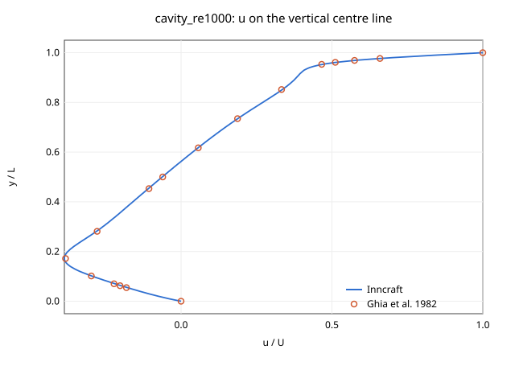
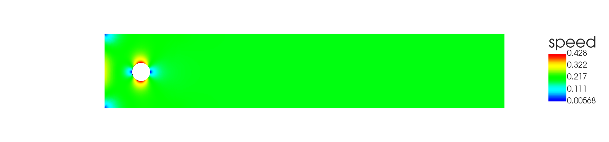

# Incompressible flow

Part of the [Example gallery](../gallery.md): steady and transient laminar verification and benchmarks: cavity, Poiseuille, Taylor–Green, cylinder, time-step control.

| # | Example | Stage | Feature |
|---|---|---|---|
| 12 | [Lid-driven cavity against Ghia et al.](#cavity) | 4 | SIMPLEC, Rhie–Chow, reference cell, centre-line comparison, 2D and 3D cells |
| 13 | [Poiseuille flow: order of accuracy of the flow solver](#poiseuille) | 4 | second order on all mesh types, velocity inlet with the exact profile, pressure outlet |
| 14 | [Taylor–Green vortex: second order in time and space](#taylor-green) | 5 | PISO, variable-step BDF2, Crank–Nicolson, extrapolation, outer iterations at large steps |
| 15 | [Cylinder in a channel: the Schäfer & Turek benchmark](#cylinder) | 5 | built-in O-grid, steady Re 20, vortex street at Re 100, adaptive time step, force coefficients |
| 20 | [Time step from the error, output at exact times, potential-flow start](#time-control) | 5 | BDF2 error estimate with rejected steps, output in simulated time, potential flow from the pressure multigrid |
| 78 | [Coupled algorithm and pseudo-time steps: the step case in 65 iterations](#coupled) | 6 | `solver.algorithm = "coupled"`, `[solver.coupled]`, `[solver.pseudo_time]`, log column `K` |
| 80 | [A multigrid for the momentum sweep of the coupled algorithm](#momentum-multigrid) | 6 | `solver.coupled.momentum_sweep`, `momentum_cycles`, `momentum_reuse`, `[solver.coupled.multigrid]` |
| 81 | [A multigrid for the turbulence equations: the step settles in 40 and 65 iterations](#turbulence-multigrid) | 6 | `solver.turbulence.preconditioner`, `solver.turbulence.reuse`, relaxations 0.995 |

---

<a id="cavity"></a>
## 12. Lid-driven cavity against Ghia et al.


The first flow of Foehncraft: the unit cavity with the lid sliding at 1 m/s,
steady and laminar, solved with SIMPLEC and the relaxation-independent
Rhie–Chow interpolation of stage 4. No boundary fixes the pressure, so a
reference cell holds its level. At Re = 1000 the primary vortex moves
towards the centre and the two corner vortices at the bottom grow; the
velocity on the two centre lines matches the tabulated multigrid solution
of Ghia, Ghia & Shin (1982) to 0.4 % (u) and 1.4 % (v) of the lid speed.




The same flow on fully three-dimensional cells, a slab with symmetry planes
front and back: 0.7 % / 1.3 % at Re = 100 on 5 445 polyhedra, 2.0 % / 2.4 %
at Re = 1000 on 28 227 polyhedra, 2.5 % / 2.2 % at Re = 100 on 24 576
tetrahedra. Re = 100 on 64 × 64 hexahedra: 0.44 % / 0.95 %
([u](../figures/gallery/cavity_re100_u.svg), [v](../figures/gallery/cavity_re100_v.svg)).


| | |
|---|---|
| Mesh | generated hex 2D, 128 × 128 cells, one layer with symmetry planes |
| Physics | ρ = 1 kg/m³, μ = 0.001 Pa s, lid 1 m/s: Re = 1 000 |
| Solver | SIMPLEC, linear upwind, α_u = 0.9, CG + AMG for the pressure correction; 1 397 outer iterations to 1e-8, 54 s on a shared 4-core cloud machine |
| Case files | `flow/cavity_re1000.toml`, `cavity_re100.toml`, `cavity_re100_poly3d.toml`, `cavity_re100_tet3d.toml`, `cavity_re1000_poly3d.toml` |

```
cargo build --release -p foehncraft-cli
target/release/foehn flow examples/cases/flow/cavity_re1000.toml
# report: output/cavity_re1000/flow.md, charts: centreline_u.svg, centreline_v.svg, residuals.svg
python3 -m tools.mesh.render_mesh output/cavity_re1000/fields.vtkhdf cavity.png --field speed --top --no-edges
```

[↑ back to top](#incompressible-flow)

---

<a id="poiseuille"></a>
## 13. Poiseuille flow: order of accuracy of the flow solver


Plane channel flow between walls at rest, the exact parabola at the inlet
(`profile = "analytic"`), a static-pressure outlet, Re = 10, on three nested
meshes per cell type. The velocity error falls with the square of the mesh
size on every type, the check of stage 4 (1.8–2.2 on the finest pair);
Couette flow (`couette_*.toml`) comes out at the iteration error, as a
linear profile must.

| Mesh | Cells (finest) | L2 error (finest) | Observed order |
|---|---:|---:|---:|
| hex, perturbed 15 % | 8 192 | 1.10e-4 | 1.98, 1.89 |
| tet (prisms) | 16 384 | 6.70e-5 | 1.93, 1.80 |
| poly, perturbed 15 % | 8 385 | 7.74e-5 | 2.01, 2.00 |
| mixed | 12 288 | 9.05e-5 | 1.94, 1.88 |

| | |
|---|---|
| Meshes | generated 2D, 32 × 16 to 128 × 64 intervals in a 2 × 1 channel |
| Case files | `flow/poiseuille_hex.toml`, `poiseuille_tet.toml`, `poiseuille_poly.toml`, `poiseuille_mixed.toml` |

```
target/release/foehn flow examples/cases/flow/poiseuille_poly.toml
# report: output/poiseuille_poly/flow.md, plot: convergence.svg
```

[↑ back to top](#incompressible-flow)

---

<a id="taylor-green"></a>
## 14. Taylor–Green vortex: second order in time and space


The decaying vortex on the unit square, Re = 100, the exact velocity on
the four sides at each time level. Five runs on the same 64 × 64 mesh
with time steps from 0.01 to 0.000625 s: the change of the solution when
the step is halved falls with Δt², for BDF2 and for Crank–Nicolson, with
one outer iteration per step (plain PISO with two correctors). That needs
the convecting flux and the deferred corrections extrapolated to the new
time; without it the lag of these terms makes PISO first order.

| Scheme | Observed time order (pairs of steps) |
|---|---|
| BDF2 | 2.35, 2.42, 2.21 |
| Crank–Nicolson | 2.40, 2.41, 2.00 |
| BDF2, Courant 1.3 to 9, outer iterations to 1e-9 | 1.97, 2.00 |


In space, at a fixed small step, the error falls from 2.6e-2 on 16² to
1.3e-4 on 128² cells, order 2.09 on the finest pair.

| | |
|---|---|
| Mesh | generated hex 2D, 64 × 64 (time), 16² to 128² (space) |
| Physics | ρ = 1 kg/m³, μ = 0.01 Pa s, U = 1 m/s, L = 1 m: Re = 100, t = 0 to 0.4 s |
| Solver | PISO, two correctors, BDF2 or Crank–Nicolson, linear solves to 1e-8 |
| Case files | `flow/taylor_green_bdf2.toml`, `taylor_green_cn.toml`, `taylor_green_space.toml`, `taylor_green_cfl10.toml` |

```
cargo build --release -p foehncraft-cli
target/release/foehn flow examples/cases/flow/taylor_green_bdf2.toml
# report: output/taylor_green_bdf2/flow.md, plot: time_convergence.svg
target/release/foehn flow examples/cases/flow/taylor_green_space.toml
# report: output/taylor_green_space/flow.md, plot: convergence.svg
```

[↑ back to top](#incompressible-flow)

---

<a id="cylinder"></a>
## 15. Cylinder in a channel: the Schäfer & Turek benchmark


The laminar cylinder benchmark of Schäfer & Turek (1996): a cylinder of
0.1 m in a 2.2 × 0.41 m channel, slightly off the centre line, with a
parabolic inflow. At Re = 20 the flow is steady with two attached
vortices; on 98 304 cells the drag and lift coefficients and the pressure
difference across the cylinder lie inside the reference ranges
(C_D 5.5800, C_L 0.01060, Δp 0.11751 Pa).


At Re = 100 a vortex street forms. The time step follows a Courant number
of 0.8; from t = 5 s the run evaluates the largest drag and lift, the
Strouhal number of the lift and the pressure difference half a period
after the lift maximum.


| Case | Cells | C_D (max) | C_L (max) | St | Δp (Pa) |
|---|---:|---:|---:|---:|---:|
| Re 20, reference | | 5.57–5.59 | 0.0104–0.0110 | | 0.1172–0.1176 |
| Re 20 | 24 576 | 5.5808 | 0.01036 | | 0.11750 |
| Re 20 | 98 304 | 5.5800 | 0.01060 | | 0.11751 |
| Re 100, reference | | 3.22–3.24 | 0.99–1.01 | 0.295–0.305 | 2.46–2.50 |
| Re 100 | 6 144 | 3.2319 | 0.9712 | 0.2955 | 2.4819 |
| Re 100 | 24 576 | 3.2305 | 0.9847 | 0.3008 | 2.4854 |


| | |
|---|---|
| Mesh | built in (`[mesh.cylinder]`): O-grid around the cylinder, graded wake block; refine 0, 1, 2: 6 144, 24 576, 98 304 hexahedra in one layer |
| Physics | ρ = 1 kg/m³, μ = 0.001 Pa s, Ū = 0.2 m/s (Re 20) or 1 m/s (Re 100), D = 0.1 m |
| Solver | Re 20 steady SIMPLEC; Re 100 PISO with BDF2, adaptive Δt (Courant 0.8), t = 0 to 8 s |
| Case files | `flow/cylinder_re20.toml`, `cylinder_re100.toml` |

```
target/release/foehn flow examples/cases/flow/cylinder_re20.toml
target/release/foehn flow examples/cases/flow/cylinder_re100.toml
# report: output/cylinder_re100/flow.md, chart: coefficients.svg, histories: forces.csv, probes.csv
python3 -m tools.mesh.render_mesh output/cylinder_re20/fields.vtkhdf cylinder.png --field speed --top --no-edges --size 1800x420 --zoom 2.9
```

[↑ back to top](#incompressible-flow)

---

<a id="time-control"></a>
## 20. Time step from the error, output at exact times, potential-flow start


The Taylor–Green vortex with the step chosen by the error of BDF2 (D65):
from the fourth step on, the local error is estimated from the difference
between the step and the quadratic extrapolation of the last three levels,
and the next step is the one that meets the tolerance, at most 1.2 times
the last and below Courant number 5. With 1e-4 the error never limits and
the run follows the growth limit like the Courant control alone; with
1e-5 and 1e-6 the estimate cuts the step where plain PISO loses accuracy,
at Courant numbers about 2, and repeats the steps that missed (the
crosses). The velocity error at the end falls from 1.6e-3 to 6.3e-4, near
the spatial error of the mesh (5.5e-4), for twice the steps. A rejected
step is taken back exactly: the repeated step is bitwise the step a run
with the shorter Δt takes, and a restart continues bitwise. At the end
every run lands on t = 0.4 s in two equal steps; the same holds for
field, monitor and restart output in simulated time (D66).



The start field of `initial.potential_flow` (D52) for the cylinder of
gallery 15: the irrotational flow that carries the parabolic inflow
around the cylinder to the outlet, with the stagnation points on the axis
and the fastest flow above and below the cylinder. It is one Laplace solve
with the pressure multigrid (the pressure-correction equation with unit
coefficients) and four passes of the non-orthogonal correction; the cell
velocity is rebuilt from the face fluxes, which are continuous to the
solver tolerance. The steady run at Re 20 from it converges in 1527
instead of 1570 outer iterations.

| Check | Result |
|---|---|
| Taylor–Green, 64², BDF2, tolerance 1e-4 / 1e-5 / 1e-6 | 26 / 37 / 50 steps, 0 / 6 / 9 rejected, velocity error L2 1.53e-3 / 8.36e-4 / 6.25e-4 (Courant control alone: 25 steps, 1.64e-3) |
| Rejected step, BDF2 and Crank–Nicolson | the repeated step and the next one bitwise equal to the run that took the short step at once |
| Restart of an error-controlled run with rejections | bit-identical continuation |
| Output at exact times | monitor rows at multiples of 0.05 s to 1e-12 s, restart at its time, no step below half the one before |
| Potential start in a channel with uniform inflow | uniform flow to 1e-11 on hexahedra, RMS deviation 1.2 % on polygons perturbed by 15 % (12 % without the non-orthogonal correction) |
| The catalogue against part 4b | 22 flow cases and the scalar cases bitwise equal without the new keys |

| | |
|---|---|
| Code | `foehncraft_flow::transient` (`ErrorControl`, `Transient::reject`), `unsteady` (rejection, `Schedule`), `simplec::Flow::potential_flow` |
| Tests | `adjoint_tests.rs` (`rejected_step_repeats_bitwise`, `potential_flow_start_in_a_channel`), `tests/stage5.rs` (`error_controlled_steps_restart_bit_identically`, `output_lands_on_scheduled_times`) |
| Case files | `flow/taylor_green_error.toml`, `flow/cylinder_potential.toml` |
| Recipe | [28](../recipes/flow.md#time-control) |

```
target/release/foehn flow examples/cases/flow/taylor_green_error.toml
python3 -m tools.plot.time_step_chart time_step_error.svg
target/release/foehn flow examples/cases/flow/cylinder_potential.toml
python3 -m tools.mesh.render_mesh output/cylinder_potential/fields.vtkhdf potential.png --field speed --top --no-edges --size 1800x420 --zoom 2.9
```

[↑ back to top](#incompressible-flow)

---

<a id="coupled"></a>
## 78. Coupled algorithm and pseudo-time steps: the step case in 65 iterations


**Why SIMPLEC needs hundreds of iterations.** Under-relaxation is a time
step in disguise: with the factor α a cell advances by α/(1 − α) of its
own transit time per outer iteration, 4 transit times at α = 0.8. The
step shrinks with the cell, but the recirculation zone behind a step
needs a fixed physical time to form. So the backward-facing step of
gallery 74 takes about 600 iterations on 8 200 cells and 1 600 to 1 750
on 32 800.

**The coupled algorithm.** `algorithm = "coupled"` solves the momentum
equations and the continuity equation of an outer iteration as one linear
system for the increments of velocity and pressure, and replaces the
relaxation by pseudo-time steps on physical scales:

```toml
[solver]
algorithm = "coupled"
```

- The momentum equations take one step Δτ for all cells, by default the
  volume of the domain over the area of its boundaries, over the flow
  speed (7.3 H/U on the step). The relaxation, now 0.98, only caps the
  local Courant number at 49.
- The turbulence equations take the step min(Δτ, 0.5 T) per cell, with T
  the time scale of the model (k/ε, 1/(β* ω)): their sources are stiff on
  that scale.
- The discrete equations are those of SIMPLEC. The converged result is
  the same and depends neither on the step nor on the cap; the face
  fluxes satisfy continuity after every outer iteration.

No block matrix is built: the coupled system is applied with the kernels
of the segregated solver and solved by flexible GMRES with a SIMPLE-type
preconditioner (a momentum sweep, a pressure solve with the multigrid of
the pressure, a velocity correction).

**The step** (`backstep_zeta_f0_coupled.toml`, 8 200 cells, from a
uniform start, no relaxation ramp). Outer iterations until x_r stays
within 1 % of its final value:

| Model | SIMPLEC (0.5, then 0.8) | Coupled | Final x_r/H, both |
|---|---|---|---|
| k-ε-ζ-f₀ | 525 | 65 | 6.385 |
| k-ε, scalable wall functions | 600 | 75 | 5.287 |
| k-ω SST | 675 | 80 | 6.82 |
| k-ε-ζ-f₀, 32 800 cells | 1 600 | 175 | 6.352 |

The gain in run time is smaller, because a coupled iteration costs
several SIMPLEC iterations: with the multigrid momentum sweep of
[gallery 80](#momentum-multigrid) the coarse step settles on one
thread in 7.0 s instead of 18.7 s and the fine one, in 150 iterations,
in 74 s instead of 243 s. The
counts are good to about 10 %: they repeat exactly for the same input,
but a change in the last digit of the step can move them
([verification page](../verification/stage6.md#coupled-algorithm-and-pseudo-time-steps-part-6e),
finding 8).

**Channel and cavity.** The channel at Re_τ = 395 with k-ε-ζ-f₀
(`channel_zeta_f0.toml` with `--set solver.algorithm=coupled`) converges
in 323 iterations instead of about 2 100, to the same U_b⁺ = 17.79. The
laminar cavity at Re = 1000 on 128 × 128 cells
(`cavity_re1000_coupled.toml`) converges to 10⁻⁸ in about 450 iterations
instead of 1 397, with the same deviation from Ghia et al. (0.0040,
0.0136) and the same kinetic-energy ledger: numerical dissipation 0.637 %
of the lid power with both algorithms, its Rhie–Chow part equal to seven
digits.

**Where it pays little.** On small laminar cases SIMPLEC at α = 0.9 is
about as fast: the cavity at Re = 400 on 48 × 48 cells takes 255
iterations with SIMPLEC and 289 with the automatic step, which is a
careful one. A larger step (`[solver.pseudo_time] factor = 4` or `20`)
brings 130 or 84 iterations. With the BiCGStab momentum sweep of the
first version such steps cost more than they saved; with the multigrid
sweep of [gallery 80](#momentum-multigrid) they no longer do (cavity
at Re = 1000 on 64 × 64 cells: 3.0 s with SIMPLEC, 3.7 s, 2.8 s and
2.6 s with the factors 1, 4 and 20). The cap stays at 0.98, which is why
the fine step mesh still needs more than twice the iterations of the
coarse one
([requirements step 22](../requirements/step22-coupled-solver.md),
section 8).

The commands are in [recipe 78](../recipes/flow.md#coupled), the
measurements and the method in the
[verification page](../verification/stage6.md#coupled-algorithm-and-pseudo-time-steps-part-6e).

[↑ back to top](#incompressible-flow)

---

<a id="momentum-multigrid"></a>
## 80. A multigrid for the momentum sweep of the coupled algorithm


**The sweep.** Every Krylov iteration of the coupled solve of
[gallery 78](#coupled) needs an approximate inverse of the momentum
matrix for each velocity component. BiCGStab with a diagonal
preconditioner did that, cut off after 10 iterations. With a large
pseudo-time step the matrix is far from diagonally dominant and 10
iterations do not reach the tolerance, so the coupled solve took more
Krylov iterations, each with its pressure solve, and an erratic number
of them (figure: red).

**The multigrid.** The momentum matrix is not symmetric: upwind
convection makes it nearly triangular along the flow, and the
aggregation multigrid of the pressure fails on it. A reduction multigrid
uses that structure. It splits the cells into coarse and fine points
such that the fine points are almost decoupled from each other (one
Jacobi sweep solves them), and it builds the coarse problem with a
restriction that approximates the ideal one (Manteuffel, Ruge &
Southworth 2018) and the direct interpolation of classical multigrid.
One V-cycle per velocity component is the sweep. It runs on the level
kernels of the pressure multigrid, on the CPU and on the GPU. It is the
default with the coupled algorithm; the old sweep is one key away:

```toml
[solver]
algorithm = "coupled"

[solver.coupled]
# momentum_sweep = "bicgstab"   # the sweep of gallery 78
```

**The step case** (k-ε-ζ-f₀, one thread; outer iterations and run time
until x_r stays within 1 % of its final value):

| Mesh | SIMPLEC (0.5, then 0.8) | Coupled, BiCGStab sweep | Coupled, multigrid sweep |
|---|---|---|---|
| 8 200 cells | 525, 18.7 s | 65, 8.3 s | 65, 7.0 s |
| 32 800 cells | 1 600, 243 s | 175, 131 s | 150, 74 s |

Up to the settled result the Krylov iterations per outer iteration halve
(10 → 5.3 and 14 → 6.0), and the pressure solves with them; the fine mesh
settles 25 iterations earlier. The final x_r is the same (6.385 H and
6.35 H). The laminar cavity at Re = 1000 on 128 × 128 cells
(`cavity_re1000_coupled.toml`) converges to 10⁻⁸ in 12.1 s instead of
18.8 s; SIMPLEC needs 28.3 s. k-ε and k-ω SST settle on the coarse step
in 75 and 80 iterations as before.

**Kept hierarchies.** Building a hierarchy costs as much as twenty to
thirty cycles. So a hierarchy is kept while the momentum matrix has
changed by at most 2 % since its setup (`momentum_reuse`), and rebuilt at
once if its cycle no longer halves the residual. The cavity needs 28
setups in 449 iterations; the step, whose matrix changes quickly while
the recirculation zone forms, 96 in 65. The report of a run counts them:

```
Seconds per phase (R6): … momentum solve 0.30, … pressure solve 1.56, multigrid setup 1.49 (7 setups, 96 of the momentum sweeps)
```

A restart file holds the matrices of the kept hierarchies, so a
continued run stays bit-identical to an uninterrupted one.

**A side result: one thread without a pool.** Timing these runs showed
a loss in the CPU backend that had nothing to do with the algorithm. On
a pool of one thread (meshes below 20 000 cells always run on one) every
kernel call was still handed to the worker thread and waited for, about
2 000 times per outer iteration of the cavity. Such loops, and loops of
one task like the coarse levels of a multigrid cycle, now run on the
calling thread, with the same values. That alone took the SIMPLEC run of
the coarse step from 31 s to 18.7 s and the coupled run of gallery 78
from 21 s to 8.3 s.

**What limits a coupled run now.** On the fine mesh the momentum sweeps
and their setups take 16 % of the run time (the BiCGStab sweeps took a
quarter), the
turbulence model 35 % (its linear solves 21 %) and the pressure solves
25 %. The setups cost
more than the cycles they serve (7.3 s against 4.1 s). And the cap on
the local step stays at 0.98: without it the fine step settles in about
120 iterations, but the Krylov solve then runs into its limit in every
outer iteration, because of the SIMPLE-type approximation of the Schur
complement and no longer because of the sweep. The same multigrid for
the turbulence equations, a cheaper setup, a multigrid with a
coarse–fine splitting for the pressure and a better Schur complement are
the next steps ([requirements step 22](../requirements/step22-coupled-solver.md),
section 8).

The commands are in [recipe 80](../recipes/flow.md#momentum-multigrid),
the method and the tests in the
[verification page](../verification/stage6.md#multigrid-for-the-momentum-sweep-part-6f).

[↑ back to top](#incompressible-flow)

---

<a id="turbulence-multigrid"></a>
## 81. A multigrid for the turbulence equations: the step settles in 40 and 65 iterations


**Why the count grew with the mesh.** With the coupled algorithm of
[gallery 78](#coupled) and the momentum multigrid of
[gallery 80](#momentum-multigrid) the step settled in 65 outer
iterations on 8 200 cells and in 150 on 32 800: 2.3 times more per four
times the cells, where the published coupled solvers stay nearly
independent of the mesh. The cause was not the pressure–velocity
coupling but the relaxation 0.98 of the turbulence equations. A
relaxation α acts as a local pseudo step α/(1−α) ρV/a_P, in a flat cell
at the wall about 25 h²/ν: it shrinks with the cells. Raising it to
0.99 alone took the fine step from 150 to 95 iterations, but then the
BiCGStab solves of k, ε and ζ with a diagonal preconditioner run into
their limit of 50 iterations in every outer iteration and the
reattachment length jitters.

**The multigrid.** The transport equations of k, ε and ζ have the same
structure as the momentum equations: convection makes them nearly
triangular along the flow. So the reduction multigrid of gallery 80
serves as their preconditioner, one V-cycle per BiCGStab iteration, and
a solve needs 1 to 2 iterations at any relaxation. With it the
relaxations of the momentum and of the turbulence equations default to
0.995. That is the default for the k-ε family (k-ε, realizable k-ε,
k-ε-ζ-f, k-ε-ζ-f₀) with the coupled algorithm in steady runs; a case
needs no key:

```toml
[solver]
algorithm = "coupled"

[solver.turbulence]
# preconditioner = "jacobi"   # with relaxation = 0.98: the runs of part 6f
```

**The step case** (k-ε-ζ-f₀, one thread, quiet machine; outer
iterations and run time until x_r stays within 1 % of its final value):

| Mesh | SIMPLEC (0.5, then 0.8) | Coupled, part 6f | Coupled, multigrid in the turbulence equations |
|---|---|---|---|
| 8 200 cells | 525, 18.7 s | 65, 7.0 s | 40, 7.5 s |
| 32 800 cells | 1 600, 243 s | 150, 74 s | 65, 56 s |

The count now grows by 1.6 per four times the cells. k-ε settles in 45
iterations instead of 75, the channel at Re_τ = 395 converges in 231
instead of 323. The final values do not change (x_r = 6.385 H and
6.353 H, 5.287 H with k-ε).

**The honest part: the cost of an iteration.** Fewer iterations do not
yet mean a shorter run on small meshes. At the momentum cap 0.995 the
SIMPLE-type Schur complement needs about 9 Krylov iterations per outer
iteration instead of 5, each with its pressure solve, and while the
recirculation zone forms the matrices of the turbulence equations change
by more than 2 % in most iterations, so their hierarchies are rebuilt in
most solves (114 setups in 120 solves on the coarse step). The coarse
steps therefore take about the time they took before (7.5 s against
7.0 s; k-ε 5.7 s against 4.5 s). The fine step is 1.3 times faster, and
the gain grows with the mesh: against SIMPLEC it is now a factor of 4.3
there. A cheaper setup and a better Schur complement are the next steps
([requirements step 22](../requirements/step22-coupled-solver.md),
section 8). The report counts the setups (coarse step, 40 iterations):

```
Seconds per phase (R6): … pressure solve 1.97, multigrid setup 1.17 (4 setups, 76 of the momentum sweeps, 114 of the turbulence equations), turbulence model 2.86
```

**k-ω SST keeps the old defaults.** With accurate solves of k and ω the
SST residuals on the step grow again after about 160 iterations and x_r
wanders from 6.81 to 6.85 H, at any relaxation; the loose Jacobi solves
of today damp this. SST therefore keeps Jacobi and 0.98 (80 iterations
on the coarse step), and laminar cases keep the cap 0.98.

The commands are in [recipe 81](../recipes/flow.md#turbulence-multigrid),
the method and the tests in the
[verification page](../verification/stage6.md#multigrid-for-the-turbulence-equations-part-6g).

[↑ back to top](#incompressible-flow)
