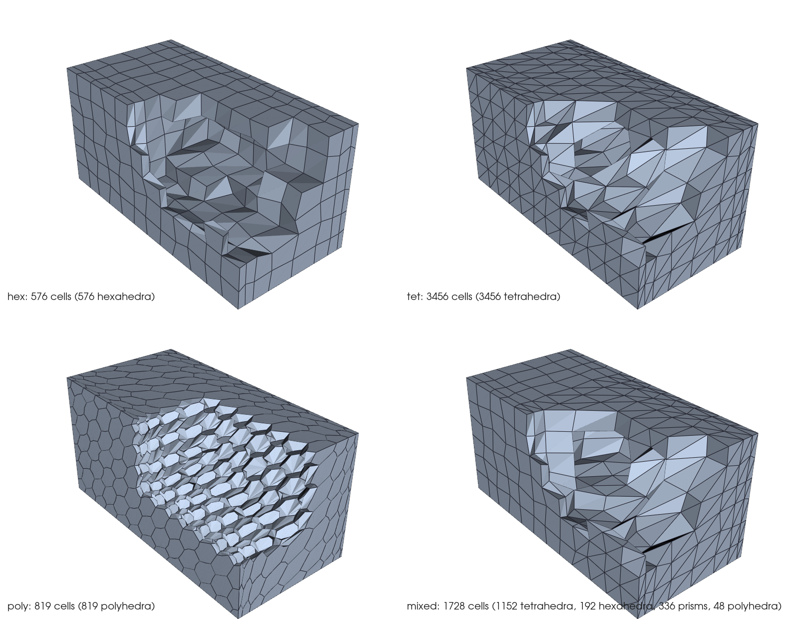
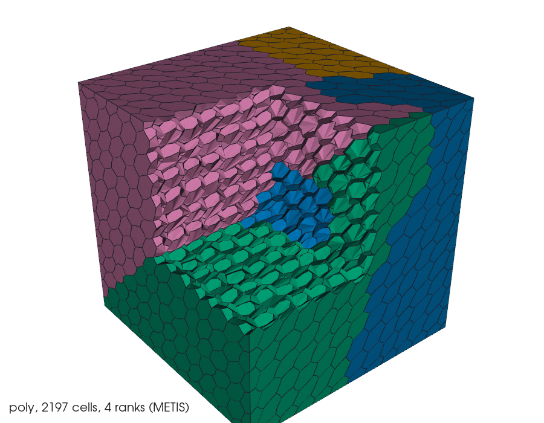
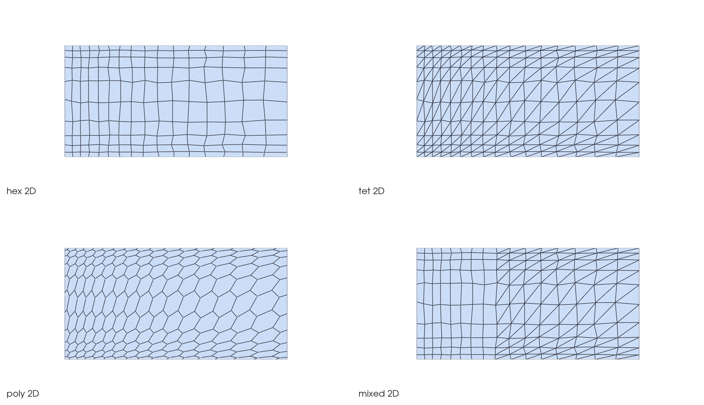
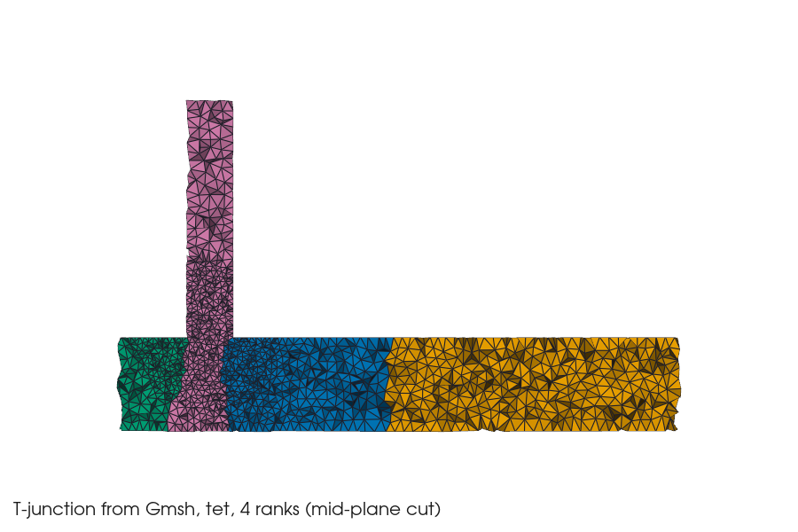
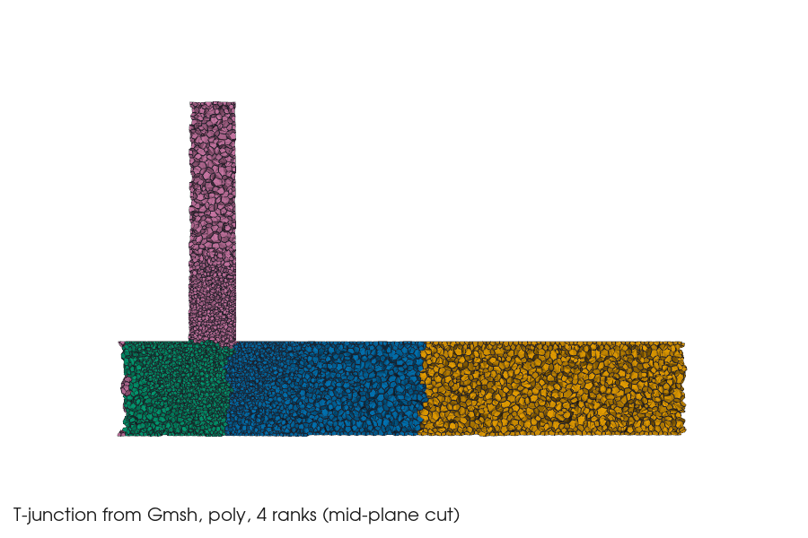
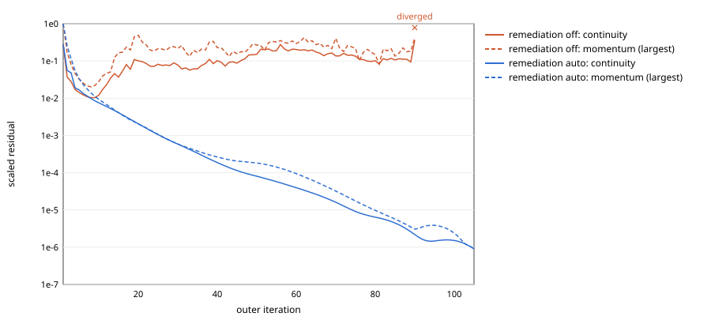

# Meshes

Part of the [Example gallery](../gallery.md): the built-in test mesher in 2D and 3D, partitioning, the Gmsh reader and flow on poor Gmsh meshes.

| # | Example | Stage | Feature |
|---|---|---|---|
| 3 | [The four test-mesh types in 3D](#mesh-types-3d) | 1 | built-in mesher, grading, perturbation, quality report |
| 4 | [A polyhedral mesh in four parts](#poly-partition) | 1 | partitioning, halo layout, point location |
| 5 | [The four test-mesh types in 2D](#mesh-types-2d) | 1 | one-cell-thick 2D meshes, boundary renaming |
| 6 | [T-junction from Gmsh](#tjunction) | 1 | Gmsh reader, conversion to polyhedra, renumbering |
| 26 | [Flow on raw Gmsh tetrahedra: the cell-quality remediation](#skewed-tets) | 6 | skewed faces, Gauss pressure gradient, limiter, divergence report (D50, D63) |

---

<a id="mesh-types-3d"></a>
## 3. The four test-mesh types in 3D



The built-in test mesher (D34) makes four mesh types of the same box
2 × 1 × 1: hexahedra, tetrahedra (six per hexahedron), polyhedra (the dual
of the tetrahedral mesh, one cell per node) and a mixed mesh of hexahedra,
prisms and tetrahedra, with polyhedra where a hexahedron meets the
triangles of its neighbours. All four are clustered towards the walls
y = 0 and y = 1 (middle-to-wall ratio 4) and have perturbed nodes (15 % of
the local interval), so the geometry is never trivially orthogonal. Every
run writes the quality report (`mesh_report.md` and `.json`): closure of
every cell, total volume against the enclosed volume, non-orthogonality,
skewness, face warp, aspect and volume ratio, inverted faces and negative
volumes. All four meshes have the exact volume 2 and closure below 1e-15.

| | |
|---|---|
| Meshes | hex 576, tet 3 456, poly 819, mixed 1 728 cells |
| Case files | `mesh/hex_box.toml`, `mesh/tet_box.toml`, `mesh/poly_box.toml`, `mesh/mixed_box.toml` |

```
cargo build --release -p foehncraft-cli
for t in hex tet poly mixed; do
  target/release/foehn mesh examples/cases/mesh/${t}_box.toml
done
# output/<case>/mesh_report.md, mesh_report.json, mesh.vtkhdf (open in ParaView)
python3 -m tools.mesh.render_mesh output/poly_box/mesh.vtkhdf poly_box.png --cut
```

[↑ back to top](#meshes)

---

<a id="poly-partition"></a>
## 4. A polyhedral mesh in four parts



A polyhedral mesh of the unit cube (2 197 cells, nodes perturbed by 20 %)
split into four parts with METIS (D32), one colour per rank. Each part is
laid out as solver ranks will see it: inner cells, then cells touching the
halo, then the halo cells by source rank, each group in reverse
Cuthill-McKee order; faces inner, processor, then boundary by boundary. The
report lists the cells, halo cells, processor faces and neighbours of each
rank (imbalance 1.001, 1 230 cut faces). The point-location test of D47
throws 5 000 random points and finds each one by walking from a random cell
through the faces; all 5 000 are found in the right cell.

| | |
|---|---|
| Mesh | poly, 12 × 12 × 12 base grid, 2 197 cells |
| Case file | `mesh/poly_partition.toml` |

```
target/release/foehn mesh examples/cases/mesh/poly_partition.toml
target/release/foehn mesh examples/cases/mesh/poly_partition.toml --method rcb --parts 6
python3 -m tools.mesh.render_mesh output/poly_partition/mesh.vtkhdf part.png --cut --field rank --categorical
```

[↑ back to top](#meshes)

---

<a id="mesh-types-2d"></a>
## 5. The four test-mesh types in 2D



2D meshes are one cell thick in z (D3): quadrilaterals become hexahedra,
triangles become prisms, polygons become prismatic polyhedra. The mixed
mesh combines both. Clustering towards x = 0 and towards the walls, nodes
perturbed in x and y. The case files rename the generator's boundaries
(`xmin` to `inlet` and so on) with a `[mesh.boundaries]` table; `zmin` and
`zmax` take the symmetry condition in a 2D case.

| | |
|---|---|
| Meshes | hex 160, tet 320, poly 187, mixed 240 cells |
| Case files | `mesh/hex_2d.toml`, `mesh/tet_2d.toml`, `mesh/poly_2d.toml`, `mesh/mixed_2d.toml` |

```
for t in hex tet poly mixed; do
  target/release/foehn mesh examples/cases/mesh/${t}_2d.toml
done
python3 -m tools.mesh.render_mesh output/poly_2d/mesh.vtkhdf poly_2d.png --top
```

[↑ back to top](#meshes)

---

<a id="tjunction"></a>
## 6. T-junction from Gmsh





The T-junction mixer of stage 7 (D45) meshed with Gmsh
(`examples/meshes/tjunction.geo`, main pipe 100 mm diameter, branch 50 mm)
and read by the Gmsh v4 reader (D33). Physical groups become boundaries
(`inlet_main`, `inlet_branch`, `outlet`, `wall`) and the cell zone `fluid`.
The second case converts the 77 776 tetrahedra into 15 927 polyhedra, one
per node; on the curved wall the boundary faces follow the triangles of
the tetrahedral mesh, so both meshes have the same volume to the last
digit (8.310580753620e-3 m³). Both are renumbered by reverse
Cuthill-McKee and split into four parts. The point-location walk stops at
the curved, non-convex wall for some points (176 of 1 195); the bin search
finds those, none lands in a wrong cell.

| | |
|---|---|
| Meshes | tet 77 776 cells, poly 15 927 cells (7 to 23 faces, mean 15) |
| Case files | `mesh/tjunction_tet.toml`, `mesh/tjunction_poly.toml` |

```
gmsh -3 examples/meshes/tjunction.geo -format msh41 -o examples/meshes/tjunction.msh
target/release/foehn mesh examples/cases/mesh/tjunction_tet.toml
target/release/foehn mesh examples/cases/mesh/tjunction_poly.toml
python3 -m tools.mesh.render_mesh output/tjunction_poly/mesh.vtkhdf tj.png \
    --field rank --categorical --half --top --crop 0.2 0.8 -0.06 0.31
```

[↑ back to top](#meshes)

---

<a id="skewed-tets"></a>
## 26. Flow on raw Gmsh tetrahedra: the cell-quality remediation



Gmsh's tetrahedra without its optimisation pass contain faces of a
skewness above 0.9: the face centroid lies almost as far from the line
through the two cell centroids as the centroids lie apart, mostly in
tetrahedra with two faces on a curved wall. On such faces the
least-squares pressure gradient (in the momentum source, the Rhie–Chow
flux and the wall pressure) drives the steady SIMPLEC iteration away
from the solution. The pipe of `examples/meshes/pipe_gmsh_raw.geo`
(D = 0.1 m, L = 1 m, Re = 100, 1 572 tetrahedra, 28 faces above 0.9, the
largest 1.23) shows it: with `solver.remediation = "off"` the residuals
stall at 0.1, and in iteration 91 the pressure-correction matrix stops
being positive definite. The divergence report (D63) names the skewed
faces as the first cause (`DIV003`) with the fix
`solver.remediation="auto"`.

With the default `solver.remediation = "auto"` the solver measures the
faces at start-up, reports them (`MESH001`), switches to the Gauss
pressure gradient (the face sum of the face pressures, with the boundary
pressures) and the Venkatakrishnan limiter on the velocity gradients, says
so (`MESH002`, `flow.log`, `flow.md`) and converges in 105 iterations:

```
mesh quality: 28 faces with skewness above 0.9 (largest 1.233) in 44 cells; an optimised mesh avoids them (Gmsh: Mesh.OptimizeNetgen = 1)
cell-quality remediation (D50, solver.remediation = "auto"): solver.pressure_gradient: "least-squares" -> "gauss", solver.momentum.limiter: "none" -> "venkatakrishnan"
```

The switch is global, not per cell: treating only the cells at the
skewed faces (first-order convection, a Gauss gradient or a damped
correction there) did not converge on these meshes, because the error of
the pressure gradient travels with the pressure correction through the
whole domain. The Gauss pressure gradient keeps second order on
tetrahedra (observed 2.00 on the Poiseuille sweep), but it is less
accurate than least squares on smooth meshes (the lift of the cylinder
at Re = 20 is 3.5 % lower), so it stays a remedy for poor meshes and
least squares the default. A mesh without faces above
`solver.skewness_limit` (0.9) runs bitwise as before; none of the
catalogue cases has such faces.

The better cure is the mesh: `Mesh.OptimizeNetgen = 1` in the .geo file
(as in `examples/meshes/tjunction_netgen.geo`) removes the skewed faces.
The T-junction of gallery 6 has 461 faces above 0.9 in Gmsh's raw mesh
and none after the Netgen pass; a laminar run on the raw mesh diverged
without the remediation and converges with it, and the optimised mesh
runs unchanged.

| | |
|---|---|
| Mesh | `examples/meshes/pipe_gmsh_raw.msh`, 1 572 tetrahedra (in the repository) |
| Case file | `flow/pipe_gmsh_raw.toml` |
| Keys | `solver.remediation`, `solver.skewness_limit`, `solver.pressure_gradient` |

```
cargo build --release -p foehncraft-cli
target/release/foehn flow examples/cases/flow/pipe_gmsh_raw.toml --set solver.log_every=1
target/release/foehn flow examples/cases/flow/pipe_gmsh_raw.toml --set solver.remediation=off \
    --set solver.log_every=1 --out output/pipe_gmsh_raw_off
python3 -m tools.plot.residuals_chart pipe_gmsh_raw_residuals.svg \
    "output/pipe_gmsh_raw_off=remediation off" "output/pipe_gmsh_raw=remediation auto"
```

[↑ back to top](#meshes)
