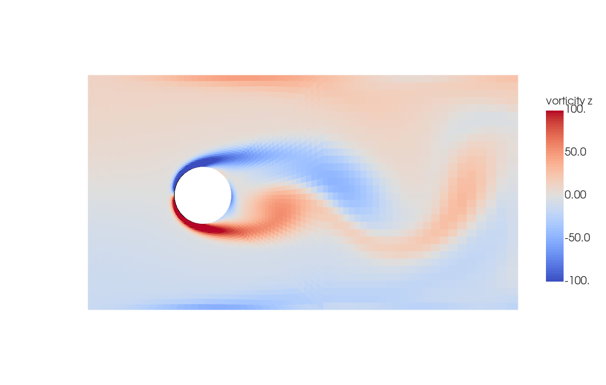

# Post-processing: derived fields

Part of the [Example gallery](../gallery.md): fields derived from the solution, written with the fields or afterwards from a restart file (D72).

| # | Example | Stage | Feature |
|---|---|---|---|
| 22 | [Derived fields: vorticity, Q, λ₂, wall shear stress and y⁺](#derived-fields) | 5 | `[output] derived`, `foehn post derive` |

---

<a id="derived-fields"></a>
## 22. Derived fields: vorticity, Q, λ₂, wall shear stress and y⁺




**Vortices behind a cylinder.** The short channel of
[gallery 21](boundary-conditions.md#boundary-conditions) at Re = 100,
t = 8 s, 4 928 cells. The run wrote only its restart file;
`foehn post derive` read it afterwards and wrote the fields with the
derived fields, the same numbers the run writes with `[output] derived`
(the two files are equal byte for byte). The vorticity shows the shear
layers leaving the cylinder and rolling up into the street of alternating
vortices; the Q criterion (the rotation rate beats the strain rate) marks
their cores. Q is also positive in the boundary layer on the curved
surface, where it is (u/r) ∂u/∂r: a property of the criterion, not a
vortex. On the cylinder wall, the boundary block of the file carries the wall
shear stress (largest 0.46 Pa) and y⁺ (at most 0.87).

```
target/release/foehn flow examples/cases/flow/cylinder_re100_short.toml --set run.restart_final=true
target/release/foehn post derive examples/cases/flow/cylinder_re100_short.toml \
    --set output.reference.velocity=1.0
# output/cylinder_re100_short/derived.vtkhdf: open it in ParaView
python3 -m tools.mesh.render_mesh output/cylinder_re100_short/derived.vtkhdf vorticity.png \
    --field vorticity_z --top --no-edges --diverging --range -100 100 --size 1100x700 --zoom 1.3
python3 -m tools.mesh.render_mesh output/cylinder_re100_short/derived.vtkhdf q.png \
    --field q_criterion --top --no-edges --range 0 1000 --size 1100x700 --zoom 1.3
```

**Exact on every mesh.** In plane Couette flow the velocity gradient is
constant, and the least-squares gradient reproduces it on any mesh, so
every derived field is exact: ω_z = −1/s, Q = λ₂ = 0 (shear is as much
strain as rotation), shear rate 1/s, wall shear stress μU/H = 0.1 Pa and
y⁺ = d √(τ_w/ρ)/ν from the wall distance d of each cell, to 1e-8 on
hexahedra, tetrahedra, polyhedra and the mixed mesh. On the Taylor–Green
vortex the vorticity, Q and λ₂ converge to the values of the exact
velocity gradient at second order (observed 2.3–2.7 on 16² to 64² cells).

```
target/release/foehn flow examples/cases/flow/couette_derived.toml
target/release/foehn post derive examples/cases/flow/couette_derived.toml
cmp output/couette_derived/fields.vtkhdf output/couette_derived/derived.vtkhdf && echo same
```

| Name in `derived` | Datasets | Unit |
|---|---|---|
| `vorticity` | `vorticity_x`, `vorticity_y`, `vorticity_z`, `vorticity_magnitude` | 1/s |
| `q-criterion` | `q_criterion`: ½ (‖Ω‖² − ‖S‖²) | 1/s² |
| `lambda2` | `lambda2`: the middle eigenvalue of S² + Ω² | 1/s² |
| `enstrophy` | `enstrophy`: ½ ω·ω | 1/s² |
| `strain-rate` | `strain_rate`: √(2 S:S) | 1/s |
| `pressure-coefficient` | `pressure_coefficient`: (p − p_ref)/(½ ρ_ref U_ref²) | - |
| `total-pressure` | `total_pressure`: p + ½ ρ u·u | Pa |
| `wall-shear-stress` | on the boundary blocks: `wall_shear_stress_x`, `_y`, `_z`, `wall_shear_stress_magnitude` | Pa |
| `y-plus` | on the boundary blocks: `y_plus` | - |

How to use them: [recipe 30](../recipes/post-processing.md#derived-fields).
