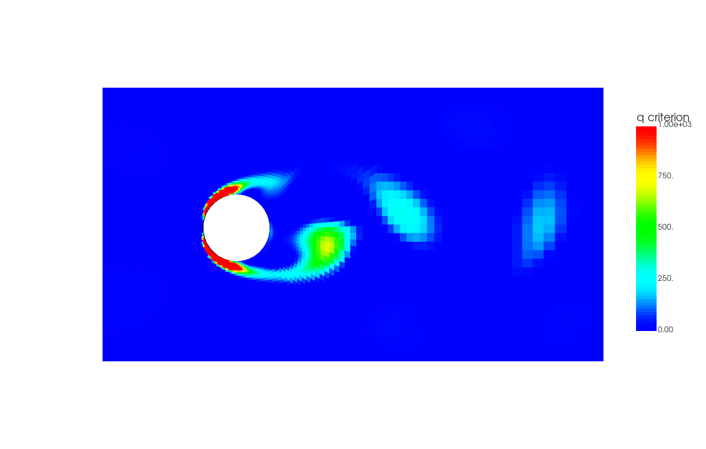
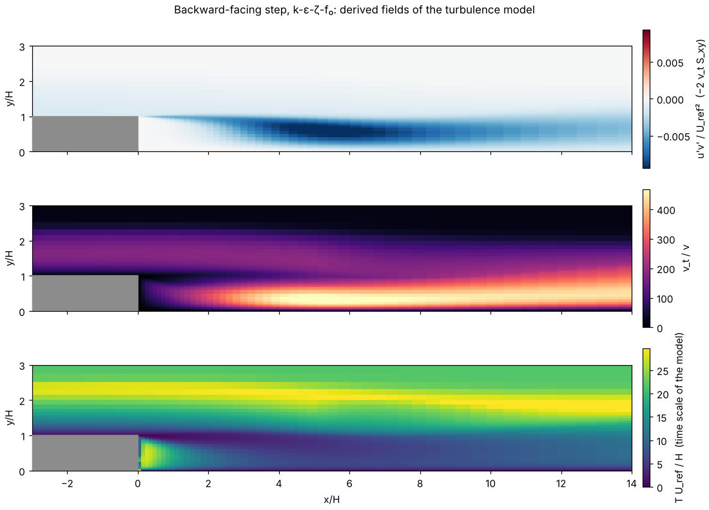
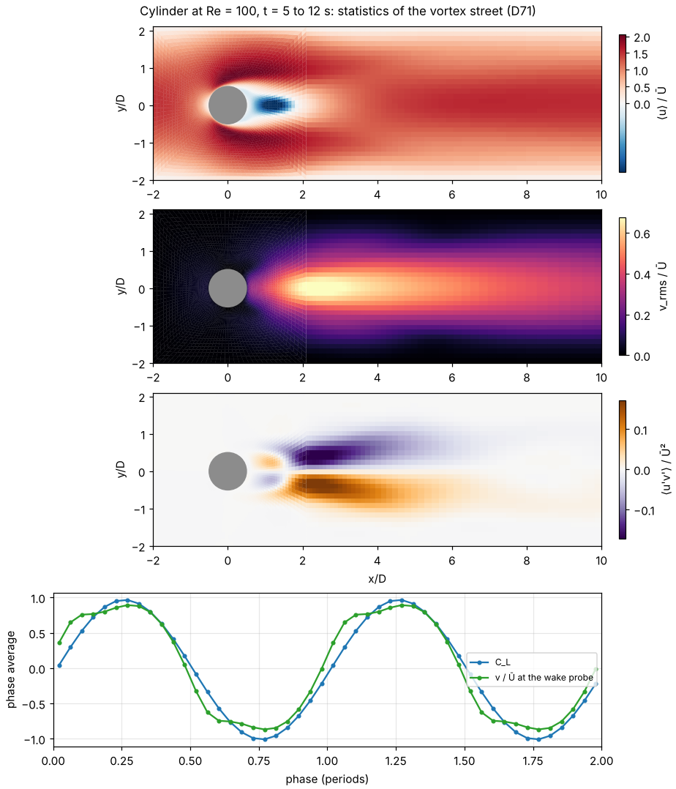

# Post-processing: derived fields and statistics

Part of the [Example gallery](../gallery.md): fields derived from the solution, written with the fields or afterwards from a restart file (D72), and the statistics of transient runs (D71).

| # | Example | Stage | Feature |
|---|---|---|---|
| 22 | [Derived fields: vorticity, Q, λ₂, wall shear stress and y⁺](#derived-fields) | 5 | `[output] derived`, `foehn post derive` |
| 108 | [Derived fields of the turbulence models: Reynolds stress, scales, wall values](#turbulence-derived-fields) | 6 | `turbulence-scales`, `reynolds-stress`, `wall-normal`, `turbulence-wall` |
| 110 | [Statistics of a transient run: the mean and the fluctuations of a vortex street](#transient-statistics) | 6 | `[output.statistics]` |

---

<a id="derived-fields"></a>
## 22. Derived fields: vorticity, Q, λ₂, wall shear stress and y⁺




**Vortices behind a cylinder.** The short channel of
[gallery 21](boundary-conditions.md#boundary-conditions) at Re = 100,
t = 8 s, 4 928 cells. The run wrote only its restart file;
`foehn post derive` read it afterwards and wrote the fields with the
derived fields, the same numbers the run writes with `[output] derived`
(the two files are equal byte for byte). The vorticity shows the shear
layers leaving the cylinder and rolling up into the street of alternating
vortices; the Q criterion (the rotation rate beats the strain rate) marks
their cores. Q is also positive in the boundary layer on the curved
surface, where it is (u/r) ∂u/∂r: a property of the criterion, not a
vortex. On the cylinder wall, the boundary block of the file carries the wall
shear stress (largest 0.46 Pa) and y⁺ (at most 0.87).

```
target/release/foehn flow examples/cases/flow/cylinder_re100_short.toml --set run.restart_final=true
target/release/foehn post derive examples/cases/flow/cylinder_re100_short.toml \
    --set output.reference.velocity=1.0
# output/cylinder_re100_short/derived.vtkhdf: open it in ParaView
python3 -m tools.mesh.render_mesh output/cylinder_re100_short/derived.vtkhdf vorticity.png \
    --field vorticity_z --top --no-edges --diverging --range -100 100 --size 1100x700 --zoom 1.3
python3 -m tools.mesh.render_mesh output/cylinder_re100_short/derived.vtkhdf q.png \
    --field q_criterion --top --no-edges --range 0 1000 --size 1100x700 --zoom 1.3
```

**Exact on every mesh.** In plane Couette flow the velocity gradient is
constant, and the least-squares gradient reproduces it on any mesh, so
every derived field is exact: ω_z = −1/s, Q = λ₂ = 0 (shear is as much
strain as rotation), shear rate 1/s, wall shear stress μU/H = 0.1 Pa and
y⁺ = d √(τ_w/ρ)/ν from the wall distance d of each cell, to 1e-8 on
hexahedra, tetrahedra, polyhedra and the mixed mesh. On the Taylor–Green
vortex the vorticity, Q and λ₂ converge to the values of the exact
velocity gradient at second order (observed 2.3–2.7 on 16² to 64² cells).

```
target/release/foehn flow examples/cases/flow/couette_derived.toml
target/release/foehn post derive examples/cases/flow/couette_derived.toml
cmp output/couette_derived/fields.vtkhdf output/couette_derived/derived.vtkhdf && echo same
```

| Name in `derived` | Datasets | Unit |
|---|---|---|
| `vorticity` | `vorticity_x`, `vorticity_y`, `vorticity_z`, `vorticity_magnitude` | 1/s |
| `q-criterion` | `q_criterion`: ½ (‖Ω‖² − ‖S‖²) | 1/s² |
| `lambda2` | `lambda2`: the middle eigenvalue of S² + Ω² | 1/s² |
| `enstrophy` | `enstrophy`: ½ ω·ω | 1/s² |
| `strain-rate` | `strain_rate`: √(2 S:S) | 1/s |
| `pressure-coefficient` | `pressure_coefficient`: (p − p_ref)/(½ ρ_ref U_ref²) | - |
| `total-pressure` | `total_pressure`: p + ½ ρ u·u | Pa |
| `wall-shear-stress` | on the boundary blocks: `wall_shear_stress_x`, `_y`, `_z`, `wall_shear_stress_magnitude` | Pa |
| `y-plus` | on the boundary blocks: `y_plus` | - |

How to use them: [recipe 30](../recipes/post-processing.md#derived-fields).

---

<a id="turbulence-derived-fields"></a>
## 108. Derived fields of the turbulence models: Reynolds stress, scales, wall values



**What the model carries.** The step of
[gallery 74](turbulence.md#zeta-f0) (Driver & Seegmiller, Re_H = 36 000,
k-ε-ζ-f₀, 8 200 cells, 1 500 iterations, 66 s) kept its restart
file; `foehn post derive` added the quantities of the turbulence model.
The Reynolds shear stress −2 ν_t S_xy grows along the shear layer that
leaves the step corner and is largest, −0.011 U_ref², at x/H 4 to 7, just
upstream of the reattachment at 6.4 H; the eddy viscosity is largest near
the lower wall downstream of the reattachment, where the new boundary
layer grows under the turbulent remains of the shear layer (ν_t/ν up to
490); the time scale of the model is short in the shear layer and long in
the slowly decaying free stream and the recirculation bubble.

```
target/release/foehn flow examples/cases/flow/backstep_zeta_f0.toml --set run.restart_final=true
target/release/foehn post derive examples/cases/flow/backstep_zeta_f0.toml \
    --fields turbulence-scales,reynolds-stress,turbulence-wall
python3 -m tools.plot.turbulence_fields turbulence_derived.png \
    output/backstep_zeta_f0/derived.vtkhdf
```

| Name in `derived` | Datasets | Unit |
|---|---|---|
| `turbulence-scales` | `dissipation_rate` ε (β* k ω for SST), `specific_dissipation_rate` ω (ε/(C_μ k) for the ε models), `time_scale` T of the model (1/(β* ω), k/ε, or the bounded T of ζ-f and EB), `length_scale` k^{3/2}/ε, `viscosity_ratio` ν_t/ν | m²/s³, 1/s, s, m, - |
| `reynolds-stress` | `reynolds_stress_xx`, `_yy`, `_zz`, `_xy`, `_yz`, `_xz`: ⅔ k δᵢⱼ − 2 ν_t Sᵢⱼ | m²/s² |
| `wall-normal` | `wall_normal_x`, `_y`, `_z`: ∇α/\|∇α\| of the elliptic-blending k-ε | - |
| `turbulence-wall` | on the boundary blocks: `friction_velocity` u_τ of the wall treatment, `y_star` = d C_μ^¼ k_P^½/ν, `blending` the viscous weight of the wall treatment (1 where the wall is resolved, `low-re` and the sublayer of `standard`; 1 − tanh((y⁺/5)²) of `automatic`; e^{−Γ} of `compound`; Γ = dU⁺/dy⁺ of `compound-2023`; 0 in the log layer and for `scalable`) (since PR #130) | m/s, -, - |

**Checked on the channel** of every model family (SST, k-ε, EB;
`tests/turbulence_derived.rs`): ε = C_μ k ω, T and L from their
definitions, the trace of the Reynolds stress 2k, u'v' negative below the
centre line and positive above, u_τ that of the wall treatment, and the
EB wall normal a unit vector pointing away from the nearer wall.

How to use them: [recipe 108](../recipes/post-processing.md#turbulence-derived-fields).

---

<a id="transient-statistics"></a>
## 110. Statistics of a transient run: the mean and the fluctuations of a vortex street



**What a time mean shows.** The vortex street of
[gallery 22](post-processing.md#derived-fields) (Schäfer & Turek 2D-2,
Re = 100, 6 144 cells, `cylinder_re100_statistics.toml`) averaged with
`[output.statistics]` over the 20.7 shedding periods from t = 5 to 12 s
(7 495 steps, 4 min on one core of the cloud machine). The mean flow
has a closed recirculation bubble reaching 1.3 D behind the cylinder,
which no instant of the street shows; the RMS of v is largest on the wake
axis where the vortices of both sides pass in turn; ⟨u'v'⟩, the resolved
Reynolds shear stress, is negative in the upper and positive in the lower
shear layer and carries the momentum that closes the bubble. The phase
averages over the shedding period 0.3384 s fold the 20 periods into one
cycle of 24 bins: the lift and the cross-flow velocity in the wake move
together.

```
target/release/foehn flow examples/cases/flow/cylinder_re100_statistics.toml
python3 -m tools.plot.statistics_fields transient_statistics.png \
    output/cylinder_re100_statistics/statistics.vtkhdf \
    output/cylinder_re100_statistics/statistics_phase.csv
```

| Series (`statistics.csv`) | Mean ± 95 % | RMS | r1 | Verdict |
|---|---|---|---|---|
| `coefficients.cd` | 3.20207 ± 1.0e-4 | 0.0208 | +0.65 | `sufficient` (by the tolerance) |
| `coefficients.cl` | −0.0104 ± 5.4e-5 | 0.700 | +0.26 | `sufficient` |
| `probes.wake.u` (3 D behind the centre) | 0.9539 ± 3.0e-4 | 0.166 | +0.51 | `sufficient` (by the tolerance) |
| `probes.wake.v` | 0.0234 ± 7.6e-5 | 0.686 | −0.20 | `sufficient` |

The ten batches hold two periods each. The drag and the streamwise
velocity oscillate at twice the shedding frequency and still drift by
about 10⁻⁴ between batches, so their batch means are correlated; the
interval, widened for that correlation, is below 0.1 % of the value, and
the `tolerance` passes them. The benchmark of the case is unchanged (C_D,max
3.232, St 0.2955 inside the reference ranges). The decaying Taylor–Green
vortex, a trend, is `too short` with warning STAT001
([verification](../verification/stage6.md#statistics-of-transient-runs-d71-pr-110)).

How to use it: [recipe 110](../recipes/post-processing.md#transient-statistics).
