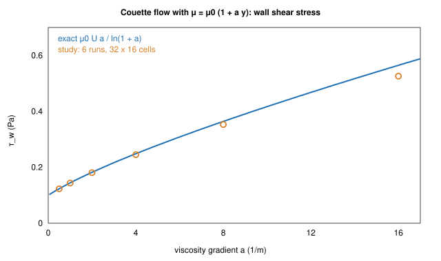

# Python

Part of the [Example gallery](../gallery.md): cases built, run and studied from Python (D61, D62), on the same engine as the `foehn` command line.

| # | Example | Stage | Feature |
|---|---|---|---|
| 24 | [A parametric study from Python: Couette flow with a viscosity gradient](#python-study) | 5 | `foehncraft` package: `Case`, expressions, `run`, callbacks, `Result`, `study` |

---

<a id="python-study"></a>
## 24. A parametric study from Python: Couette flow with a viscosity gradient



**Six runs, one table.** `examples/studies/couette_viscosity_study.py`
takes `couette_viscosity.toml` (gallery 23) as the base case and varies
the viscosity gradient a from 0.5 to 16 1/m (`constants.a`, and
`analytic.gradient` for the exact solution). The study writes a case file
per variant (`v0000/v0000.toml` …), runs each in process, and collects
the numbers of every run into `study.csv`: status, iterations, residuals,
velocity errors, and per boundary the mass flow, mean pressure and force.
The wall shear stress (force on the lower wall over its area) follows the
exact τ = μ0 U a / ln(1 + a); on 32 × 16 cells it is 0.17 % low at
a = 0.5 and 6.9 % low at a = 16, where the viscosity changes by a factor
of 17 across the channel and the one-sided wall gradient sees the
steepest velocity; one refinement brings the a = 16 value to 2.1 %. The
study takes 5 s; run again, it reads the finished variants back
(resume).

```
pip install ./python
python examples/studies/couette_viscosity_study.py output/couette_study \
    --chart docs/figures/gallery/python_study.svg
```

**A case built in Python.** `examples/python/poiseuille_inflow.py`
replaces the analytic inflow of `poiseuille_hex.toml` with a profile
built from expression objects, `6 * u_mean * (y / h) * (1 - y / h)`, and
runs it with a callback that sees every outer iteration and stops the run
once the continuity residual is below 1e-8 (stopped after 145 iterations,
with the restart file and the final output). The case file the package
writes is the run: the same case written by hand gives the same fields
bit for bit, in process and through the command line.

```
python examples/python/poiseuille_inflow.py output/poiseuille_py
target/release/foehn flow output/poiseuille_py/poiseuille_py.toml   # the same run
```

How to use it: [recipe 33](../recipes/python.md#python-api).
