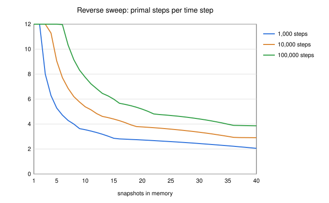
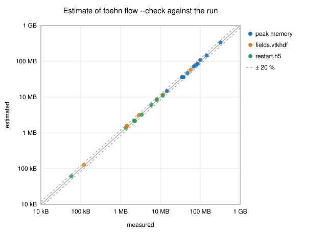

# Run control, health and adjoint readiness

Part of the [Example gallery](../gallery.md): adjoint-ready kernels, runs that a program drives, balances and the divergence report.

| # | Example | Stage | Feature |
|---|---|---|---|
| 17 | [Adjoint-ready kernels: derivatives and checkpointing](#adjoint-ready) | 5 | dual numbers through the kernel bodies, transposed matrices, binomial checkpointing |
| 18 | [A run that a program can drive](#run-contract) | 5 | `--json`, exit codes, `--set`, limits, signals, `--restart latest`, diagnostic codes, estimate before the run, byte-identical files |
| 19 | [Balances and the divergence report](#health) | 5 | mass and kinetic-energy ledger, numerical dissipation of the schemes (second law), divergence report with ranked causes |
| 27 | [A log that can be circulated](#log) | 5 | frames, blocks of settings, tables with headers, summaries, closing frame with exit code (D125) |
| 28 | [A table with the columns you choose](#log-columns) | 5 | `[log] columns`: probes, cells, extremes with their cells, boundary mass flow; the same content in `run.jsonl` (D125) |
| 29 | [Settings that change during the run](#schedule) | 5 | `[[schedule]]`: under-relaxation, tolerances and cadences change at prepared iterations, steps or times; every change in the log and in `run.jsonl` (D128) |

---

<a id="adjoint-ready"></a>
## 17. Adjoint-ready kernels: derivatives and checkpointing



Preparation for a discrete adjoint solver (D59, L17). The kernel bodies are
generic over the floating-point type, so they also run on dual numbers and
return the exact derivatives of their results; matrices can be applied
transposed as a gather; and a transient run can be reversed with few
states in memory.

The chart shows the cost of reversing a transient run with binomial
checkpointing (Griewank & Walther 2000): with 20 snapshots, the reverse
sweep of 10 000 time steps runs each step 3.8 times on average and never
more than 4 times; with 40 snapshots, 100 000 steps cost 3.9 primal steps
each (values above 12 drawn at 12). The schedule is optimal: its count of
recomputed steps equals that of a dynamic program over all positions of
the snapshots.

| Check | Result |
|---|---|
| Jacobians of 11 face, cell and boundary kernels from dual numbers, every input array, against central differences | 320 580 derivatives, largest relative difference 5.0e-7 |
| Shape derivatives of areas, centroids and volumes from the node coordinates | 165 024 derivatives, 2.8e-7; total volume unchanged by interior nodes |
| ⟨Av, w⟩ = ⟨v, Aᵀw⟩ on the momentum and pressure matrices of a SIMPLEC solve | to 10⁻¹⁴; Aᵀ without storing it equals the stored Aᵀ bit for bit, on 1 and 4 threads |
| CG + multigrid and BiCGStab on Aᵀ | converged to 10⁻¹⁰ |
| Reverse sweep of 13 BDF2 steps with 2 snapshots | every level bitwise equal to the forward run, 24 primal steps (the optimum) |

| | |
|---|---|
| Code | `foehncraft_core::Dual`, `foehncraft_kernels::adjoint`, `foehncraft_flow::checkpoint`, `foehncraft_mesh::geometry` (generic over `Coord`) |
| Tests | `crates/foehncraft-flow/tests/adjoint.rs`, `crates/foehncraft-flow/src/adjoint_tests.rs`, `checkpoint.rs`, `geometry.rs` |
| Report | [stage 5, part 3](../verification/stage5.md#adjoint-ready-kernels-part-3) |

```
cargo test --release -p foehncraft-flow --test adjoint -- --nocapture   # Jacobians, one line per kernel
cargo test --release -p foehncraft-flow --lib -- adjoint_tests checkpoint   # transposed matrices, checkpointing
python3 -m tools.plot.checkpoint_chart checkpoint_steps.svg
```

[↑ back to top](#run-control-health-and-adjoint-readiness)

---

<a id="run-contract"></a>
## 18. A run that a program can drive



A parametric study, a batch job or an agent drives `foehn` without
reading its log: it sets keys with `--set`, reads one JSON object, acts on
the exit code and continues a stopped run with `--restart latest`. Before
it starts a run, `--check` tells it what the run will cost. The chart
shows that estimate against eleven runs of the catalogue, from 128 to
28 227 cells, hexahedra to polyhedra: peak memory within 6 %, field and
restart files within 9 %. The memory model is a base of 14 MB plus
1960 bytes per interior face and 710 per boundary face.

```
$ foehn --json flow cavity_re100_budget.toml --set run.limits.max_iterations=300; echo "exit $?"
{
  "format": "foehncraft.result",
  "format_version": "1.0",
  "status": "stopped",
  "exit_code": 3,
  "stop": { "code": "RUN004", "kind": "iterations", "message": "stopped at the limit of 300 outer iterations ([run.limits] max_iterations)" },
  ...
exit 3
$ foehn --json flow cavity_re100_budget.toml --restart latest; echo "exit $?"
  ...
  "status": "finished",
exit 0
```

| Check | Result |
|---|---|
| Stop at a limit or on SIGTERM, then `--restart latest` | fields and restart file bitwise equal to the run without the stop (steady and transient) |
| Two identical runs | `result.json`, `fields.vtkhdf`, `restart.h5` and every CSV byte for byte the same; only the log, the reports and `run.jsonl` (timings) differ |
| Exit codes | 0 finished, 1 error (as a JSON object with code and key), 2 failed check (`RUN006`, `RUN007`), 3 stopped (`RUN001`–`RUN005`) |
| A typo in the case file | `CASE002` with the key `mesh.generate.cels`, line 4, column 1 and "did you mean `cells`" |
| The 20 flow cases of the catalogue, this build against main | every field, CSV and JSON value bitwise equal; the resolved case gains the empty `[run.limits]` table |

| | |
|---|---|
| Code | `foehncraft_flow::engine` (run, check, estimate, limits, result, run record), `diag` (codes), `schema` (JSON Schema), `foehncraft-cli` |
| Tests | `crates/foehncraft-cli/tests/run_contract.rs`, unit tests in `engine.rs`, `diag.rs`, `schema.rs` |
| Formats | [interfaces.md](../interfaces.md), [keys.md](../keys.md) |
| Case | `examples/cases/flow/cavity_re100_budget.toml` |
| Recipe | [26](../recipes/runs.md#run-contract) |

```
cargo test --release -p foehncraft-cli --test run_contract
python3 -m tools.plot.estimate_chart estimate.svg
```

[↑ back to top](#run-control-health-and-adjoint-readiness)

---

<a id="health"></a>
## 19. Balances and the divergence report


Every run books mass and kinetic energy: what flows and works through
each boundary, what the body force adds, what viscosity dissipates, and what
is left, the dissipation of the numerical schemes. The second law asks
that this rest is not negative. In the steady lid-driven cavity the lid
works on the fluid and everything ends up as dissipation; the schemes take
about 1.5 % of it, falling slowly with the mesh because the two corners
where the lid meets the walls are singular. The ledger splits the rest in
two: the pressure part, which the momentum interpolation of the face
fluxes dissipates, and the part of the convection and time schemes. In
the cavity the pressure part is nearly all of it and stays of the same
size at the singular corners, while the linear-upwind correction gives
back a little, less with every refinement. On the smooth Taylor–Green
vortex both parts are positive: the numerical dissipation falls with
order 2.5, its pressure part with order 3.

```
$ foehn flow cavity_re100_energy.toml
      balance of the final state
        kinetic energy
          ymax viscous work in                         +2.919438e-3 W
          viscous dissipation                          +2.877098e-3 W
          storage                                       +0.000000e0 W
          numerical dissipation (+1.45e-2)             +4.234029e-5 W
            of it pressure                             +5.115046e-5 W
            of it schemes                              -8.810171e-6 W
```

When a run diverges it keeps its last valid state and says why:

```
$ foehn flow cavity_re1000.toml --set 'solver.algorithm="simple"' --set solver.momentum.relaxation=0.99 --set solver.pressure.relaxation=1.0
      DIVERGED in outer iteration 16: 1 failing cells, velocity first; report in divergence.md
        DIV002 under-relaxation (0.80): relaxation factors velocity 0.99, pressure 1 (SIMPLE); try --set solver.momentum.relaxation=0.69 --set solver.pressure.relaxation=0.31
        DIV006 linear solve (0.60): momentum BiCGStab at its limit of 50 iterations; try --set solver.momentum.max_iter=100
Error RUN014: the solution diverged in outer iteration 16 ...
```

| Check | Result |
|---|---|
| Cavity Re 100, 16² to 128² | numerical dissipation 2.05 %, 1.59 %, 1.45 %, 1.33 % of the lid power, positive; pressure part 7.6e-5 to 5.0e-5 W, scheme part −3.6e-5 to −4.4e-6 W; mass ledger zero |
| Taylor–Green, 16² to 64², fixed Courant number | numerical dissipation 4.1e-4, 7.4e-5, 1.2e-5 J over 0.4 s (pressure part 1.3e-4, 1.6e-5, 1.4e-6 J); mass imbalance at round-off |
| Steady divergence (SIMPLE, no relaxation) | `RUN014`, the first cause is the relaxation; its fix runs |
| Transient divergence (time step 100 times too large) | the first cause is the time step, with a smaller one as the fix |
| The catalogue against part 4a | fields, CSV files and report values bitwise equal; one new warning, `BAL003` on the Courant-10 Taylor–Green sweep |

| | |
|---|---|
| Code | `foehncraft_flow::balance` (ledger, tables, CSV, chart), `divergence` (analysis, snapshot, report), `simplec::Flow::keep_valid`, `rewind` |
| Tests | `crates/foehncraft-flow/tests/health.rs`, unit tests in `balance.rs`, `divergence.rs` |
| Formats | [interfaces.md](../interfaces.md#conservation-ledger-d88-d89-d90-part-4) |
| Case | `examples/cases/flow/cavity_re100_energy.toml` |
| Recipe | [27](../recipes/runs.md#health) |

```
cargo test --release -p foehncraft-flow --test health
python3 -m tools.plot.energy_budget_chart energy_budget.svg
```

[↑ back to top](#run-control-health-and-adjoint-readiness)

---

<a id="log"></a>
## 27. A log that can be circulated

Part of what a run says about itself (D125): the log shows what the case file set, so a log mailed on its own is enough to see the run. The log opens with the name of the code in block letters with depth; every block is a box of asterisks as wide as its content, centred on the page (no colour, no fixed width: the banner is 141 columns, the other blocks fit their text); the console and `flow.log` are identical. Excerpt of the transient cavity (Re 100, 64 x 64, BDF2), blocks between the banner and the table, most time steps and the lower summaries left out:

```
*********************************************************************************************************************************************
*                                                                                                                                           *
*                  __________                          ____                                                             _______      ____   *
*                /::::::::/ /                        /::/ /                                                           /:::::/ /    /::/ /   *
*               /:::_____/_/                        /::/ /                                                           /:::__/_/    /::/ /    *
*              /::/ /                              /::/ /                                                           /::/ /       /::/ /     *
*             /::/ /     __________   __________  /::/_______   __________   __________   _______   __________   __/::/____   __/::/____    *
*            /::/ /    /::::::::/ / /::::::::/ / /::::::::/ / /::::::::/ / /::::::::/ / /:::::/ / /::::::::/ / /::::::::/ / /::::::::/ /    *
*           /::/____  /:::__:::/ / /:::__:::/ / /:::__:::/ / /:::__:::/ / /:::_____/_/ /:::__/_/ /_____:::/ / /__::::__/_/ /__::::__/_/     *
*          /:::::/ / /::/ //::/ / /::/ //::/ / /::/ //::/ / /::/ //::/ / /::/ /       /::/ /          /::/ /    /::/ /       /::/ /         *
*         /:::__/_/ /::/ //::/ / /::/__/::/ / /::/ //::/ / /::/ //::/ / /::/ /       /::/ /     _____/::/ /    /::/ /       /::/ /          *
*        /::/ /    /::/ //::/ / /::::::::/ / /::/ //::/ / /::/ //::/ / /::/ /       /::/ /    /::::::::/ /    /::/ /       /::/ /           *
*       /::/ /    /::/ //::/ / /:::_____/_/ /::/ //::/ / /::/ //::/ / /::/ /       /::/ /    /:::__:::/ /    /::/ /       /::/ /            *
*      /::/ /    /::/ //::/ / /::/ /       /::/ //::/ / /::/ //::/ / /::/ /       /::/ /    /::/ //::/ /    /::/ /       /::/ /             *
*     /::/ /    /::/__/::/ / /::/_______  /::/ //::/ / /::/ //::/ / /::/_______  /::/ /    /::/__/::/ /    /::/ /       /::/____            *
*    /::/ /    /::::::::/ / /::::::::/ / /::/ //::/ / /::/ //::/ / /::::::::/ / /::/ /    /::::::::/ /    /::/ /       /:::::/ /            *
*   /__/_/    /________/_/ /________/_/ /__/_//__/_/ /__/_//__/_/ /________/_/ /__/_/    /________/_/    /__/_/       /_____/_/             *
*                                                                                                                                           *
*********************************************************************************************************************************************
*   Version                            0.5.0  (build ae35d5c-dirty)                                                                         *
*   Date and time                      2026-11-16 21:43:19 UTC                                                                              *
*   Host name                          vm                                                                                                   *
*   Platform                           linux-x86_64, Intel(R) Xeon(R) Processor @ 2.10GHz                                                   *
*   Features                           hdf5, metis                                                                                          *
*   Threads / backend                  4 / cpu                                                                                              *
*********************************************************************************************************************************************

  ...

                                   **********************************************************************
                                   *         1. TIME STEP     TIME = 1.00000E-01     DT = 1.00000E-01   *
                                   *            COURANT NUMBER = 4.645     OUTER ITERATIONS = 1         *
                                   **********************************************************************

         -- time ------------------- -- scaled residuals ----------------- -- solvers --
    Step    Time [s]   Dt [s] Cour.       ResU     ResV     ResW     ResM   Outer    CG 
       1  1.0000E-01 1.00E-01 4.645   1.00E+00 0.00E+00 0.00E+00 6.33E-02       1    22
      balance  mass +0.00e0  kinetic energy: dK/dt +9.006e-4 W, boundary +1.332e-2 W, dissipation 1.217e-2 W, numerical +2.505e-4 W (+1.9e-2)

  ...

                       **********************************************************************************************
                       *                                                                                            *
                       *   Time stepping:                                                                           *
                       *                                                                                            *
                       *   Status                             DONE: 500 steps to t = 5.00000E+01 s                  *
                       *   Time step                          1.000E-01 to 1.000E-01 s                              *
                       *   Largest Courant number             6.095                                                 *
                       *   Solve time                         21.74 s  (setup 0.02 s, 10618 ns per cell and step)   *
                       *                                                                                            *
                       **********************************************************************************************

          ************************************************************************************************************************
          *                                                                                                                      *
          *   Run finished: every check passed                                                                                   *
          *                                                                                                                      *
          *   Exit code                          0                                                                               *
          *   Elapsed time                       0:00:22                                                                         *
          *   Results in                         /tmp/claude-0/-home-user/8486083e-90f2-5e7f-b60b-e659997a40c3/scratchpad/run5   *
          *   Report                             flow.md, result.json                                                            *
          *                                                                                                                      *
          ************************************************************************************************************************
```

Before the table, the log lists the input and output files, the run control, the mesh information with its quality, the fluid properties, the solution settings as a matrix per equation and the boundary conditions with their values. After it come the summaries: convergence or time stepping, verification, results per boundary, the ledger, the run time and the warnings. Each time step that is logged starts with a box (step, time, time step, Courant number, outer iterations), the summaries are boxes with a heading, blank rows and dashed rules. Messages read ` %FOEHN-I-CASE, text` (`I`, `W` or `E`, then the capitalised name of the source file that writes the message), so `%FOEHN` finds them in the log and in the code; a failed run ends with `Run FAILED: <code>`, the reason and the exit code. `[log] style = "box"` draws the boxes with box characters.

| | |
|---|---|
| Code | `crates/foehncraft-flow/src/console.rs`, `logblocks.rs`, `case.rs`, `unsteady.rs` |
| Tests | `crates/foehncraft-flow/src/console.rs` (frames, tables), `tests/health.rs`, `tests/stage5.rs` |
| Case files | every file of `examples/cases/flow/` |

```
target/release/foehn flow examples/cases/flow/cavity_re100_transient.toml
less output/cavity_re100_transient/flow.log
```

[↑ back to top](#run-control-health-and-adjoint-readiness)

---

<a id="log-columns"></a>
## 28. A table with the columns you choose

The table of iterations or time steps shows what the case asks for (D125). The cavity at Re = 100 with a probe in the lower-left vortex, the pressure in one cell, the largest velocity and the lowest pressure of the domain with the cell where each occurs, and the mass flow through the lid (`examples/cases/flow/cavity_re100_columns.toml`):

```
         -- scaled residuals --------------------- -- probe vortex -- cell 2000 -- extremes ----------------------------- -- mass flow -- run [s]
    Iter       ResU      ResV      ResW      ResM           Ux            P         Umax     cell       Pmin     cell         ymax      s/iter
       1  1.000E+00 0.000E+00 0.000E+00 1.453E-01   -6.842E-02   -2.911E-03    6.253E-01      248 -2.707E-01      240    0.000E+00           -
      10  3.704E-03 4.362E-03 0.000E+00 7.042E-03   -1.873E-01   -9.042E-03    7.868E-01      250 -2.703E-01      240    0.000E+00   1.796E-02
     ...
```

(The numbers are those of the 16 × 16 test cavity of the test suite, to show the layout; the case file runs on 64 × 64 cells.) A group heads the columns of one kind and target; an extreme gives two columns, its value and its cell. The table is as wide as the columns need; `[log] digits` sets the significant digits. The columns are read-only: the fields are not changed, so the run is bitwise the one without `[log] columns`.

The same content goes to `run.jsonl` (format 1.1): a `columns` row describes the table once, a `table_row` row carries the values of every line (an extreme carries its cell and the cell centre), and a `section` row carries every framed block of the log with label, value and unit. A monitor reads these rows and draws the blocks and the table without parsing text.

| | |
|---|---|
| Code | `crates/foehncraft-flow/src/logcols.rs`, `console.rs`, `case.rs`, `unsteady.rs` |
| Tests | `crates/foehncraft-flow/src/logcols.rs` (names), `crates/foehncraft-cli/tests/run_contract.rs` (`configurable_log_columns_change_no_result`) |
| Case files | `flow/cavity_re100_columns.toml` |

```
target/release/foehn flow examples/cases/flow/cavity_re100_columns.toml
tail -f output/cavity_re100_columns/run.jsonl      # the rows of a monitor
```

[↑ back to top](#run-control-health-and-adjoint-readiness)

---

<a id="schedule"></a>
## 29. Settings that change during the run

A whole run can be set up before it starts (D128). `[[schedule]]` lists the settings that change and the iteration, step or time from which the new value holds (`examples/cases/flow/cavity_re100_schedule.toml`):

```toml
[solver.momentum]
relaxation = 0.5               # cautious start

[[schedule]]
at_iteration = 100
set = { solver.momentum.relaxation = 0.9 }

[[schedule]]
at_iteration = 200
set = { solver.log_every = 10 }
```

The "Run control" frame lists the changes before the run, and every change is a line in the log when it takes effect:

```
 Scheduled: iteration 100          solver.momentum.relaxation = 0.9
 Scheduled: iteration 200          solver.log_every = 10
 ...
 [I] iteration 100: schedule (iteration 100): solver.momentum.relaxation: 0.5 -> 0.9
```

The same change is an `event` row of `run.jsonl` with the code `RUN015` and the fields `key`, `old` and `new`, so a monitor marks the iteration where the setting changed. The case file alone says what was run (the entries are part of the resolved case and of its hash), and a restart continues the schedule: entries before the restart point apply at once.

Which keys may be scheduled: those that a re-read of the case file may change during a run (D40) - relaxation factors, linear-solver tolerances and iteration limits, the stop and convergence criteria, the time step and its adaptive controls, the output, restart and balance cadences, `solver.log_every` - without the guard rails `run.limits.*` and `run.reread_every`. Anything that belongs to the state the run starts from (mesh, boundary values, schemes, fluid) is refused when the case is read, with the reason. A transient case uses `at_step` or `at_time` (the run lands a step on the time); steady `at_iteration`.

| | |
|---|---|
| Code | `crates/foehncraft-flow/src/schedule.rs`, `case.rs` (`schedule_step`), `unsteady.rs`, `control.rs` |
| Tests | `crates/foehncraft-flow/tests/schedule.rs`, `crates/foehncraft-cli/tests/run_contract.rs` (`schedule_changes_are_events_of_the_run_record`) |
| Case files | `flow/cavity_re100_schedule.toml` |

```
target/release/foehn flow examples/cases/flow/cavity_re100_schedule.toml
```

[↑ back to top](#run-control-health-and-adjoint-readiness)
