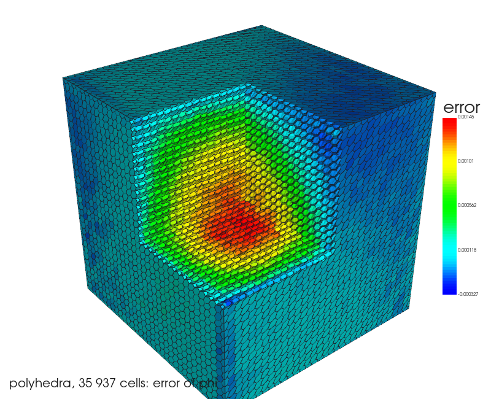
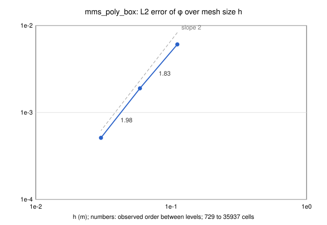
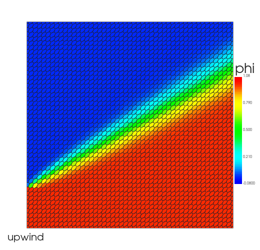
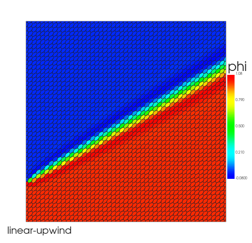
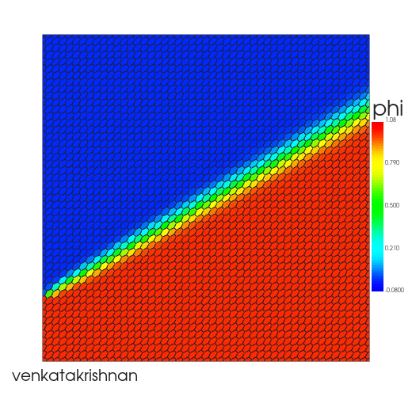
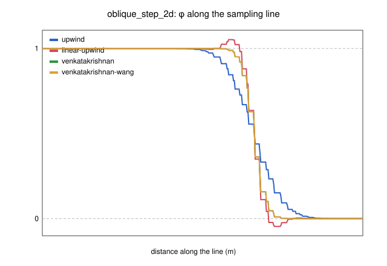
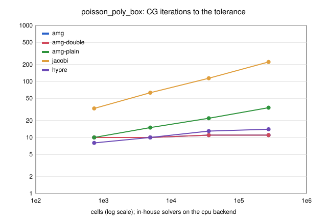

# Scalar transport and the pressure solver

Part of the [Example gallery](../gallery.md): convection–diffusion order of accuracy, convection schemes and limiters, the pressure multigrid.

| # | Example | Stage | Feature |
|---|---|---|---|
| 8 | [Convection–diffusion, manufactured solution](#scalar-mms) | 2 | least-squares gradients, linear upwind, non-orthogonal diffusion, BiCGStab, order of accuracy |
| 9 | [Oblique step: five convection schemes](#oblique-step) | 2, 5 | Venkatakrishnan and Venkatakrishnan–Wang limiters, bounded central scheme, bounded solutions |
| 10 | [Pressure solver: iterations over the mesh size](#poisson-iterations) | 3 | CG with smoothed-aggregation AMG, mixed precision, hypre reference |
| 11 | [Poisson manufactured solution with the multigrid](#poisson-amg-mms) | 3 | CG + AMG inside the outer iterations, non-orthogonal correction |

---

<a id="scalar-mms"></a>
## 8. Convection–diffusion, manufactured solution



Steady convection–diffusion of a scalar with a manufactured solution
(Roache 2002) on perturbed polyhedral meshes: φ = 1 + sin(πx + 0.5)
cos(πy + 0.3) cos(πz/2 + 0.2), u = (1, 0.6, 0.3) m/s, Γ = 0.2 kg/(m s),
fixed values of the exact solution on all six boundaries. The operators of
stage 2 at work: weighted least-squares gradients, linear upwind as a
deferred correction, diffusion with the over-relaxed non-orthogonal
correction, gather-based assembly into a sliced-ELL matrix, BiCGStab with
Jacobi. The picture is the error φ − φ_exact on the finest level; it is
largest in the interior, where the solution has its largest curvature.



The same case on hexahedra, tetrahedra, mixed cells and 2D polygons gives
observed orders between 1.87 and 2.08 on the finest pair; table and
discussion in [Stage 2 verification](../verification/stage2.md#order-of-accuracy).
On an NVIDIA GPU the operators give bitwise the CPU result: the 912 673-cell
case `mms_poly_gpu` on a Tesla T4 runs at 311 ns per cell and iteration
([GPU against CPU](../verification/stage2.md#gpu-against-cpu-tesla-t4-2026-11-14),
recipe 14).

| | |
|---|---|
| Meshes | generated poly 3D, base 4³ intervals, refine 1–3: 729, 4 913, 35 937 cells, perturb 0.15 |
| Machine | Intel Xeon @ 2.10 GHz, 4 virtual cores; 2.8 s for the three levels |
| Case files | `scalar/mms_poly_box.toml`, `mms_hex_box.toml`, `mms_tet_box.toml`, `mms_mixed_box.toml`, `mms_poly_2d.toml` |

```
cargo build --release -p foehncraft-cli
target/release/foehn scalar examples/cases/scalar/mms_poly_box.toml
# report: output/mms_poly_box/scalar.md, plot: convergence.svg, fields: fields.vtkhdf
python3 -m tools.mesh.render_mesh output/mms_poly_box/fields.vtkhdf mms_poly_error.png --field error --cut
```

[↑ back to top](#scalar-transport-and-the-pressure-solver)

---

<a id="oblique-step"></a>
## 9. Oblique step: five convection schemes

| first-order upwind | linear upwind, no limiter | linear upwind, Venkatakrishnan (K = 0) | bounded central (β = 0.5) |
|---|---|---|---|
|  |  |  |  |



Pure convection of a step at 30° to the x axis across 2 401 polygonal
prisms. Upwind is bounded but smears the step over many cells. Linear
upwind without a limiter is sharp but over- and undershoots by 7 % and
5 %. With the Venkatakrishnan limiter (and with Venkatakrishnan–Wang) at
K = 0 the step is as sharp as with linear upwind and φ stays in [0, 1].
The bounded central scheme of stage 5 (D25) takes the central face value
where the normalised variable of the upwind cell shows a smooth profile,
blends towards upwind near extrema and is upwind at them; on these
distorted polygons it needs the limiter of the upwind cell as well. It
stays in [0, 1] with a 10–90 % width of the step of 0.090 m (linear
upwind with the limiter 0.082 m, upwind 0.172 m). The run checks the
bounds of every limited variant and fails if one leaves [0, 1].

| | |
|---|---|
| Mesh | generated poly 2D, 48 × 48 intervals, perturb 0.1: 2 401 cells |
| Case file | `scalar/oblique_step_2d.toml` (five `[[variants]]`) |

```
target/release/foehn scalar examples/cases/scalar/oblique_step_2d.toml
# report: output/oblique_step_2d/scalar.md, profiles: profile.svg,
# fields per variant: output/oblique_step_2d/<variant>/fields.vtkhdf
python3 -m tools.mesh.render_mesh output/oblique_step_2d/venkatakrishnan/fields.vtkhdf step.png --field phi --top --range -0.08 1.08
```

[↑ back to top](#scalar-transport-and-the-pressure-solver)

---

<a id="poisson-iterations"></a>
## 10. Pressure solver: iterations over the mesh size



The Poisson equation −∇·(Γ∇φ) = s, the model of the pressure equation, on
perturbed polyhedral meshes from 729 to 274 625 cells, each solved from
φ = 0 to ‖b − Aφ‖ ≤ 1e-10 ‖b‖. CG with the smoothed-aggregation multigrid
of stage 3 needs 10 to 11 iterations on every level, in mixed precision
(float32 hierarchy) as in float64; hypre's BoomerAMG-PCG needs 8 to 14;
plain aggregation grows from 10 to 34 and Jacobi-CG from 33 to 223, the
growth of a method without a coarse-grid correction. All solutions agree
with hypre's to 1.3e-9 (relative), and each in-house solver gives bitwise
the same solution on 4 threads and on 1. The same holds on hexahedra,
tetrahedra and mixed meshes (10 to 13 iterations; table in
[Stage 3 verification](../verification/stage3.md#iterations-over-the-mesh-size)).

| | |
|---|---|
| Meshes | generated poly 3D, base 4³ intervals, refine 1–4: 729, 4 913, 35 937, 274 625 cells, perturb 0.15 |
| Machine | Intel Xeon @ 2.30 GHz, 4 virtual cores; about 25 s with hypre and both backends |
| Case files | `poisson/poisson_poly_box.toml`, `poisson_hex_box.toml`, `poisson_tet_box.toml`, `poisson_mixed_box.toml` |

```
cargo build --release -p foehncraft-cli
target/release/foehn poisson examples/cases/poisson/poisson_poly_box.toml
# report: output/poisson_poly_box/poisson.md, plot: iterations.svg
# with hypre as the reference (recipe 17):
python3 -m tools.bench.build_hypre target/hypre
HYPRE_DIR=$PWD/target/hypre cargo build --release -p foehncraft-cli --features hypre
target/release/foehn poisson examples/cases/poisson/poisson_poly_box.toml \
    --solvers amg,amg-double,amg-plain,jacobi,hypre
```

[↑ back to top](#scalar-transport-and-the-pressure-solver)

---

<a id="poisson-amg-mms"></a>
## 11. Poisson manufactured solution with the multigrid

The pressure solver inside the outer iterations of `foehn scalar`: the
Poisson equation with the manufactured solution of gallery 8, Γ = 1, on
polyhedra with the non-orthogonal correction as a deferred correction,
solved with `linear_solver = "cg"` and `preconditioner = "amg"` and, as a
second variant, with BiCGStab and Jacobi. Both reach the same solution and
the same observed order (1.75, 1.90); on 35 937 polyhedra the multigrid
needs 110 linear iterations in 23 outer iterations against 944 for
BiCGStab with Jacobi, and the time per outer iteration drops from 2 357 to
933 ns per cell.

| Variant | Cells | Outer it. | Linear it. | L2 error | ns/cell/it. |
|---|---:|---:|---:|---:|---:|
| cg-amg | 729 | 17 | 64 | 3.772e-3 | 4 511 |
| bicgstab-jacobi | 729 | 17 | 149 | 3.772e-3 | 5 807 |
| cg-amg | 4 913 | 21 | 99 | 1.239e-3 | 2 238 |
| bicgstab-jacobi | 4 913 | 21 | 409 | 1.239e-3 | 3 250 |
| cg-amg | 35 937 | 23 | 110 | 3.517e-4 | 933 |
| bicgstab-jacobi | 35 937 | 23 | 944 | 3.517e-4 | 2 357 |

| | |
|---|---|
| Meshes | generated poly 3D, base 4³ intervals, refine 1–3, perturb 0.15 |
| Case file | `scalar/poisson_amg_poly_box.toml` (two `[[variants]]`) |

```
target/release/foehn scalar examples/cases/scalar/poisson_amg_poly_box.toml
# report: output/poisson_amg_poly_box/scalar.md (linear iterations, time per phase incl. multigrid setup)
```

[↑ back to top](#scalar-transport-and-the-pressure-solver)
