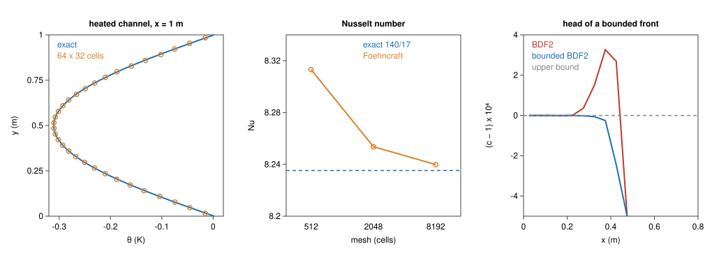

# Passive scalars and the wall distance

Part of the [Example gallery](../gallery.md): passive scalars carried by the flow (D51) with the generic scalar transport equation of stage 6 (D116), the bounded BDF2 (D28 (1)) and the exact wall distance (D48, D108).

| # | Example | Stage | Feature |
|---|---|---|---|
| 63 | [A heated channel and a bounded front](#passive-scalars) | 6 | `[scalars.<name>]`, `[boundary.<name>.scalar.<scalar>]`, `bounds`, `exact`, `wall-distance` |

---

<a id="passive-scalars"></a>
## 63. A heated channel and a bounded front



**The laminar heated channel.** `channel_heated.toml` carries a passive
temperature θ in the Poiseuille flow of `poiseuille_hex.toml` (channel
height h = 1 m, mean velocity 1 m/s, Péclet number 1000). Both walls take
the same heat flux, `flux = "q"` in their `[boundary.<wall>.scalar.theta]`
tables; the inlet takes the thermally developed profile. The exact
solution is θ = G x + h (2η³ − η⁴ − η) with η = y/h and the axial gradient
G = 2q/(U h); the run computes the L2 error against the `exact` expression
of the scalar and the observed order over three meshes:

| Cells | L2 error of θ (K) | Nu | Nu − 140/17 |
|---|---|---|---|
| 512 | 1.10e-3 | 8.3132 | +0.95 % |
| 2 048 | 2.74e-4 | 8.2536 | +0.22 % |
| 8 192 | 6.23e-5 | 8.2398 | +0.055 % |

The observed orders of the error are 2.01 and 2.14 (the case requires 1.8
to 2.2). The Nusselt number with the hydraulic diameter 2h,
Nu = 2 h q / (Γ (T̄_w − T_b)), uses the area mean of θ on the walls and
the mixed mean at the inlet from the report (`result.json`, per boundary
`mean`, `mixed_mean` and `flux`), recipe 63.

**A bounded front.** `scalar_front_bdf2.toml` lets a scalar with the
bounds [0, 1] enter a channel in a uniform flow, first-order upwind in
space, BDF2 in time, Courant number 0.8. BDF2 steps from the old value
φ* = (4 cⁿ − cⁿ⁻¹)/3, which exceeds 1 at the head of the front where c
still grows: without bounds (`--set 'scalars.c.bounds=[-1e9, 1e9]'`) the
solution overshoots to 1.00033. With `bounds = [0, 1]` the cells where φ*
leaves the bounds take a backward-Euler step for that step (one or two
cells per step here, counted in `history.csv` as `first_order_c`), and
the largest value is 1 − 7e-11. Smooth scalars keep second order in time:
the Taylor–Green vortex carrying a scalar gives the observed time orders
1.98 with BDF2 and 2.02 with Crank–Nicolson (`tests/scalars.rs`).

**The wall distance.** `[output] derived = ["wall-distance"]` writes the
exact distance of every cell centroid to the nearest wall face, found
with a bounding volume hierarchy over the wall triangles (binned surface
area heuristic, closest-point queries, ties broken by the global face
id, so the field is the same on any number of threads and partitions).
The turbulence models of stage 6 take it from the same search.

```
cargo build --release -p foehncraft-cli
target/release/foehn flow examples/cases/flow/channel_heated.toml --out output/heated
target/release/foehn flow examples/cases/flow/channel_heated.toml --out output/heated_mid \
    --set 'verification.levels=[1]' \
    --set 'output.lines=[{name="mid",from=[1.0,0.015625,0.05],to=[1.0,0.984375,0.05],points=32}]'
target/release/foehn flow examples/cases/flow/scalar_front_bdf2.toml --out output/front
target/release/foehn flow examples/cases/flow/scalar_front_bdf2.toml --out output/front_free \
    --set 'scalars.c.bounds=[-1e9, 1e9]'
python3 -m tools.plot.scalar_chart docs/figures/gallery/passive_scalars.svg \
    output/heated output/heated_mid output/front output/front_free
```
