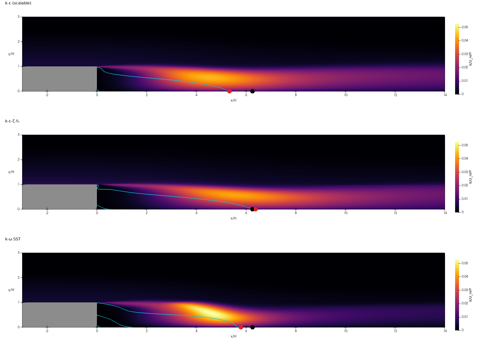

# Turbulence models

Part of the [Example gallery](../gallery.md): the RANS turbulence models of stage 6 with their wall treatments (D129–D139), checked against the NASA Turbulence Modeling Resource (TMR), DNS and correlations.

| # | Example | Stage | Feature |
|---|---|---|---|
| 68 | [k-ω SST on the TMR flat plate and in a channel](#sst) | 6 | `[turbulence] model = "k-omega-sst"`, `wall_treatment`, inlet turbulence values, `roughness`, derived field `turbulence-features` |
| 71 | [k-ε family with wall functions: flat plate, channel, Moody chart](#k-epsilon) | 6 | `model = "k-epsilon"`, `"realizable-k-epsilon"`, `wall_treatment = "scalable"`, `"standard"`, `"compound"`, `epsilon` at inlets, `roughness_constant` |
| 73 | [k-ε-ζ-f to the wall: channel and flat plate](#zeta-f) | 6 | `model = "k-epsilon-zeta-f"`, `wall_treatment = "compound"`, `"low-re"`, `zeta` at inlets and in `[initial]`, `[solver.elliptic]`, `solver.turbulence.preconditioner = "amg"` |
| 74 | [k-ε-ζ-f₀ at any y⁺: channel, flat plate, backward-facing step](#zeta-f0) | 6 | `model = "k-epsilon-zeta-f0"`, `wall_treatment = "compound-2023"`, `constants.n_zeta`, `a`, `mesh.generate.remove` |

---

<a id="sst"></a>
## 68. k-ω SST on the TMR flat plate and in a channel


**The model.** The k-ω SST model of Menter, Kuntz & Langtry (2003): the
blend F₁ between k-ω near walls and k-ε away from them, the eddy
viscosity ν_t = a₁k/max(a₁ω, S F₂) and the production limiter
P̃ = min(ν_t S², 10 β* k ω). k and ω are two transport equations of the
generic scalar path of stage 6a, solved after each pressure correction
with a point-implicit (Newton) linearisation of the destruction, so k and ω
stay positive without clipping in a converging run. Two wall treatments:

```toml
[turbulence]
model = "k-omega-sst"
wall_treatment = "low-re"   # or "automatic" (the default)
```

`low-re` integrates to the wall (y⁺ ≲ 1): k = 0 and ω = 60ν/(β₁ d₁²) on
the wall face, d₁ the height of the wall cell, as in the TMR's own codes.
`automatic` takes any first-cell y⁺: the wall shear stress and ω in the
first cell are blended between their viscous-sublayer and log-law values,
and so is the production of k there.

**The TMR flat plate** (`tmr_plate_sst.toml`). The 2D zero-pressure-gradient
plate at Re = 5·10⁶ per metre with the TMR's free-stream values
(k = 2.25·10⁻⁷ U², ν_t/ν = 0.009), on the built-in mesher's copy
of the TMR grid family (point counts and stretching, not the TMR files):
four meshes from 32 × 24 to 256 × 192 cells, first-cell y⁺ 0.09 on the
finest. The skin friction at x = 0.97 converges monotonically:

| Cells | C_f(0.97) | against TMR | C_D (one side) | against TMR |
|---|---|---|---|---|
| 768 | 2.6937e-3 | +0.11 % | – | – |
| 3 072 | 2.6682e-3 | −0.83 % | 2.8259e-3 | −0.80 % |
| 12 288 | 2.6868e-3 | −0.14 % | 2.8477e-3 | −0.04 % |
| 49 152 | 2.7007e-3 | +0.37 % | 2.8606e-3 | +0.41 % |
| TMR, SST, finest grid | 2.6907e-3 | | 2.8488e-3 | |

The validation band of the specification, |C_f − C_f,TMR| ≤ 1 % plus
the numerical uncertainty, holds on every mesh but the first. The
verification band does not: the observed order of the three finest meshes
is 0.43 for C_f (GCI 1.87 %, extrapolated 2.741e-3) and 0.74 for C_D
(GCI 0.84 %), where the specification asks for p ≥ 1.5 and GCI ≤ 1 %.
This is recorded as a finding: on the coarsest mesh the stretched grid
puts only a few cells into the laminar leading-edge region, and the
convergence is not yet in its asymptotic range; the TMR itself reports
its finest-grid values after five grids. White's correlation lies 5 to 9 %
above the computed C_f along the plate, the TMR value of SST 6.4 % at
x = 0.97, so the model, not the code, sets that difference. u⁺ at x = 0.97
follows Spalding's law (κ = 0.41, B = 5.0) within 2.3 % for
1 ≤ y⁺ ≤ 300.

**The automatic treatment** on the second mesh with the wall grading
changed so that the first cell sits at y⁺ ≈ 2 to 100:

| First-cell y⁺ at x = 0.97 | 1.7 | 4.6 | 9.3 | 27 | 92 |
|---|---|---|---|---|---|
| C_f against the TMR value | +2.3 % | +15.6 % | +14.8 % | −0.2 % | −0.7 % |

In the sublayer and in the log layer the result holds; in the buffer
layer (3 ≲ y⁺ ≲ 20) the blended wall values give a wall shear stress up
to 16 % high, outside the ±2 % band of the specification. This is the
known weakness of the blending of the original formulation; until it is
improved, TURB001 warns when more than a tenth of a wall lies in that
range, and meshes should put the first cell at y⁺ ≲ 1 or y⁺ ≳ 25.

**The channel** (`channel_sst.toml`). Fully developed flow between two
walls at Re_τ = 395 on one periodic module (stage 6p) driven by the bulk
velocity of the DNS of Moser, Kim & Mansour (1999), 96 cells across,
first-cell y⁺ 0.28. The driving force gives u_τ and with it
Re_τ = 397.8 and U_b⁺ = 17.43: −0.7 % from the DNS (17.55) and +1.1 %
from Dean's correlation C_f = 0.073 Re_b^−¼ (17.24), inside the ±3 %
band. On three meshes (96, 192 and 384 cells across) U_b⁺ is 17.427, 17.381 and 17.346: the observed order is 0.40, the extrapolated value 17.237 (Dean: 17.24) and GCI_fine 0.78 %, outside the verification band of the specification (finding, as for the plate: the convergence is slow). The fourth mesh did not reach its tolerance in 30 000 iterations and is left out. The centreline velocity U_c⁺ = 19.64 lies about 2.4 % below the DNS
(about 20.1), inside ±4 %.

| Check | Result |
|---|---|
| Homogeneous decay of k and ω (periodic box, no walls) against the exact ODE solution | BDF2 time order of k 1.92 and 1.96, of ω 2.07 and 2.03 (band 1.8–2.2) |
| Restart in the middle of a steady SST run | bit-identical to the run without restart |
| 1 against 4 threads on the flat plate | bit-identical |
| Wall distance by the Poisson PDE on a plane wall | exact to round-off |
| Bad input (unknown model, constants, central convection in a steady run, k without ω) | refused with CASE002/CASE004/CASE005/TURB006 |
| Inlet turbulence values out of range, defaulted, or given at an outlet | BC029, TURB009, BC028 |

| | |
|---|---|
| Code | kernels `turb::sst` (closure, blending, production), `turb::wall` (low-re, automatic and Aupoix wall values), `turb::invariants` (the D166 features), `scalar` (the fractional first-cell fix); `foehncraft_flow::turbulence` (`Turbulence`, settings, health counts, `summary`), `turbulence::wall` (thickness, Poisson distance), `turbulence::inlet` (intensity, length scale, viscosity ratio), `derived` (`turbulence-features`) |
| Tests | `tests/turbulence.rs`, `turbulence/inlet.rs`, `turbulence/wall.rs`, kernel tests of `turb::sst` and `turb::wall` |
| Case files | `flow/tmr_plate_sst.toml`, `flow/channel_sst.toml` |
| Recipe | [68](../recipes/turbulence.md#sst) |

```
target/release/foehn flow examples/cases/flow/tmr_plate_sst.toml --out output/plate \
    --set 'verification.levels=[0, 1, 2, 3]'
target/release/foehn flow examples/cases/flow/channel_sst.toml --out output/channel
for r in "2 7983.6" "5 2859.1" "10 1298.9" "30 361.1" "100 83.3"; do set -- $r
  target/release/foehn flow examples/cases/flow/tmr_plate_sst.toml --out output/yp$1 \
      --set 'turbulence.wall_treatment="automatic"' --set "mesh.generate.grading.y.ratio=$2"
done
python3 -m tools.plot.sst_chart docs/figures/gallery/sst.svg output/plate output/channel \
    output/yp2 output/yp5 output/yp10 output/yp30 output/yp100
```

[↑ back to top](#turbulence-models)

---

<a id="k-epsilon"></a>
## 71. k-ε family with wall functions: flat plate, channel, Moody chart


**The models.** The standard k-ε of Launder & Spalding (1974) and the
realizable k-ε of Shih et al. (1995), with its variable C_μ and the
destruction C₂ε²/(k + √(νε)), share one kernel. The standard model is
bounded by Durbin's realizability limit by default, which is inactive in
an equilibrium boundary layer and keeps the impulsive start of the
near-wall cells in check; the ε destruction is linearised in the Picard
form, which lets ε follow k when the free stream decays. Inlets take k
with ε or with ω (ε = C_μ k ω), and a run can start from an SST restart
file.

```toml
[turbulence]
model = "k-epsilon"            # or "realizable-k-epsilon"
wall_treatment = "scalable"    # "standard", "compound"
```

**The wall treatments.** All take the velocity scale u* = C_μ^¼ k^½ of
the first cell, so they need no iteration. `scalable` evaluates the log
law at max(y*, 11.06) and fixes ε and the production of the first cell
from it; `standard` falls back to the viscous sublayer below 11.06;
`compound` blends sublayer and log law with the function of Popovac &
Hanjalić. Rough walls shift the log law by ΔB of Cebeci & Bradshaw.

**The flat plate** (`tmr_plate_keps.toml`). The TMR plate of gallery 68
on 64 × 48 cells, its free-stream values held by the sustaining terms
(without them the free stream of the k-ε family decays before the plate).
With the wall grading changed so that the first cell sits at y⁺ 1 to 100
at x = 0.97, `scalable` gives C_f within −2.6 to −0.3 % of White's
correlation at every y⁺ (left). `compound` agrees from y⁺ 30
(−2.3 to −3.6 %) but overpredicts below, by 21 % at y⁺ 11 and 58 % at
y⁺ 1: the high-Re models have no damping in the buffer layer. This is a
finding, and TURB001 warns below y⁺ 30; walls resolved to y⁺ ≈ 1 are for
the ζ-f and EB models. The realizable model gives 3 to 7 % less friction
(finding).

**The channel** (`channel_keps.toml`). Re_τ = 395 on 12 uniform cells
(first-cell y⁺ 32): U_b⁺ = 18.31, +4.3 % from the DNS, inside the ±5 %
band of wall functions; +4.3 to +4.9 % for every y⁺ from 9 to 47.

**Rough pipes** (`pipe_rough_keps.toml`, `examples/studies/moody_study.py`).
A wedge pipe of one periodic module; the friction factor follows from the
driving force (right). Smooth pipes lie 2 to 5 % below Colebrook's
equation. Fully rough pipes lie 8 to 11 % above with the default
C_s = 0.5 and within 3 % with C_s = 0.4 (finding). In the transitional
range the Cebeci–Bradshaw shift follows Nikuradse's sand-grain dip and
lies below Colebrook's monotonic curve for commercial pipes.

| Check | Result |
|---|---|
| Plate, `scalable`, y⁺ 1 to 100: C_f(0.97) against White | −2.6 % to −0.3 % (band ±5 %) |
| Plate, `compound`, y⁺ 30 / 60 / 100 | −2.3 / −3.6 / −3.4 %; below y⁺ 30 up to +58 % (finding, TURB001) |
| Channel Re_τ 395, `scalable`, y⁺ 32: U_b⁺ | 18.31, +4.3 % (band ±5 %) |
| Realizable k-ε, plate and channel | 3 to 7 % low friction (finding) |
| Rough pipe Re 10⁶, k_s/D 10⁻³ | f 0.02081, +4.4 % from Colebrook |
| Moody study, 16 runs | smooth −5.0 to −1.7 %, fully rough +8 to +11 % (C_s 0.4: +1 to +3 %) |
| Homogeneous decay of k and ε, BDF2 | second order (asserted 1.8 to 2.2) |
| SST restart continued with k-ε; 1 against 4 threads | converted; bit-identical |
| Bad input (SST treatment with k-ε, realizable with a limiter, ω ambient, ω and ε at one inlet) | CASE005, BC029 |

| | |
|---|---|
| Code | kernels `turb::keps` (both closures, sources, Durbin bound), `turb::wall` (`keps_wall_face`, `roughness_shift`, `compound_gamma`), `entry` (`KepsCells`, the k-ε branch of `WallFaces`, the field update of `WallCells`); `foehncraft_flow::turbulence` (model and treatment keys, ω–ε conversion of inlets, initial values and restart files) |
| Tests | `tests/keps.rs`, kernel tests of `turb::keps` and `turb::wall`, `turbulence/inlet.rs` |
| Case files | `flow/tmr_plate_keps.toml`, `flow/channel_keps.toml`, `flow/pipe_rough_keps.toml`; study `examples/studies/moody_study.py` |
| Recipe | [71](../recipes/turbulence.md#k-epsilon) |

```
target/release/foehn flow examples/cases/flow/tmr_plate_keps.toml
target/release/foehn flow examples/cases/flow/channel_keps.toml
target/release/foehn flow examples/cases/flow/pipe_rough_keps.toml
python3 examples/studies/moody_study.py output/moody --jobs 4 --chart output/moody.svg
```

[↑ back to top](#turbulence-models)

---

<a id="zeta-f"></a>
## 73. k-ε-ζ-f to the wall: channel and flat plate

**The model.** The k-ε-ζ-f model of Hanjalić, Popovac & Hadžiabdić
(2004) adds ζ = v²/k, the wall-normal share of the turbulence, and the
elliptic relaxation f of its pressure-strain term to k and ε:
ν_t = C_μ ζ k T with C_μ = 0.22, the time scale
T = max[min(k/ε, 0.6/(√6 C_μ S ζ)), C_T (ν/ε)^½] and the length scale L
of the elliptic equation −∇·(L²∇f) + f = (C₁ − 1 + C₂′ P/ε)(2/3 − ζ)/T
bounded by realizability above and by the Kolmogorov scales below. ζ
falls to zero towards a wall by itself, so the model needs no damping
functions. One outer iteration solves k and ε, then f (CG with its own
multigrid hierarchy), then ζ with the new f. A solve may lower k, ε or ζ
by at most a factor 10 per iteration: an unconverged iterate that drops
ε to its floor would otherwise blow up T, L and P/ε in the source of f.

```toml
[turbulence]
model = "k-epsilon-zeta-f"
wall_treatment = "compound"    # or "low-re"
```

**The wall treatments.** `low-re` sets k = ζ = 0, ε_w = 2νk₁/d₁² and
f_w = −2νζ₁/d₁² on the wall faces and needs y⁺ ≲ 2 (TURB001).
`compound` (the default) takes k and ζ by zero gradient, which is exact
at the wall, fixes ε and P_k of the first cell and the wall value of f by
the blend of viscous sublayer and log law of Popovac & Hanjalić (2007),
and covers every y⁺.

**The channel** (`channel_zeta_f.toml`). Re_τ = 395 on 96 cells across
(first-cell y⁺ 0.27): U_b⁺ = 17.89, +1.9 % from the DNS of Moser, Kim &
Mansour with `compound`, +1.4 % with `low-re` (band ±3 %). The k⁺ peak
and U⁺ up to y⁺ ≈ 25 follow the DNS.

**The flat plate** (`tmr_plate_zeta_f.toml`). The TMR plate on 64 × 48
cells at first-cell y⁺ 1: C_f(0.97) = 3.023·10⁻³, +5.1 % from White's
correlation, +4.7 % on 96 cells across (finding: outside the ±3 % band,
mesh-independent). Two more findings: from the free stream of the TMR
(ν_t/ν = 0.009) the model keeps the boundary layer laminar over the
whole plate, because the length scale of the weak free stream exceeds the
layer and f drives ζ to zero across it, so the case starts from a
turbulent field; and in the laminar part near the leading edge the
published k sink −ε has no positive steady solution while T sits at its
Kolmogorov bound, so the floor holds k there (TURB002) and the k residual
stays at 7·10⁻⁶ while every other field converges to round-off.

**The scalar multigrid.** The f equation is symmetric positive definite
and runs CG with the aggregation multigrid by default
(`[solver.elliptic]`). The transport equations take it with
`solver.turbulence.preconditioner = "amg"`: one hierarchy per equation,
built from the symmetric part ½(A + Aᵀ) of the convection matrix. All
hierarchies are rebuilt on the schedule of the pressure
(`solver.amg_rebuild`), which halved the run time of the channel
(56 s → 26 s) against a rebuild in every solve, and their matrices go
into the restart file, so a continued run is bit-identical.

| Check | Result |
|---|---|
| Channel Re_τ 395, y⁺ 0.27: U_b⁺, `compound` / `low-re` | 17.89 (+1.9 %) / 17.79 (+1.4 %) (band ±3 %) |
| Plate, `compound`, y⁺ 1: C_f(0.97) against White, 48 / 96 cells across | +5.1 % / +4.7 % (finding, band ±3 %) |
| Plate from the TMR free-stream values | laminar, C_f = 3.0·10⁻⁴ (finding; turbulent start) |
| Homogeneous decay: k, ε (C_ε2 = 1.9) and the return of ζ to 2/3, BDF2 | second order (asserted 1.8 to 2.2) |
| Sustaining terms: k, ε held, ζ = 2/3 and f = 0 a fixed point | to 10⁻¹⁰ |
| Restart (multigrid of all four equations), 1 against 4 threads | bit-identical |
| k-ε restart continued with ζ-f | ζ = 2/3, f = 0 at the start |
| Bad input (wall functions of the k-ε family, a production limiter, ω ambient, ζ outside (0, 2]) | CASE005, CASE002, CASE004 |

| | |
|---|---|
| Code | kernels `turb::zeta_f` (scales, ν_t, source split, right-hand side of f), `turb::wall` (`zeta_f_wall_values`), `entry` (`ZetaFCells`, the ζ-f branches of `TurbFaces` and `WallFaces`, the relative bound of `Floor`); `foehncraft_fv` (hierarchy slots, `Csr::symmetric_part`, `setup_amg_with`); `foehncraft_flow::turbulence` (solve order, the elliptic solve, the multigrid schedule and its restart matrices) |
| Tests | `tests/zeta_f.rs`, kernel tests of `turb::zeta_f`, `amg_slots_keep_the_pressure_hierarchy` (fv `tests/stage3.rs`), `symmetric_part_of_a_convection_matrix` |
| Case files | `flow/channel_zeta_f.toml`, `flow/tmr_plate_zeta_f.toml` |
| Recipe | [73](../recipes/turbulence.md#zeta-f) |

```
target/release/foehn flow examples/cases/flow/channel_zeta_f.toml
target/release/foehn flow examples/cases/flow/tmr_plate_zeta_f.toml
```

[↑ back to top](#turbulence-models)

---

<a id="zeta-f0"></a>
## 74. k-ε-ζ-f₀ at any y⁺: channel, flat plate, backward-facing step

**The model.** Popovac (2023) solves f₀ = f + (N_ζ − 1)ζ/T in place of
the f of k-ε-ζ-f (gallery 73). With N_ζ = 2 its wall value is zero, so
the stiff wall value −2νζ/y² of f is gone, and with the compound wall
treatment of the same paper the model is meant to run on any near-wall
mesh. No code of the author is available, so Foehncraft takes its own
default, which keeps the constants of the paper (ν_t = (0.09/0.41) ζ k T,
C_ε1 = 1.4(1 + 0.012/√ζ)) and deviates where the validation asked for it
(specification 3.3.1): the sign of the (N_ζ − 1) term of the f₀
equation, which the paper prints the other way round; ε/k in the
(N_ζ − 1) terms; the k sink k/T_K with the Kolmogorov-bounded k/ε, which
keeps k positive in laminar regions; and the realizability coefficient
of T, a = 0.6 √2 instead of 0.6.

```toml
[turbulence]
model = "k-epsilon-zeta-f0"
wall_treatment = "compound-2023"   # default; "compound", "low-re"
```

**The wall treatment.** `compound-2023` blends the viscous sublayer and
the log law in one profile, u⁺ = [y*^(−10/3) + u⁺_log^(−10/3)]^(−3/10)
with u* = C_μ^¼ k^½, and corrects the log law by ψ for the convection and
the pressure gradient next to the wall (non-equilibrium). ε and P_k of
the first cell follow from the slope of the blend; k and ζ have zero
flux through the wall and f₀,w = 0.

**The channel** (`channel_zeta_f0.toml`, Re_τ = 395). U_b⁺ = 17.79, +1.4 %
from the DNS at first-cell y⁺ 1 (band ±3 %). The same channel at y⁺ 0.3,
10 and 30: +2.7, −4.2 and −1.5 %; ζ-f with its 2007 treatment gives
+1.9, −7.1 and +4.8 %. Every run converges.

**The flat plate** (`tmr_plate_zeta_f0.toml`). The run starts from the
free stream of the TMR (ν_t/ν = 0.009), and the boundary layer turns
turbulent on its own, which ζ-f does not do. C_f(0.97) = 2.802·10⁻³,
−2.5 % from White's correlation (+4.1 % from the TMR value of SST); at
y⁺ 10 and 30 +0.9 and −2.0 %. Every field converges to 10⁻⁷ without a
positivity floor, at all three y⁺; ζ-f converges at none of them.

**The backward-facing step** (`backstep_zeta_f0.toml`). Driver &
Seegmiller (1985), Re_H = 36 000, the step cut out of the box by the
built-in mesher (`mesh.generate.remove`), the wall from x = −85 H so
that the boundary layer is about 1.5 H thick at x = −4 H. The
reattachment length x_r/H is 6.38, +2 % from the experiment's 6.26
(band ±10 %). With a = 0.6 the realizability bound of T is active in the
separated shear layer, halves ν_t there and the bubble grows to 7.4 H;
ζ-f of 2004 has the same bound and gives 7.82 (+25 %), and 6.80 with `constants = { a = 0.849 }`.

**Three models on the same step** (`examples/studies/backstep/`, the
fine mesh of 32 800 cells). k-ε with scalable wall functions reattaches
at 5.34 H (−15 %), k-ω SST at 5.79 H (−7 %) and k-ε-ζ-f₀ at 6.38 H
(+2 %). The streamwise velocity with streamlines, the line U = 0 in
white, the computed reattachment point in red and the experiment's in
black:


The turbulent kinetic energy on one scale, with the line U = 0 in
cyan. SST has the highest peak, k/U_ref² = 0.05 just ahead of
reattachment, and the fastest decay behind it; k-ε builds k up earliest
in the shear layer, ζ-f₀ latest, and ζ-f₀ carries it furthest
downstream:



| Check | Result |
|---|---|
| Channel Re_τ 395, U_b⁺ at first-cell y⁺ 0.3 / 1 / 10 / 30 | +2.7 / +1.4 / −4.2 / −1.5 % (band ±3 % at y⁺ 1) |
| Plate C_f(0.97) from White at y⁺ 1 / 10 / 30 | −2.5 / +0.9 / −2.0 %, all converged without a floor (band ±3 %) |
| Plate from the TMR free stream | turbulent on its own, the same C_f |
| Step x_r/H, 8 200 / 32 800 cells | 6.38 (+2 %) / 6.38: mesh-independent (band ±10 %) |
| Step x_r/H with a = 0.6 / ζ-f | 7.44 / 7.82 (6.80 with a = 0.849) |
| Step x_r/H, 32 800 cells: k-ε scalable / ζ-f₀ / SST | 5.34 (−15 %) / 6.38 (+2 %) / 5.79 (−7 %) |
| 1 against 4 threads (plate, 20 480 cells) | bit-identical |
| Bad input (wall functions of the k-ε family, `compound-2023` with k-ε, `n_zeta` with ζ-f) | CASE005, CASE005, CASE002 |

| | |
|---|---|
| Code | kernels `turb::zeta_f` (`FORM_F0`, `ZetaFConstants::popovac_2023`), `turb::wall` (`compound_2023`, `COMPOUND_2023`), `entry` (C_U of `WallFaces`); `foehncraft_flow::turbulence` (model and treatment, the non-equilibrium inputs); `foehncraft_mesh::generate` (`RemoveBox`) |
| Tests | `tests/zeta_f0.rs`, kernel tests of `turb::zeta_f` and `turb::wall`, `removed_box_builds_a_step` |
| Case files | `flow/channel_zeta_f0.toml`, `flow/tmr_plate_zeta_f0.toml`, `flow/backstep_zeta_f0.toml`; the model comparison `examples/studies/backstep/{keps,zf0,sst}.toml` |
| Figures | `tools/plot/backstep_paraview.py` (ParaView), `tools/plot/backstep_chart.py` (matplotlib) |
| Recipe | [74](../recipes/turbulence.md#zeta-f0) |

```
target/release/foehn flow examples/cases/flow/channel_zeta_f0.toml
target/release/foehn flow examples/cases/flow/tmr_plate_zeta_f0.toml
target/release/foehn flow examples/cases/flow/backstep_zeta_f0.toml
```

The model comparison and its two figures (recipe 74):

```
target/release/foehn flow examples/studies/backstep/keps.toml --out output/backstep_keps
target/release/foehn flow examples/studies/backstep/zf0.toml --out output/backstep_zeta_f0
target/release/foehn flow examples/studies/backstep/sst.toml --out output/backstep_sst
pvpython tools/plot/backstep_paraview.py docs/figures/gallery/backstep \
    "k-ε (scalable)=output/backstep_keps" "k-ε-ζ-f₀=output/backstep_zeta_f0" "k-ω SST=output/backstep_sst"
```

[↑ back to top](#turbulence-models)
