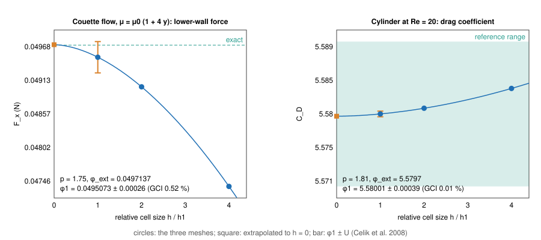

# Verification

Part of the [Example gallery](../gallery.md): the discretisation uncertainty of mesh and time-step sweeps (D67) and the verification manual generated from the cases (D68).

| # | Example | Stage | Feature |
|---|---|---|---|
| 25 | [Grid convergence index: Couette flow and the cylinder at Re = 20](#gci) | 5 | `[verification] levels` with three or more meshes, `uncertainty` in `result.json`, `tools/release/verification_manual.py` |

---

<a id="gci"></a>
## 25. Grid convergence index: Couette flow and the cylinder at Re = 20



**What the report adds.** Every sweep of three or more meshes (or time
steps) now ends with a table of the discretisation uncertainty of its
monitored quantities: boundary mass flows, mean pressures and forces, the
drag and lift coefficients, the benchmark values and the viscous and
numerical dissipation. For each, the procedure of Celik et al. (2008)
takes the three finest solutions and gives the observed order p (by
fixed-point iteration, so the refinement ratios need not be equal), the
value extrapolated to zero cell size, the band φ1 ± U of the finest
solution with U = 1.25 |φ1 − φ2| / (r^p − 1), the grid convergence index
U / |φ1|, and a verdict: monotonic, oscillatory, divergent or unchanged.
The table is in `flow.md`; `result.json` has the same numbers under
`uncertainty` (also `Result.uncertainty` in Python).

**Left: a case with an exact answer.** `couette_viscosity.toml` (gallery
23) on 16 × 8, 32 × 16 and 64 × 32 cells: the force on the lower wall
converges at order 1.75. The finest mesh is 0.40 % below the exact
μ0 U a / ln(1 + a) times the area; the extrapolated value is 0.014 %
above it, and the band ± 2.6e-4 N of the finest mesh (GCI 0.52 %) holds
the exact value. This is the check of the estimate itself.

**Right: a benchmark without an exact solution.**
`cylinder_re20_gci.toml` runs the steady benchmark 2D-1 of Schäfer &
Turek (1996) on the built-in meshes of 6 144, 24 576 and 98 304
hexahedra. C_D falls from 5.5835 to 5.5808 and 5.5800 (order 1.81) and
extrapolates to 5.5797 ± 0.0004 (GCI 0.007 %), inside the reference range
5.57–5.59. C_L, 7 % below the range on the coarse mesh, converges at
order 2.03 to 0.01071 (GCI 0.77 %) inside 0.0104–0.0110; the pressure
difference Δp extrapolates to 0.11754 Pa (range 0.1172–0.1176). The mean
pressure on the cylinder changes by more from the medium to the fine
mesh than from the coarse to the medium one and is reported as
divergent, without an order. These are the SIMPLEC numbers (12 minutes
on four cores, 9 876 iterations on the finest mesh). Since PR 144 the
case runs the coupled algorithm, in 51, 90 and 225 outer iterations and
about a minute (in the `long` set): C_D 5.5800 extrapolates to 5.5796 ±
0.0004 (order 1.78) and Δp to 0.11754 Pa as before; C_L converges at
order 1.65 to 0.01073 (GCI 1.35 %). The lift is a force of 2·10⁻⁷ N and
depends on the pseudo-time step through the face velocity of the
pressure coupling (0.01037 on the medium mesh with the default
relaxation, 0.01041 with 0.9, 0.01044 with SIMPLEC).

```
target/release/foehn flow examples/cases/flow/cylinder_re20_gci.toml
python3 -m tools.plot.gci_chart docs/figures/gallery/gci.svg output/couette_viscosity output/cylinder_re20_gci
```

**The manual.** `tools/release/verification_manual.py` collects every
verification case with its pass bands, the value of its run and the
uncertainty tables of its sweeps into
[docs/verification/manual.md](../verification/manual.md) (with
`results.json` and a chart of the observed orders against their bands).

How to use it: [recipes 34 and 35](../recipes/verification.md).
