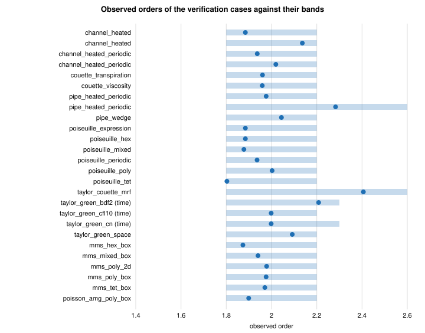

# Verification manual

<!-- generated by tools/release/verification_manual.py (D68); do not edit -->

Every verification case of the [case catalogue](../cases.md) with its pass bands and the result of its run. The cases check themselves (a run outside its band exits with code 1, R5); this page collects the bands and the values. The explanations stay on the stage pages ([stage 2](stage2.md), [stage 3](stage3.md), [stage 4](stage4.md), [stage 5](stage5.md)). The same data as JSON: [results.json](results.json).

Runs of Foehncraft 0.5.0 (7afe9c9cc2b1): 48 of 48 cases passed, 0 without a run.

## Flow cases (`foehn flow`)

| Case | What it checks | Cells | Check | Band | Value | |
|---|---|---|---|---|---|---|
| `cavity_re100` | Lid-driven cavity at Re = 100 on 64 x 64 hexahedra | 4 096 | largest deviation from Ghia et al. (1982), Re = 100 | ≤ 0.02 | 0.009451 of U_lid | passed |
|  |  |  | every steady solve converged | converged | yes | passed |
|  |  |  | net mass flow out of the domain | ≤ 1e-06 | 0 relative | passed |
| `cavity_re1000` | Lid-driven cavity at Re = 1000 on 128 x 128 hexahedra | 16 384 | largest deviation from Ghia et al. (1982), Re = 1000 | ≤ 0.02 | 0.01356 of U_lid | passed |
|  |  |  | every steady solve converged | converged | yes | passed |
|  |  |  | net mass flow out of the domain | ≤ 1e-06 | 0 relative | passed |
| `cavity_re1000_poly3d` | Lid-driven cavity at Re = 1000 on three-dimensional polyhedra | 28 227 | largest deviation from Ghia et al. (1982), Re = 1000 | ≤ 0.03 | 0.02388 of U_lid | passed |
|  |  |  | every steady solve converged | converged | yes | passed |
|  |  |  | net mass flow out of the domain | ≤ 1e-06 | 2.932e-22 relative | passed |
| `cavity_re100_budget` | Lid-driven cavity at Re = 100 with a budget | 4 096 | largest deviation from Ghia et al. (1982), Re = 100 | ≤ 0.02 | 0.009451 of U_lid | passed |
|  |  |  | every steady solve converged | converged | yes | passed |
|  |  |  | net mass flow out of the domain | ≤ 1e-06 | 0 relative | passed |
| `cavity_re100_energy` | Lid-driven cavity at Re = 100: the energy budget | 4 096 | largest deviation from Ghia et al. (1982), Re = 100 | ≤ 0.02 | 0.009451 of U_lid | passed |
|  |  |  | every steady solve converged | converged | yes | passed |
|  |  |  | net mass flow out of the domain | ≤ 1e-06 | 0 relative | passed |
| `cavity_re100_poly3d` | Lid-driven cavity at Re = 100 on three-dimensional polyhedra | 5 445 | largest deviation from Ghia et al. (1982), Re = 100 | ≤ 0.03 | 0.01327 of U_lid | passed |
|  |  |  | every steady solve converged | converged | yes | passed |
|  |  |  | net mass flow out of the domain | ≤ 1e-06 | 3.824e-21 relative | passed |
| `cavity_re100_tet3d` | Lid-driven cavity at Re = 100 on three-dimensional tetrahedra | 24 576 | largest deviation from Ghia et al. (1982), Re = 100 | ≤ 0.03 | 0.02542 of U_lid | passed |
|  |  |  | every steady solve converged | converged | yes | passed |
|  |  |  | net mass flow out of the domain | ≤ 1e-06 | 0 relative | passed |
| `cavity_re100_transient` | Lid-driven cavity at Re = 100, run in time to the steady state | 4 096 | largest deviation from Ghia et al. (1982), Re = 100 | ≤ 0.02 | 0.009454 of U_lid | passed |
|  |  |  | net mass flow out of the domain | ≤ 1e-06 | 0 relative | passed |
| `channel_ramp` | Start-up of a channel flow with the inflow ramped up in time by a table (D53) | 512 | velocity error L2 (largest of the levels) | ≤ 0.002 | 0.001592 m/s | passed |
|  |  |  | net mass flow out of the domain | ≤ 1e-06 | 4.644e-18 relative | passed |
| `channel_slip` | Uniform flow between slip walls | 432 | velocity error L2 (largest of the levels) | ≤ 1e-09 | 1.537e-11 m/s | passed |
|  |  |  | every steady solve converged | converged | yes | passed |
|  |  |  | net mass flow out of the domain | ≤ 1e-06 | 2.082e-16 relative | passed |
| `couette_derived` | Derived fields (D72) of plane Couette flow on perturbed poly cells | 153 | velocity error L2 (largest of the levels) | ≤ 1e-09 | 6.864e-11 m/s | passed |
|  |  |  | every steady solve converged | converged | yes | passed |
|  |  |  | net mass flow out of the domain | ≤ 1e-06 | 3.554e-18 relative | passed |
| `couette_hex` | Plane Couette flow on hexahedra, with convection | 128 | velocity error L2 (largest of the levels) | ≤ 1e-09 | 4.458e-11 m/s | passed |
|  |  |  | every steady solve converged | converged | yes | passed |
|  |  |  | net mass flow out of the domain | ≤ 1e-06 | 7.401e-18 relative | passed |
| `couette_mixed` | Plane Couette flow on perturbed mixed cells, Stokes flow | 192 | velocity error L2 (largest of the levels) | ≤ 1e-09 | 1.362e-10 m/s | passed |
|  |  |  | every steady solve converged | converged | yes | passed |
|  |  |  | net mass flow out of the domain | ≤ 1e-06 | 7.840e-47 relative | passed |
| `couette_poly` | Plane Couette flow on perturbed poly cells, Stokes flow | 153 | velocity error L2 (largest of the levels) | ≤ 1e-09 | 6.864e-11 m/s | passed |
|  |  |  | every steady solve converged | converged | yes | passed |
|  |  |  | net mass flow out of the domain | ≤ 1e-06 | 3.554e-18 relative | passed |
| `couette_tet` | Plane Couette flow on perturbed tet cells, Stokes flow | 256 | velocity error L2 (largest of the levels) | ≤ 1e-09 | 1.695e-10 m/s | passed |
|  |  |  | every steady solve converged | converged | yes | passed |
|  |  |  | net mass flow out of the domain | ≤ 1e-06 | 0 relative | passed |
| `couette_transpiration` | Plane Couette flow with transpiration | 128 … 2 048 | observed order in space (finest pair) | 1.8 – 2.2 | 1.96 | passed |
|  |  |  | every steady solve converged | converged | yes | passed |
|  |  |  | net mass flow out of the domain | ≤ 1e-06 | 1.622e-16 relative | passed |
| `couette_viscosity` | Plane Couette flow with a viscosity that grows linearly across the gap, given as an expression of y (D53, D94) | 128 … 2 048 | observed order in space (finest pair) | 1.8 – 2.2 | 1.959 | passed |
|  |  |  | every steady solve converged | converged | yes | passed |
|  |  |  | net mass flow out of the domain | ≤ 1e-06 | 9.857e-17 relative | passed |
| `cylinder_potential` | Potential-flow start around the cylinder of Schäfer & Turek | 24 576 | net mass flow out of the domain | ≤ 1e-06 | 2.678e-16 relative | passed |
| `cylinder_re100` | Flow around a cylinder in a channel at Re = 100 | 6 144 | C_D,max (Schäfer & Turek (1996) 2D-2, Re = 100) | 3.22 – 3.24 | 3.232 | passed |
|  |  |  | C_L,max (Schäfer & Turek (1996) 2D-2, Re = 100) | 0.99 – 1.01 | 0.9712 | passed |
|  |  |  | St (Schäfer & Turek (1996) 2D-2, Re = 100) | 0.295 – 0.305 | 0.2955 | passed |
|  |  |  | Δp (Pa) (Schäfer & Turek (1996) 2D-2, Re = 100) | 2.46 – 2.5 | 2.482 | passed |
|  |  |  | net mass flow out of the domain | ≤ 1e-06 | 8.748e-19 relative | passed |
| `cylinder_re100_convective` | Flow around a cylinder at Re = 100 in a short channel | 4 928 | C_D,max (Schäfer & Turek (1996) 2D-2, Re = 100) | 3.22 – 3.24 | 3.226 | passed |
|  |  |  | C_L,max (Schäfer & Turek (1996) 2D-2, Re = 100) | 0.99 – 1.01 | 0.9555 | passed |
|  |  |  | St (Schäfer & Turek (1996) 2D-2, Re = 100) | 0.295 – 0.305 | 0.2952 | passed |
|  |  |  | Δp (Pa) (Schäfer & Turek (1996) 2D-2, Re = 100) | 2.46 – 2.5 | 2.478 | passed |
|  |  |  | net mass flow out of the domain | ≤ 1e-06 | 8.321e-38 relative | passed |
| `cylinder_re100_short` | Flow around a cylinder at Re = 100 in a short channel | 4 928 | C_D,max (Schäfer & Turek (1996) 2D-2, Re = 100) | 3.22 – 3.24 | 3.234 | passed |
|  |  |  | C_L,max (Schäfer & Turek (1996) 2D-2, Re = 100) | 0.99 – 1.01 | 0.9713 | passed |
|  |  |  | St (Schäfer & Turek (1996) 2D-2, Re = 100) | 0.295 – 0.305 | 0.2951 | passed |
|  |  |  | Δp (Pa) (Schäfer & Turek (1996) 2D-2, Re = 100) | 2.46 – 2.5 | 2.482 | passed |
|  |  |  | net mass flow out of the domain | ≤ 1e-06 | 2.609e-18 relative | passed |
| `cylinder_re20` | Flow around a cylinder in a channel at Re = 20 | 24 576 | C_D (Schäfer & Turek (1996) 2D-1, Re = 20) | 5.57 – 5.59 | 5.581 | passed |
|  |  |  | C_L (Schäfer & Turek (1996) 2D-1, Re = 20) | 0.0104 – 0.011 | 0.01036 | passed |
|  |  |  | Δp (Pa) (Schäfer & Turek (1996) 2D-1, Re = 20) | 0.1172 – 0.1176 | 0.1175 | passed |
|  |  |  | every steady solve converged | converged | yes | passed |
|  |  |  | net mass flow out of the domain | ≤ 1e-06 | 1.016e-16 relative | passed |
| `cylinder_re20_gci` | Flow around a cylinder in a channel at Re = 20 on three meshes | 6 144 … 98 304 | C_D (Schäfer & Turek (1996) 2D-1, Re = 20) | 5.57 – 5.59 | 5.58 | passed |
|  |  |  | C_L (Schäfer & Turek (1996) 2D-1, Re = 20) | 0.0104 – 0.011 | 0.01064 | passed |
|  |  |  | Δp (Pa) (Schäfer & Turek (1996) 2D-1, Re = 20) | 0.1172 – 0.1176 | 0.1175 | passed |
|  |  |  | every steady solve converged | converged | yes | passed |
|  |  |  | net mass flow out of the domain | ≤ 1e-06 | 1.060e-12 relative | passed |
| `pipe_wedge` | Hagen–Poiseuille flow in a pipe on an axisymmetric wedge | 256 … 4 096 | observed order in space (finest pair) | 1.8 – 2.2 | 2.044 | passed |
|  |  |  | every steady solve converged | converged | yes | passed |
|  |  |  | net mass flow out of the domain | ≤ 1e-06 | 1.011e-14 relative | passed |
| `poiseuille_expression` | Plane Poiseuille flow with the inlet profile, the outlet pressure and the body force given as expressions (D53) | 512 … 8 192 | observed order in space (finest pair) | 1.8 – 2.2 | 1.885 | passed |
|  |  |  | every steady solve converged | converged | yes | passed |
|  |  |  | net mass flow out of the domain | ≤ 1e-06 | 5.987e-13 relative | passed |
| `poiseuille_hex` | Plane Poiseuille flow on hex cells | 512 … 8 192 | observed order in space (finest pair) | 1.8 – 2.2 | 1.885 | passed |
|  |  |  | every steady solve converged | converged | yes | passed |
|  |  |  | net mass flow out of the domain | ≤ 1e-06 | 5.986e-13 relative | passed |
| `poiseuille_mixed` | Plane Poiseuille flow on mixed cells | 768 … 12 288 | observed order in space (finest pair) | 1.8 – 2.2 | 1.878 | passed |
|  |  |  | every steady solve converged | converged | yes | passed |
|  |  |  | net mass flow out of the domain | ≤ 1e-06 | 8.388e-14 relative | passed |
| `poiseuille_poly` | Plane Poiseuille flow on poly cells | 561 … 8 385 | observed order in space (finest pair) | 1.8 – 2.2 | 2.003 | passed |
|  |  |  | every steady solve converged | converged | yes | passed |
|  |  |  | net mass flow out of the domain | ≤ 1e-06 | 2.844e-13 relative | passed |
| `poiseuille_table` | Plane Poiseuille flow with the inlet profile read from a table | 512 | velocity error L2 (largest of the levels) | ≤ 0.002 | 0.001592 m/s | passed |
|  |  |  | every steady solve converged | converged | yes | passed |
|  |  |  | net mass flow out of the domain | ≤ 1e-06 | 1.272e-14 relative | passed |
| `poiseuille_tet` | Plane Poiseuille flow on tet cells | 1 024 … 16 384 | observed order in space (finest pair) | 1.8 – 2.2 | 1.803 | passed |
|  |  |  | every steady solve converged | converged | yes | passed |
|  |  |  | net mass flow out of the domain | ≤ 1e-06 | 2.549e-13 relative | passed |
| `poiseuille_water` | Plane Poiseuille flow of water at 40 °C from the material database (D94-D102) | 2 048 | velocity error L2 (largest of the levels) | ≤ 0.001 | 3.998e-04 m/s | passed |
|  |  |  | every steady solve converged | converged | yes | passed |
|  |  |  | net mass flow out of the domain | ≤ 1e-06 | 2.209e-13 relative | passed |
| `taylor_green_bdf2` | Taylor–Green vortex, time order of BDF2 with plain PISO | 4 096 | observed order in time (finest pair) | 1.8 – 2.3 | 2.208 | passed |
|  |  |  | net mass flow out of the domain | ≤ 1e-06 | 5.860e-18 relative | passed |
| `taylor_green_cfl10` | Taylor–Green vortex at Courant number 9 with outer correctors | 4 096 | observed order in time (finest pair) | 1.8 – 2.2 | 1.998 | passed |
|  |  |  | net mass flow out of the domain | ≤ 1e-06 | 3.466e-18 relative | passed |
| `taylor_green_cn` | Taylor–Green vortex, time order of Crank–Nicolson with plain PISO | 4 096 | observed order in time (finest pair) | 1.8 – 2.3 | 1.998 | passed |
|  |  |  | net mass flow out of the domain | ≤ 1e-06 | 5.860e-18 relative | passed |
| `taylor_green_error` | Taylor–Green vortex with the time step from the time-integration error and output at exact simulated times (D66) | 4 096 | net mass flow out of the domain | ≤ 1e-06 | 5.859e-18 relative | passed |
| `taylor_green_expression` | Taylor–Green vortex with the exact velocity on the sides written as expressions of x, y and t (D53) | 4 096 | velocity error L2 (largest of the levels) | ≤ 0.002 | 5.481e-04 m/s | passed |
|  |  |  | net mass flow out of the domain | ≤ 1e-06 | 6.450e-18 relative | passed |
| `taylor_green_space` | Taylor–Green vortex, space order of the transient solver | 256 … 16 384 | observed order in space (finest pair) | 1.8 – 2.2 | 2.092 | passed |
|  |  |  | net mass flow out of the domain | ≤ 1e-06 | 3.373e-17 relative | passed |

### Discretisation uncertainty of `couette_transpiration`

Three finest solutions, Celik et al. (2008) (D67): observed order p, the extrapolated value, the band φ1 ± U with U = 1.25 |φ1 − φ2| / (r^p − 1) and the GCI U / |φ1| where |φ1| is larger than U.

| Quantity | φ1 (finest) | p | Extrapolated | ± U | GCI | Verdict |
|---|---|---|---|---|---|---|
| boundaries.xmin.mass_flow | -2.311747e-02 | 1.992 | -2.313377e-02 | 2.04e-05 | 0.088 % | monotonic |
| boundaries.xmin.mean_pressure | 2.334540e-04 | 1.857 | -1.662117e-04 | 5.00e-04 | - | monotonic |
| boundaries.xmin.force_x | -2.334540e-05 | 1.857 | 1.662117e-05 | 5.00e-05 | - | monotonic |
| boundaries.xmax.mass_flow | 2.311747e-02 | 1.992 | 2.313377e-02 | 2.04e-05 | 0.088 % | monotonic |
| boundaries.ymin.mass_flow | -4.000000e-02 | - | - | - | - | unchanged |
| boundaries.ymin.mean_pressure | -2.840277e-05 | 3.005 | -5.309377e-05 | 3.09e-05 | - | monotonic |
| boundaries.ymin.force_x | 7.528606e-04 | 2.082 | 7.457203e-04 | 8.93e-06 | 1.186 % | monotonic |
| boundaries.ymin.force_y | 5.798756e-06 | 3.020 | 1.064763e-05 | 6.06e-06 | - | monotonic |
| boundaries.ymax.mass_flow | 4.000000e-02 | - | - | - | - | unchanged |
| boundaries.ymax.mean_pressure | 1.128960e-04 | 2.517 | 2.529450e-05 | 1.10e-04 | 96.994 % | monotonic |
| boundaries.ymax.force_x | -4.053556e-02 | 1.829 | -4.073883e-02 | 2.54e-04 | 0.627 % | monotonic |
| boundaries.ymax.force_y | 1.121857e-05 | 2.532 | -2.157497e-06 | 1.67e-05 | - | monotonic |
| boundaries.zmin.mean_pressure | -1.692049e-05 | 2.918 | -4.924790e-05 | 4.04e-05 | - | monotonic |
| boundaries.zmin.force_z | 3.384098e-05 | 2.918 | 9.849581e-05 | 8.08e-05 | - | monotonic |
| boundaries.zmax.mean_pressure | -1.692049e-05 | 2.918 | -4.924790e-05 | 4.04e-05 | - | monotonic |
| boundaries.zmax.force_z | -3.384098e-05 | 2.918 | -9.849581e-05 | 8.08e-05 | - | monotonic |
| balance.viscous_dissipation | 2.074566e-02 | 3.362 | 2.074520e-02 | 5.67e-07 | 0.003 % | oscillatory |
| balance.numerical_dissipation | -1.639594e-04 | 1.802 | 1.567560e-06 | 2.07e-04 | - | monotonic |

### Discretisation uncertainty of `couette_viscosity`

Three finest solutions, Celik et al. (2008) (D67): observed order p, the extrapolated value, the band φ1 ± U with U = 1.25 |φ1 − φ2| / (r^p − 1) and the GCI U / |φ1| where |φ1| is larger than U.

| Quantity | φ1 (finest) | p | Extrapolated | ± U | GCI | Verdict |
|---|---|---|---|---|---|---|
| boundaries.xmin.mass_flow | -6.287475e-02 | 1.962 | -6.286631e-02 | 1.06e-05 | 0.017 % | monotonic |
| boundaries.xmin.mean_pressure | -2.634542e-03 | 1.790 | 7.693013e-04 | 4.25e-03 | - | monotonic |
| boundaries.xmin.force_x | 2.634542e-04 | 1.790 | -7.693013e-05 | 4.25e-04 | - | monotonic |
| boundaries.xmax.mass_flow | 6.287475e-02 | 1.962 | 6.286631e-02 | 1.06e-05 | 0.017 % | monotonic |
| boundaries.ymin.mean_pressure | -1.327470e-03 | 1.840 | 3.156255e-04 | 2.05e-03 | - | monotonic |
| boundaries.ymin.force_x | 4.950734e-02 | 1.751 | 4.971368e-02 | 2.58e-04 | 0.521 % | monotonic |
| boundaries.ymin.force_y | 2.549773e-04 | 1.852 | -5.883213e-05 | 3.92e-04 | - | monotonic |
| boundaries.ymax.mean_pressure | -1.081715e-03 | 1.918 | 2.452030e-04 | 1.66e-03 | - | monotonic |
| boundaries.ymax.force_x | -4.981047e-02 | 1.868 | -4.969377e-02 | 1.46e-04 | 0.293 % | monotonic |
| boundaries.ymax.force_y | -2.139991e-04 | 1.915 | 5.195628e-05 | 3.32e-04 | - | monotonic |
| boundaries.zmin.mean_pressure | -1.081013e-03 | 1.911 | 2.694464e-04 | 1.69e-03 | - | monotonic |
| boundaries.zmin.force_z | 2.162025e-03 | 1.911 | -5.388928e-04 | 3.38e-03 | - | monotonic |
| boundaries.zmax.mean_pressure | -1.081013e-03 | 1.911 | 2.694464e-04 | 1.69e-03 | - | monotonic |
| boundaries.zmax.force_z | -2.162025e-03 | 1.911 | 5.388928e-04 | 3.38e-03 | - | monotonic |
| balance.viscous_dissipation | 4.966764e-02 | 1.907 | 4.970888e-02 | 5.16e-05 | 0.104 % | monotonic |
| balance.numerical_dissipation | 2.429429e-05 | 3.489 | 2.433385e-05 | 4.94e-08 | 0.204 % | monotonic |

### Discretisation uncertainty of `cylinder_re20_gci`

Three finest solutions, Celik et al. (2008) (D67): observed order p, the extrapolated value, the band φ1 ± U with U = 1.25 |φ1 − φ2| / (r^p − 1) and the GCI U / |φ1| where |φ1| is larger than U.

| Quantity | φ1 (finest) | p | Extrapolated | ± U | GCI | Verdict |
|---|---|---|---|---|---|---|
| boundaries.inlet.mass_flow | -8.200250e-04 | 2.000 | -8.200000e-04 | 3.13e-08 | 0.004 % | monotonic |
| boundaries.inlet.mean_pressure | 6.945348e-02 | 1.203 | 6.946200e-02 | 1.06e-05 | 0.015 % | monotonic |
| boundaries.inlet.force_x | -2.847593e-04 | 1.203 | -2.847942e-04 | 4.37e-08 | 0.015 % | monotonic |
| boundaries.outlet.mass_flow | 8.200250e-04 | 2.000 | 8.200000e-04 | 3.13e-08 | 0.004 % | monotonic |
| boundaries.walls.mean_pressure | 2.011667e-02 | 1.084 | 2.012391e-02 | 9.05e-06 | 0.045 % | monotonic |
| boundaries.walls.force_x | 1.737492e-04 | 1.852 | 1.737874e-04 | 4.77e-08 | 0.027 % | monotonic |
| boundaries.walls.force_y | -1.357950e-07 | 1.904 | -1.380336e-07 | 2.80e-09 | 2.061 % | monotonic |
| boundaries.cylinder.mean_pressure | 2.891126e-02 | - | - | - | - | divergent |
| boundaries.cylinder.force_x | 1.116002e-04 | 1.807 | 1.115939e-04 | 7.83e-09 | 0.007 % | monotonic |
| boundaries.cylinder.force_y | 2.128787e-07 | 2.028 | 2.141842e-07 | 1.63e-09 | 0.767 % | monotonic |
| boundaries.zmin.mean_pressure | 1.987620e-02 | 1.166 | 1.988277e-02 | 8.21e-06 | 0.041 % | monotonic |
| boundaries.zmin.force_z | -1.777223e-02 | 1.164 | -1.777811e-02 | 7.35e-06 | 0.041 % | monotonic |
| boundaries.zmax.mean_pressure | 1.987620e-02 | 1.166 | 1.988277e-02 | 8.21e-06 | 0.041 % | monotonic |
| boundaries.zmax.force_z | 1.777223e-02 | 1.164 | 1.777811e-02 | 7.35e-06 | 0.041 % | monotonic |
| benchmark.C_D | 5.580010e+00 | 1.807 | 5.579697e+00 | 3.92e-04 | 0.007 % | monotonic |
| benchmark.C_L | 1.064393e-02 | 2.028 | 1.070921e-02 | 8.16e-05 | 0.767 % | monotonic |
| benchmark.Δp (Pa) | 1.175155e-01 | 0.556 | 1.175413e-01 | 3.22e-05 | 0.027 % | monotonic |
| balance.viscous_dissipation | 5.902860e-05 | 1.942 | 5.904470e-05 | 2.01e-08 | 0.034 % | monotonic |
| balance.numerical_dissipation | 2.768876e-08 | 2.092 | 1.190465e-08 | 1.97e-08 | 71.257 % | monotonic |

### Discretisation uncertainty of `pipe_wedge`

Three finest solutions, Celik et al. (2008) (D67): observed order p, the extrapolated value, the band φ1 ± U with U = 1.25 |φ1 − φ2| / (r^p − 1) and the GCI U / |φ1| where |φ1| is larger than U.

| Quantity | φ1 (finest) | p | Extrapolated | ± U | GCI | Verdict |
|---|---|---|---|---|---|---|
| boundaries.xmin.mass_flow | -1.091026e-03 | 1.996 | -1.090845e-03 | 2.27e-07 | 0.021 % | monotonic |
| boundaries.xmin.mean_pressure | 6.400605e+00 | 1.964 | 6.404974e+00 | 5.46e-03 | 0.085 % | monotonic |
| boundaries.xmin.force_x | -6.981888e-03 | 1.964 | -6.986655e-03 | 5.96e-06 | 0.085 % | monotonic |
| boundaries.xmax.mass_flow | 1.091026e-03 | 1.996 | 1.090845e-03 | 2.27e-07 | 0.021 % | monotonic |
| boundaries.ymax.mean_pressure | 3.200557e+00 | 2.121 | 3.202010e+00 | 1.82e-03 | 0.057 % | monotonic |
| boundaries.ymax.force_x | 6.977009e-03 | 2.042 | 6.980987e-03 | 4.97e-06 | 0.071 % | monotonic |
| boundaries.ymax.force_y | 2.793038e-02 | 2.116 | 2.794299e-02 | 1.58e-05 | 0.056 % | monotonic |
| boundaries.zmin.mean_pressure | 3.200683e+00 | 2.135 | 3.202056e+00 | 1.72e-03 | 0.054 % | monotonic |
| boundaries.zmin.force_y | -1.396557e-02 | 2.135 | -1.397156e-02 | 7.49e-06 | 0.054 % | monotonic |
| boundaries.zmin.force_z | -3.200652e+00 | 2.135 | -3.202026e+00 | 1.72e-03 | 0.054 % | monotonic |
| boundaries.zmax.mean_pressure | 3.200683e+00 | 2.135 | 3.202056e+00 | 1.72e-03 | 0.054 % | monotonic |
| boundaries.zmax.force_y | -1.396557e-02 | 2.135 | -1.397156e-02 | 7.49e-06 | 0.054 % | monotonic |
| boundaries.zmax.force_z | 3.200652e+00 | 2.135 | 3.202026e+00 | 1.72e-03 | 0.054 % | monotonic |
| balance.viscous_dissipation | 6.979473e-03 | 2.223 | 6.981097e-03 | 2.03e-06 | 0.029 % | monotonic |
| balance.numerical_dissipation | 4.933552e-06 | 2.785 | 4.917784e-06 | 1.97e-08 | 0.400 % | monotonic |

### Discretisation uncertainty of `poiseuille_expression`

Three finest solutions, Celik et al. (2008) (D67): observed order p, the extrapolated value, the band φ1 ± U with U = 1.25 |φ1 − φ2| / (r^p − 1) and the GCI U / |φ1| where |φ1| is larger than U.

| Quantity | φ1 (finest) | p | Extrapolated | ± U | GCI | Verdict |
|---|---|---|---|---|---|---|
| boundaries.xmin.mass_flow | -1.000128e-01 | 1.967 | -9.999949e-02 | 1.66e-05 | 0.017 % | monotonic |
| boundaries.xmin.mean_pressure | 1.202140e+00 | 1.918 | 1.203505e+00 | 1.71e-03 | 0.142 % | monotonic |
| boundaries.xmin.force_x | -1.202140e-01 | 1.918 | -1.203505e-01 | 1.71e-04 | 0.142 % | monotonic |
| boundaries.xmax.mass_flow | 1.000128e-01 | 1.967 | 9.999949e-02 | 1.66e-05 | 0.017 % | monotonic |
| boundaries.ymin.mean_pressure | 6.011313e-01 | 1.767 | 6.018174e-01 | 8.58e-04 | 0.143 % | monotonic |
| boundaries.ymin.force_x | 1.199341e-01 | 1.774 | 1.200080e-01 | 9.24e-05 | 0.077 % | monotonic |
| boundaries.ymin.force_y | -1.202291e-01 | 1.757 | -1.203642e-01 | 1.69e-04 | 0.140 % | monotonic |
| boundaries.ymax.mean_pressure | 6.011302e-01 | 1.656 | 6.019345e-01 | 1.01e-03 | 0.167 % | monotonic |
| boundaries.ymax.force_x | 1.199372e-01 | 1.967 | 1.199984e-01 | 7.65e-05 | 0.064 % | monotonic |
| boundaries.ymax.force_y | 1.202309e-01 | 1.708 | 1.203768e-01 | 1.82e-04 | 0.152 % | monotonic |
| boundaries.zmin.mean_pressure | 6.011862e-01 | 1.757 | 6.018326e-01 | 8.08e-04 | 0.134 % | monotonic |
| boundaries.zmin.force_z | -1.202372e+00 | 1.757 | -1.203665e+00 | 1.62e-03 | 0.134 % | monotonic |
| boundaries.zmax.mean_pressure | 6.011862e-01 | 1.757 | 6.018326e-01 | 8.08e-04 | 0.134 % | monotonic |
| boundaries.zmax.force_z | 1.202372e+00 | 1.757 | 1.203665e+00 | 1.62e-03 | 0.134 % | monotonic |
| balance.viscous_dissipation | 2.399420e-01 | 1.978 | 2.399988e-01 | 7.10e-05 | 0.030 % | monotonic |
| balance.numerical_dissipation | 3.492728e-04 | 5.780 | 3.492608e-04 | 1.50e-08 | 0.004 % | monotonic |

### Discretisation uncertainty of `poiseuille_hex`

Three finest solutions, Celik et al. (2008) (D67): observed order p, the extrapolated value, the band φ1 ± U with U = 1.25 |φ1 − φ2| / (r^p − 1) and the GCI U / |φ1| where |φ1| is larger than U.

| Quantity | φ1 (finest) | p | Extrapolated | ± U | GCI | Verdict |
|---|---|---|---|---|---|---|
| boundaries.xmin.mass_flow | -1.000128e-01 | 1.967 | -9.999949e-02 | 1.66e-05 | 0.017 % | monotonic |
| boundaries.xmin.mean_pressure | 2.402140e+00 | 1.918 | 2.403505e+00 | 1.71e-03 | 0.071 % | monotonic |
| boundaries.xmin.force_x | -2.402140e-01 | 1.918 | -2.403505e-01 | 1.71e-04 | 0.071 % | monotonic |
| boundaries.xmax.mass_flow | 1.000128e-01 | 1.967 | 9.999949e-02 | 1.66e-05 | 0.017 % | monotonic |
| boundaries.ymin.mean_pressure | 1.201131e+00 | 1.767 | 1.201817e+00 | 8.58e-04 | 0.071 % | monotonic |
| boundaries.ymin.force_x | 1.199341e-01 | 1.774 | 1.200080e-01 | 9.24e-05 | 0.077 % | monotonic |
| boundaries.ymin.force_y | -2.402291e-01 | 1.757 | -2.403642e-01 | 1.69e-04 | 0.070 % | monotonic |
| boundaries.ymax.mean_pressure | 1.201130e+00 | 1.656 | 1.201934e+00 | 1.01e-03 | 0.084 % | monotonic |
| boundaries.ymax.force_x | 1.199372e-01 | 1.967 | 1.199984e-01 | 7.65e-05 | 0.064 % | monotonic |
| boundaries.ymax.force_y | 2.402309e-01 | 1.708 | 2.403768e-01 | 1.82e-04 | 0.076 % | monotonic |
| boundaries.zmin.mean_pressure | 1.201186e+00 | 1.757 | 1.201833e+00 | 8.08e-04 | 0.067 % | monotonic |
| boundaries.zmin.force_z | -2.402372e+00 | 1.757 | -2.403665e+00 | 1.62e-03 | 0.067 % | monotonic |
| boundaries.zmax.mean_pressure | 1.201186e+00 | 1.757 | 1.201833e+00 | 8.08e-04 | 0.067 % | monotonic |
| boundaries.zmax.force_z | 2.402372e+00 | 1.757 | 2.403665e+00 | 1.62e-03 | 0.067 % | monotonic |
| balance.viscous_dissipation | 2.399420e-01 | 1.978 | 2.399988e-01 | 7.10e-05 | 0.030 % | monotonic |
| balance.numerical_dissipation | 3.491461e-04 | 6.831 | 3.491434e-04 | 3.30e-09 | 0.001 % | monotonic |

### Discretisation uncertainty of `poiseuille_mixed`

Three finest solutions, Celik et al. (2008) (D67): observed order p, the extrapolated value, the band φ1 ± U with U = 1.25 |φ1 − φ2| / (r^p − 1) and the GCI U / |φ1| where |φ1| is larger than U.

| Quantity | φ1 (finest) | p | Extrapolated | ± U | GCI | Verdict |
|---|---|---|---|---|---|---|
| boundaries.xmin.mass_flow | -1.000122e-01 | 2.000 | -1.000000e-01 | 1.53e-05 | 0.015 % | monotonic |
| boundaries.xmin.mean_pressure | 2.398178e+00 | 1.677 | 2.399732e+00 | 1.94e-03 | 0.081 % | monotonic |
| boundaries.xmin.force_x | -2.398178e-01 | 1.677 | -2.399732e-01 | 1.94e-04 | 0.081 % | monotonic |
| boundaries.xmax.mass_flow | 1.000122e-01 | 2.000 | 1.000000e-01 | 1.53e-05 | 0.015 % | monotonic |
| boundaries.ymin.mean_pressure | 1.199137e+00 | 1.592 | 1.199778e+00 | 8.02e-04 | 0.067 % | monotonic |
| boundaries.ymin.force_x | 1.199443e-01 | 1.846 | 1.200015e-01 | 7.15e-05 | 0.060 % | monotonic |
| boundaries.ymin.force_y | -2.398323e-01 | 1.579 | -2.399559e-01 | 1.55e-04 | 0.064 % | monotonic |
| boundaries.ymax.mean_pressure | 1.198929e+00 | 1.505 | 1.199733e+00 | 1.01e-03 | 0.084 % | monotonic |
| boundaries.ymax.force_x | 1.199483e-01 | 1.834 | 1.200007e-01 | 6.55e-05 | 0.055 % | monotonic |
| boundaries.ymax.force_y | 2.397854e-01 | 1.501 | 2.399467e-01 | 2.02e-04 | 0.084 % | monotonic |
| boundaries.zmin.mean_pressure | 1.199092e+00 | 1.561 | 1.199741e+00 | 8.11e-04 | 0.068 % | monotonic |
| boundaries.zmin.force_z | -2.398184e+00 | 1.561 | -2.399483e+00 | 1.62e-03 | 0.068 % | monotonic |
| boundaries.zmax.mean_pressure | 1.199092e+00 | 1.561 | 1.199741e+00 | 8.11e-04 | 0.068 % | monotonic |
| boundaries.zmax.force_z | 2.398184e+00 | 1.561 | 2.399483e+00 | 1.62e-03 | 0.068 % | monotonic |
| balance.viscous_dissipation | 2.399646e-01 | 2.010 | 2.400000e-01 | 4.42e-05 | 0.018 % | monotonic |
| balance.numerical_dissipation | -7.346770e-05 | 0.082 | 8.596315e-04 | 1.17e-03 | - | monotonic |

### Discretisation uncertainty of `poiseuille_poly`

Three finest solutions, Celik et al. (2008) (D67): observed order p, the extrapolated value, the band φ1 ± U with U = 1.25 |φ1 − φ2| / (r^p − 1) and the GCI U / |φ1| where |φ1| is larger than U.

| Quantity | φ1 (finest) | p | Extrapolated | ± U | GCI | Verdict |
|---|---|---|---|---|---|---|
| boundaries.xmin.mass_flow | -1.000032e-01 | 2.044 | -1.000000e-01 | 3.99e-06 | 0.004 % | monotonic |
| boundaries.xmin.mean_pressure | 2.403662e+00 | 1.358 | 2.401113e+00 | 3.19e-03 | 0.133 % | monotonic |
| boundaries.xmin.force_x | -2.403662e-01 | 1.358 | -2.401113e-01 | 3.19e-04 | 0.133 % | monotonic |
| boundaries.xmax.mass_flow | 1.000032e-01 | 2.044 | 1.000000e-01 | 3.99e-06 | 0.004 % | monotonic |
| boundaries.ymin.mean_pressure | 1.199891e+00 | 0.536 | 1.200491e+00 | 7.49e-04 | 0.062 % | monotonic |
| boundaries.ymin.force_x | 1.200046e-01 | 2.259 | 1.200010e-01 | 4.43e-06 | 0.004 % | monotonic |
| boundaries.ymin.force_y | -2.399738e-01 | 0.560 | -2.400945e-01 | 1.51e-04 | 0.063 % | monotonic |
| boundaries.ymax.mean_pressure | 1.199931e+00 | 1.024 | 1.200272e+00 | 4.26e-04 | 0.035 % | monotonic |
| boundaries.ymax.force_x | 1.200145e-01 | 2.157 | 1.200030e-01 | 1.44e-05 | 0.012 % | monotonic |
| boundaries.ymax.force_y | 2.399914e-01 | 0.933 | 2.400627e-01 | 8.92e-05 | 0.037 % | monotonic |
| boundaries.zmin.mean_pressure | 1.199914e+00 | 0.706 | 1.200379e+00 | 5.81e-04 | 0.048 % | monotonic |
| boundaries.zmin.force_z | -2.399828e+00 | 0.706 | -2.400758e+00 | 1.16e-03 | 0.048 % | monotonic |
| boundaries.zmax.mean_pressure | 1.199914e+00 | 0.706 | 1.200379e+00 | 5.81e-04 | 0.048 % | monotonic |
| boundaries.zmax.force_z | 2.399828e+00 | 0.706 | 2.400758e+00 | 1.16e-03 | 0.048 % | monotonic |
| balance.viscous_dissipation | 2.400750e-01 | 1.987 | 2.399986e-01 | 9.55e-05 | 0.040 % | monotonic |
| balance.numerical_dissipation | -3.682546e-05 | 1.710 | 3.303814e-05 | 8.73e-05 | - | monotonic |

### Discretisation uncertainty of `poiseuille_tet`

Three finest solutions, Celik et al. (2008) (D67): observed order p, the extrapolated value, the band φ1 ± U with U = 1.25 |φ1 − φ2| / (r^p − 1) and the GCI U / |φ1| where |φ1| is larger than U.

| Quantity | φ1 (finest) | p | Extrapolated | ± U | GCI | Verdict |
|---|---|---|---|---|---|---|
| boundaries.xmin.mass_flow | -1.000122e-01 | 2.000 | -1.000000e-01 | 1.53e-05 | 0.015 % | monotonic |
| boundaries.xmin.mean_pressure | 2.400594e+00 | 3.125 | 2.400647e+00 | 6.52e-05 | 0.003 % | monotonic |
| boundaries.xmin.force_x | -2.400594e-01 | 3.125 | -2.400647e-01 | 6.52e-06 | 0.003 % | monotonic |
| boundaries.xmax.mass_flow | 1.000122e-01 | 2.000 | 1.000000e-01 | 1.53e-05 | 0.015 % | monotonic |
| boundaries.ymin.mean_pressure | 1.199105e+00 | 1.688 | 1.199769e+00 | 8.30e-04 | 0.069 % | monotonic |
| boundaries.ymin.force_x | 1.199637e-01 | 1.905 | 1.200008e-01 | 4.63e-05 | 0.039 % | monotonic |
| boundaries.ymin.force_y | -2.398257e-01 | 1.684 | -2.399536e-01 | 1.60e-04 | 0.067 % | monotonic |
| boundaries.ymax.mean_pressure | 1.199005e+00 | 1.649 | 1.199743e+00 | 9.23e-04 | 0.077 % | monotonic |
| boundaries.ymax.force_x | 1.199697e-01 | 1.848 | 1.200002e-01 | 3.82e-05 | 0.032 % | monotonic |
| boundaries.ymax.force_y | 2.398017e-01 | 1.643 | 2.399487e-01 | 1.84e-04 | 0.077 % | monotonic |
| boundaries.zmin.mean_pressure | 1.199095e+00 | 1.669 | 1.199750e+00 | 8.19e-04 | 0.068 % | monotonic |
| boundaries.zmin.force_z | -2.398189e+00 | 1.669 | -2.399500e+00 | 1.64e-03 | 0.068 % | monotonic |
| boundaries.zmax.mean_pressure | 1.199095e+00 | 1.669 | 1.199750e+00 | 8.19e-04 | 0.068 % | monotonic |
| boundaries.zmax.force_z | 2.398189e+00 | 1.669 | 2.399500e+00 | 1.64e-03 | 0.068 % | monotonic |
| balance.viscous_dissipation | 2.399883e-01 | 2.026 | 2.399999e-01 | 1.45e-05 | 0.006 % | monotonic |
| balance.numerical_dissipation | -7.035228e-05 | 0.154 | 3.959322e-04 | 5.83e-04 | - | monotonic |

### Discretisation uncertainty of `taylor_green_bdf2`

Three finest solutions, Celik et al. (2008) (D67): observed order p, the extrapolated value, the band φ1 ± U with U = 1.25 |φ1 − φ2| / (r^p − 1) and the GCI U / |φ1| where |φ1| is larger than U.

| Quantity | φ1 (finest) | p | Extrapolated | ± U | GCI | Verdict |
|---|---|---|---|---|---|---|
| boundaries.xmin.mean_pressure | -3.667341e-01 | 1.266 | -3.667302e-01 | 4.88e-06 | 0.001 % | monotonic |
| boundaries.xmin.force_x | 5.730220e-03 | 1.266 | 5.730159e-03 | 7.63e-08 | 0.001 % | monotonic |
| boundaries.xmax.mean_pressure | -3.667341e-01 | 1.266 | -3.667302e-01 | 4.88e-06 | 0.001 % | monotonic |
| boundaries.xmax.force_x | -5.730220e-03 | 1.266 | -5.730159e-03 | 7.63e-08 | 0.001 % | monotonic |
| boundaries.ymin.mean_pressure | -3.667341e-01 | 1.266 | -3.667302e-01 | 4.88e-06 | 0.001 % | monotonic |
| boundaries.ymin.force_y | 5.730220e-03 | 1.266 | 5.730159e-03 | 7.63e-08 | 0.001 % | monotonic |
| boundaries.ymax.mean_pressure | -3.667341e-01 | 1.266 | -3.667302e-01 | 4.88e-06 | 0.001 % | monotonic |
| boundaries.ymax.force_y | -5.730220e-03 | 1.266 | -5.730159e-03 | 7.63e-08 | 0.001 % | monotonic |
| boundaries.zmin.mean_pressure | -2.323867e-01 | 1.445 | -2.323837e-01 | 3.65e-06 | 0.002 % | monotonic |
| boundaries.zmin.force_z | 2.323867e-01 | 1.445 | 2.323837e-01 | 3.65e-06 | 0.002 % | monotonic |
| boundaries.zmax.mean_pressure | -2.323867e-01 | 1.445 | -2.323837e-01 | 3.65e-06 | 0.002 % | monotonic |
| boundaries.zmax.force_z | -2.323867e-01 | 1.445 | -2.323837e-01 | 3.65e-06 | 0.002 % | monotonic |
| balance.viscous_dissipation | 3.282906e-03 | 1.012 | 3.281303e-03 | 2.00e-06 | 0.061 % | monotonic |
| balance.numerical_dissipation | 2.121250e-05 | - | - | - | - | divergent |

### Discretisation uncertainty of `taylor_green_cfl10`

Three finest solutions, Celik et al. (2008) (D67): observed order p, the extrapolated value, the band φ1 ± U with U = 1.25 |φ1 − φ2| / (r^p − 1) and the GCI U / |φ1| where |φ1| is larger than U.

| Quantity | φ1 (finest) | p | Extrapolated | ± U | GCI | Verdict |
|---|---|---|---|---|---|---|
| boundaries.xmin.mean_pressure | -4.079940e-01 | 1.978 | -4.079687e-01 | 3.16e-05 | 0.008 % | monotonic |
| boundaries.xmin.force_x | 6.374907e-03 | 1.978 | 6.374511e-03 | 4.94e-07 | 0.008 % | monotonic |
| boundaries.xmax.mean_pressure | -4.079940e-01 | 1.978 | -4.079687e-01 | 3.16e-05 | 0.008 % | monotonic |
| boundaries.xmax.force_x | -6.374907e-03 | 1.978 | -6.374511e-03 | 4.94e-07 | 0.008 % | monotonic |
| boundaries.ymin.mean_pressure | -4.079940e-01 | 1.978 | -4.079687e-01 | 3.16e-05 | 0.008 % | monotonic |
| boundaries.ymin.force_y | 6.374907e-03 | 1.978 | 6.374511e-03 | 4.94e-07 | 0.008 % | monotonic |
| boundaries.ymax.mean_pressure | -4.079940e-01 | 1.978 | -4.079687e-01 | 3.16e-05 | 0.008 % | monotonic |
| boundaries.ymax.force_y | -6.374907e-03 | 1.978 | -6.374511e-03 | 4.94e-07 | 0.008 % | monotonic |
| boundaries.zmin.mean_pressure | -3.160246e-01 | 1.993 | -3.159856e-01 | 4.88e-05 | 0.015 % | monotonic |
| boundaries.zmin.force_z | 3.160246e-01 | 1.993 | 3.159856e-01 | 4.88e-05 | 0.015 % | monotonic |
| boundaries.zmax.mean_pressure | -3.160246e-01 | 1.993 | -3.159856e-01 | 4.88e-05 | 0.015 % | monotonic |
| boundaries.zmax.force_z | -3.160246e-01 | 1.993 | -3.159856e-01 | 4.88e-05 | 0.015 % | monotonic |
| balance.viscous_dissipation | 2.282344e-03 | 1.105 | 2.249181e-03 | 4.15e-05 | 1.816 % | monotonic |
| balance.numerical_dissipation | 1.167949e-05 | 1.331 | 1.145654e-05 | 2.79e-07 | 2.386 % | monotonic |

### Discretisation uncertainty of `taylor_green_cn`

Three finest solutions, Celik et al. (2008) (D67): observed order p, the extrapolated value, the band φ1 ± U with U = 1.25 |φ1 − φ2| / (r^p − 1) and the GCI U / |φ1| where |φ1| is larger than U.

| Quantity | φ1 (finest) | p | Extrapolated | ± U | GCI | Verdict |
|---|---|---|---|---|---|---|
| boundaries.xmin.mean_pressure | -3.666694e-01 | 0.985 | -3.667300e-01 | 7.57e-05 | 0.021 % | monotonic |
| boundaries.xmin.force_x | 5.729210e-03 | 0.985 | 5.730156e-03 | 1.18e-06 | 0.021 % | monotonic |
| boundaries.xmax.mean_pressure | -3.666694e-01 | 0.985 | -3.667300e-01 | 7.57e-05 | 0.021 % | monotonic |
| boundaries.xmax.force_x | -5.729210e-03 | 0.985 | -5.730156e-03 | 1.18e-06 | 0.021 % | monotonic |
| boundaries.ymin.mean_pressure | -3.666694e-01 | 0.985 | -3.667300e-01 | 7.57e-05 | 0.021 % | monotonic |
| boundaries.ymin.force_y | 5.729210e-03 | 0.985 | 5.730156e-03 | 1.18e-06 | 0.021 % | monotonic |
| boundaries.ymax.mean_pressure | -3.666694e-01 | 0.985 | -3.667300e-01 | 7.57e-05 | 0.021 % | monotonic |
| boundaries.ymax.force_y | -5.729210e-03 | 0.985 | -5.730156e-03 | 1.18e-06 | 0.021 % | monotonic |
| boundaries.zmin.mean_pressure | -2.322557e-01 | 0.989 | -2.323839e-01 | 1.60e-04 | 0.069 % | monotonic |
| boundaries.zmin.force_z | 2.322557e-01 | 0.989 | 2.323839e-01 | 1.60e-04 | 0.069 % | monotonic |
| boundaries.zmax.mean_pressure | -2.322557e-01 | 0.989 | -2.323839e-01 | 1.60e-04 | 0.069 % | monotonic |
| boundaries.zmax.force_z | -2.322557e-01 | 0.989 | -2.323839e-01 | 1.60e-04 | 0.069 % | monotonic |
| balance.viscous_dissipation | 3.282905e-03 | 1.008 | 3.281297e-03 | 2.01e-06 | 0.061 % | monotonic |
| balance.numerical_dissipation | 2.122514e-05 | 0.545 | 2.115262e-05 | 9.06e-08 | 0.427 % | monotonic |

### Discretisation uncertainty of `taylor_green_space`

Three finest solutions, Celik et al. (2008) (D67): observed order p, the extrapolated value, the band φ1 ± U with U = 1.25 |φ1 − φ2| / (r^p − 1) and the GCI U / |φ1| where |φ1| is larger than U.

| Quantity | φ1 (finest) | p | Extrapolated | ± U | GCI | Verdict |
|---|---|---|---|---|---|---|
| boundaries.xmin.mean_pressure | -3.669884e-01 | - | - | - | - | divergent |
| boundaries.xmin.force_x | 2.293678e-02 | - | - | - | - | divergent |
| boundaries.xmax.mean_pressure | -3.669884e-01 | - | - | - | - | divergent |
| boundaries.xmax.force_x | -2.293678e-02 | - | - | - | - | divergent |
| boundaries.ymin.mean_pressure | -3.669884e-01 | - | - | - | - | divergent |
| boundaries.ymin.force_y | 2.293678e-02 | - | - | - | - | divergent |
| boundaries.ymax.mean_pressure | -3.669884e-01 | - | - | - | - | divergent |
| boundaries.ymax.force_y | -2.293678e-02 | - | - | - | - | divergent |
| boundaries.zmin.mean_pressure | -2.337125e-01 | 1.775 | -2.342523e-01 | 6.75e-04 | 0.289 % | monotonic |
| boundaries.zmin.force_z | 2.337125e-01 | 1.775 | 2.342523e-01 | 6.75e-04 | 0.289 % | monotonic |
| boundaries.zmax.mean_pressure | -2.337125e-01 | 1.775 | -2.342523e-01 | 6.75e-04 | 0.289 % | monotonic |
| boundaries.zmax.force_z | -2.337125e-01 | 1.775 | -2.342523e-01 | 6.75e-04 | 0.289 % | monotonic |
| balance.viscous_dissipation | 1.314784e-02 | 1.879 | 1.314656e-02 | 1.60e-06 | 0.012 % | oscillatory |
| balance.numerical_dissipation | 1.619752e-05 | 2.580 | 2.391023e-06 | 1.73e-05 | - | monotonic |

## Scalar transport (`foehn scalar`)

| Case | What it checks | Cells | Check | Band | Value | |
|---|---|---|---|---|---|---|
| `mms_hex_box` | Convection–diffusion with a manufactured solution on hexahedral meshes | 512 … 32 768 | observed order (finest pair) | 1.8 – 2.2 | 1.873 | passed |
|  |  |  | every solve converged | converged | yes | passed |
| `mms_mixed_box` | Convection–diffusion with a manufactured solution on mixed meshes (hexahedra, prisms, tetrahedra and transitional polyhedra) | 1 344 … 95 232 | observed order (finest pair) | 1.8 – 2.2 | 1.94 | passed |
|  |  |  | every solve converged | converged | yes | passed |
| `mms_poly_2d` | Convection–diffusion with a manufactured solution on 2D polygonal meshes (one cell thick, D3) | 289 … 16 641 | observed order (finest pair) | 1.8 – 2.2 | 1.978 | passed |
|  |  |  | every solve converged | converged | yes | passed |
| `mms_poly_box` | Convection–diffusion with a manufactured solution on polyhedral meshes | 729 … 35 937 | observed order (finest pair) | 1.8 – 2.2 | 1.976 | passed |
|  |  |  | every solve converged | converged | yes | passed |
| `mms_tet_box` | Convection–diffusion with a manufactured solution on tetrahedral meshes | 3 072 … 196 608 | observed order (finest pair) | 1.8 – 2.2 | 1.971 | passed |
|  |  |  | every solve converged | converged | yes | passed |
| `oblique_step_2d` | Oblique step: pure convection of a discontinuity at 30° to the x axis on a 2D polygonal mesh, with five convection schemes (stages 2 and 5, D25) | 2 401 | range of the solution (upwind) | 0 – 1 (± 1e-6) | -2.332e-33 … 1 | passed |
|  |  |  | range of the solution (venkatakrishnan) | 0 – 1 (± 1e-6) | -1.825e-20 … 1 | passed |
|  |  |  | range of the solution (venkatakrishnan-wang) | 0 – 1 (± 1e-6) | -1.825e-20 … 1 | passed |
|  |  |  | range of the solution (bounded-central) | 0 – 1 (± 1e-6) | -4.268e-35 … 1 | passed |
|  |  |  | every solve converged | converged | yes | passed |
| `poisson_amg_poly_box` | Poisson problem with a manufactured solution on polyhedral meshes, solved by the stage-3 pressure solver inside the outer iterations of the scalar solver | 729 … 35 937 | observed order (finest pair) | 1.8 – 2.2 | 1.899 | passed |
|  |  |  | every solve converged | converged | yes | passed |

## Pressure equation (`foehn poisson`)

| Case | What it checks | Cells | Check | Band | Value | |
|---|---|---|---|---|---|---|
| `poisson_hex_box` | The pressure solver on hexahedral meshes | 512 … 262 144 | amg: iterations finest / coarsest level | ≤ 1.5 | 1.2 | passed |
|  |  |  | amg-double: iterations finest / coarsest level | ≤ 1.5 | 1.2 | passed |
|  |  |  | largest difference to the reference solution | ≤ 1e-06 | 1.176e-09 relative | passed |
| `poisson_mixed_box` | The pressure solver on mixed meshes (hexahedra, prisms, tetrahedra and transitional polyhedra) | 1 344 … 95 232 | amg: iterations finest / coarsest level | ≤ 1.5 | 1.3 | passed |
|  |  |  | amg-double: iterations finest / coarsest level | ≤ 1.5 | 1.3 | passed |
|  |  |  | largest difference to the reference solution | ≤ 1e-06 | 9.724e-10 relative | passed |
| `poisson_poly_box` | The pressure solver on polyhedral meshes | 729 … 274 625 | amg: iterations finest / coarsest level | ≤ 1.5 | 1.1 | passed |
|  |  |  | amg-double: iterations finest / coarsest level | ≤ 1.5 | 1.1 | passed |
|  |  |  | largest difference to the reference solution | ≤ 1e-06 | 1.111e-09 relative | passed |
| `poisson_tet_box` | The pressure solver on tetrahedral meshes | 3 072 … 196 608 | amg: iterations finest / coarsest level | ≤ 1.5 | 1.182 | passed |
|  |  |  | amg-double: iterations finest / coarsest level | ≤ 1.5 | 1.182 | passed |
|  |  |  | largest difference to the reference solution | ≤ 1e-06 | 1.646e-09 relative | passed |
