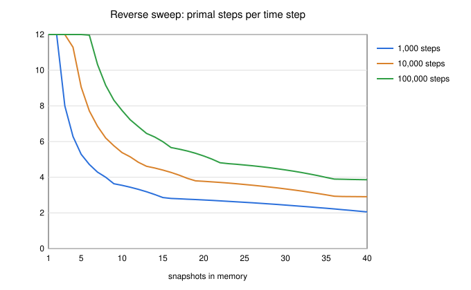

# Stage 5 – transient laminar flow

Stage 5 of the [stage plan](../requirements.md#7-stage-plan) adds time to
the flow solver of stage 4: the PISO algorithm (Issa 1986) with
variable-step BDF2 and Crank–Nicolson (D28), an adaptive time step,
optional outer iterations per step (a PIMPLE-type loop), restart files
(D42), control files and re-reading the case file during a run (D40),
point probes, force histories and field series (D43), and the built-in
mesh of the cylinder benchmark of Schäfer & Turek (1996). A case becomes
transient with a `[time]` table; without it, it runs as before (the 13
case files of stage 4 give bitwise the results of v0.4). This page covers
the first part of stage 5 (the transient core and its benchmarks); the GPU
flow loop and the further items of the stage follow in their own pull
requests and are added here. Part 2 is the GPU flow loop
([below](#gpu-flow-loop-part-2)), part 3 the adjoint-ready kernels
([below](#adjoint-ready-kernels-part-3)), part 4a the run contract for
scripts and agents ([below](#run-contract-part-4a)), part 4b the health
checks ([below](#health-checks-conservation-ledger-and-divergence-report-part-4b)),
part 5a the numerics ([below](#numerics-part-5a)). The commands are in
[recipes 21–28](../recipes.md#transient-flow), the pictures in
[gallery 14–20](../gallery.md#taylor-green), the case files in the
[case catalogue](../cases.md#flow-cases-examplescasesflow).

## Acceptance checks and results

| Check (stage plan row 5) | Result | Where |
|---|---|---|
| Taylor–Green vortex: time order 2 | plain PISO (one outer iteration, two correctors) on 64 × 64 cells, Δt = 0.01 … 0.000625 s: BDF2 2.35, 2.42, 2.21; Crank–Nicolson 2.40, 2.41, 2.00 | cases `taylor_green_bdf2`, `taylor_green_cn` (fail outside 1.8–2.3), test `taylor_green_time_order` |
| Taylor–Green vortex: space order 2 | 16² to 128² cells at Δt = 0.0025 s: 3.02, 2.55, 2.09 | case `taylor_green_space` (fail outside 1.8–2.2) |
| Order 2 at large time steps | Courant numbers 1.3 to 9 with outer iterations to 1e-9: 1.97, 2.00 | case `taylor_green_cfl10` |
| Cylinder 2D-1, Re 20 (C_D, C_L, Δp) | on 24 576 cells C_D and Δp inside the reference ranges, C_L 0.4 % below; on 98 304 cells all three inside | case `cylinder_re20` (fails above 0.5 %), test `cylinder_re20_on_the_coarse_mesh` |
| Cylinder 2D-2, Re 100 (C_D,max, C_L,max, St) | on 6 144 cells C_D,max, St and Δp inside the ranges, C_L,max 1.9 % below; on 24 576 cells C_L,max 0.5 % below, the others inside | case `cylinder_re100` (fails above 2.5 %) |
| A restart continues bit-identically (D42) | BDF2 with the adaptive step, and Crank–Nicolson with outer iterations: every field, old level, the clock and the multigrid matrix of the continued run equal those of the run without the interruption | tests `restart_continues_bit_identically`, `restart_crank_nicolson_outer` |
| Control files and re-reading (D40) | `.stop` ends a run with its restart file and results; `.result_N` writes the fields at step N; `.read_toml_N` and `reread_every` apply the changed run-time keys and list the rest as not applied | tests `stop_file_ends_the_run`, `result_and_reread_files` |
| Steady state of the time stepping | the lid-driven cavity at Re 100, time-stepped with BDF2 or Crank–Nicolson at Courant number 6 to the steady state, equals the SIMPLEC solution to 2e-12 (relative); the Rhie–Chow time-step term does not depend on Δt (D27) | case `cavity_re100_transient` (Ghia et al. to 0.44 % / 0.95 %, as stage 4), test `steady_state_of_the_time_stepping_is_the_simplec_solution` |

### Taylor–Green vortex

The decaying vortex u = −U cos kx sin ky F, v = U sin kx cos ky F,
p = p₀ − ¼ρU²(cos 2kx + cos 2ky) F², F = exp(−2νk²t), on the unit square
(one period, k = 2π), U = 1 m/s, ν = 0.01 m²/s (Re = 100), the exact
velocity on the four sides at each time level (`profile = "analytic"`),
from t = 0 to 0.4 s. The time order comes from the differences of
successive solutions on one mesh, ‖u(Δt) − u(2Δt)‖, so the spatial error
cancels; the space order from the error against the exact solution at a
fixed small step.

| Δt (s) | Largest Courant | BDF2 ‖u(Δt) − u(2Δt)‖ order | Crank–Nicolson order |
|---:|---:|---:|---:|
| 0.01 → 0.005 | 0.63 | 2.35 | 2.40 |
| 0.005 → 0.0025 | 0.32 | 2.42 | 2.41 |
| 0.0025 → 0.00125 | 0.16 | 2.21 | 2.00 |

On finer steps the orders approach 2 from above (a sweep down to
Δt = 0.04 … 0.000625 s gives 2.06–2.48 for BDF2 and 2.10–2.45 for
Crank–Nicolson). On a coarser mesh (32², end time 0.4 s) the order on the
smallest steps (Courant numbers below 0.1) falls to 1.8; the likely cause
is a mesh-dependent part of the differences that does not scale with Δt²,
such as the start from an initial field that is not discretely
divergence-free. The case files therefore use 64².

| Cells | L2 error / U at t = 0.4 s | Order |
|---:|---:|---:|
| 256 | 2.61e-2 | |
| 1 024 | 3.22e-3 | 3.02 |
| 4 096 | 5.50e-4 | 2.55 |
| 16 384 | 1.29e-4 | 2.09 |

At large steps plain PISO is no longer accurate (the splitting error grows
with the Courant number); outer iterations restore the order:

| Δt (s) | Largest Courant | Outer iterations per step | CG per step | Order |
|---:|---:|---:|---:|---:|
| 0.16 | 9.07 | 51 | 1 122 | |
| 0.08 | 4.80 | 30 | 660 | |
| 0.04 | 2.48 | 19.6 | 422 | 1.97 |
| 0.02 | 1.26 | 15.1 | 315 | 2.00 |

### Cylinder in a channel (Schäfer & Turek 1996)

Channel 2.2 × 0.41 m, cylinder D = 0.1 m at (0.2, 0.2) m, parabolic inflow
with U_max = 0.3 m/s (2D-1, Ū = 0.2 m/s, Re = 20) or 1.5 m/s (2D-2,
Ū = 1 m/s, Re = 100), ν = 1e-3 m²/s, no-slip walls, zero static pressure
at the outlet. C_D = 2F_x/(ρŪ²D d) and C_L = 2F_y/(ρŪ²D d) from the
pressure and viscous forces on the cylinder (d the layer thickness); Δp
between the points (0.15, 0.2) and (0.25, 0.2) m. For 2D-2 the evaluation
window starts at t = 5 s (the vortex street is periodic from about
t = 4 s); St = D f/Ū from the mean of the last five lift periods and Δp
half a period after the last lift maximum, as in the benchmark
definition.

The built-in mesh `[mesh.cylinder]`: an O-grid of 4n × radial cells
around the cylinder filling the square 0 ≤ x, y ≤ 0.41 m, graded towards
the cylinder (ratio 6), its grid lines leaving the cylinder normal to it,
and a wake block of 64 × n cells graded towards the square (ratio 8);
`refine` halves every interval. Refine 0 has 6 144 cells, 128 around the
cylinder.

2D-1, steady SIMPLEC (reference ranges C_D 5.57–5.59, C_L 0.0104–0.0110,
Δp 0.1172–0.1176 Pa):

| Cells | Outer iterations | C_D | C_L | Δp (Pa) |
|---:|---:|---:|---:|---:|
| 6 144 | 502 | 5.5835 | 0.00960 | 0.11749 |
| 24 576 | 1 570 | 5.5808 | 0.01036 | 0.11750 |
| 98 304 | 12 000 (residual 1.3e-8, α_u = 0.5) | 5.5800 | 0.01060 | 0.11751 |

2D-2, PISO with BDF2, Δt adapted to a largest Courant number of 0.8, from
rest to t = 8 s (reference ranges C_D,max 3.22–3.24, C_L,max 0.99–1.01,
St 0.295–0.305, Δp 2.46–2.50 Pa):

| Cells | Steps | Δt (s) | C_D,max | C_L,max | St | Δp (Pa) | Time |
|---:|---:|---:|---:|---:|---:|---:|---:|
| 6 144 | 8 488 | 5.0e-4–1.2e-3 | 3.2319 | 0.9712 | 0.2955 | 2.4819 | 458 s, 1 thread |
| 24 576 | 17 009 | 1.7e-4–6.1e-4 | 3.2305 | 0.9847 | 0.3008 | 2.4854 | 2 310 s, 2 threads |

## Methods

**One time step** from tⁿ to tⁿ⁺¹ = tⁿ + Δt (`transient.rs`):

1. the old levels move on (uⁿ⁻¹ ← uⁿ, ṁⁿ⁻¹ ← ṁⁿ); for Crank–Nicolson the
   spatial operator R(uⁿ) of the old level is evaluated with the old flux;
2. per outer iteration (one for plain PISO): boundary values of tⁿ⁺¹,
   gradients and limiters; the momentum predictor (the rows of stage 4
   with the time term ρV a₀/Δt on the diagonal and the old levels on the
   right-hand side, convected by the flux of the latest iterate); the
   predicted Rhie–Chow flux with the time-step term; `correctors` pressure
   corrections Σ c_f (p'_P − p'_N) = −Σ ±ṁ* with c_f from D = V/(a_P/α)
   (the PISO coefficient), the fluxes corrected to continuity,
   u' = δ − D∇p', p += p'; between two correctors the neighbour
   correction δ = H(u')/a_P, which the first corrector neglects, is added
   to u and its flux to ṁ;
3. boundary values and gradients of the new level, the old-level
   difference of the Rhie–Chow time-step term and the largest Courant
   number.

An outer iteration ends the step when the momentum and continuity
residuals at its start are below `outer_tolerance`. The momentum and
pressure solves of a transient case go to a relative tolerance of 1e-8
by default (1e-2 for steady cases, where the outer iterations converge
anyway): with the steady default the solver error dominates the
differences of a time-order sweep.

**Time integration.** Backward differences with variable steps:
du/dt ≈ (a₀uⁿ⁺¹ + a₁uⁿ + a₂uⁿ⁻¹)/Δt, ω = Δtₙ/Δtₙ₋₁, a₀ = (1 + 2ω)/(1 + ω),
a₁ = −(1 + ω), a₂ = ω²/(1 + ω); zero-stable for ω < 1 + √2, so
`max_growth` is limited to that range. Crank–Nicolson: a₀ = 1, a₁ = −1,
θ = ½ on the spatial terms, with D_s = V/(a_P/α)·θ in the Rhie–Chow flux
so that its steady state is the SIMPLEC one. The first step of a run is
BDF1 for both schemes. For Crank–Nicolson this is the start of Rannacher
(1984): the scheme does not damp the part of the initial fields that is
not consistent with the discrete equations (the face fluxes, the
pressure), and without the damped first step the Taylor–Green error kept
a part of first order in Δt.

**Extrapolation.** Plain PISO lags the convecting flux and the deferred
corrections (the velocity gradients and limiters) by a step, which makes
it first order in time. In the first outer iteration of a second-order
step they are extrapolated from the two old levels,
φ* = (1 + ω)φⁿ − ωφⁿ⁻¹, with the level-n values taken at the end of the
previous step; later outer iterations use the latest iterate. This
restores second order at one outer iteration per step and does not change
a steady state. The pressure is not extrapolated: on the cylinder O-grid
the extrapolated pressure gradient drove an instability. The extrapolation
starts once two steps are done, because the initial field is not
discretely divergence-free and would otherwise be carried into the
convecting flux (on the cylinder this gave negative multigrid diagonals).

**Rhie–Chow in time** (D27). In a time step the face flux gets the term
γ_f Y_f, with Y_f = Σ_k (−a_k/a₀)(ṁ_f − ρū_f·S)ᵏ over the old levels and
γ_f = α(1 − D̄_f/D̄ˢ_f), D̄ˢ the interpolated D without the time term. At a
steady state the face flux is then the one of the steady solver, for any
Δt and α (the analogue of Majumdar's relaxation term; the cell-centred
form ρD a₀/Δt is only approximately independent on non-uniform meshes).
The cavity check above shows it to 2e-12.

**Adaptive time step.** After each step the next one is
Δt_new = Δt·min(max_cfl/C, max_growth), C the largest Courant number of
the step just taken, bounded by `min_time_step` and `max_time_step`; the
last step is cut to land on `end_time`, and the step after a cut one grows
from the cut step.

**Restart files** (D42, `restart.rs`, HDF5): the solution, the gradients
and limiters, the boundary values, the old levels with the extrapolated
quantities, the clock and the pressure matrix of the last multigrid setup,
per cell and face with their global identities. A run continued from the
file on the same mesh and decomposition is bit-identical to the run
without the interruption; a file from another numbering is mapped by
identity and rebuilds the multigrid (no longer bit-identical).

**Control files** (D40, `control.rs`): `.stop`, `.result_N` and
`.read_toml_N` in the output directory are checked after every step (or
outer iteration of a steady case). A re-read applies only the keys that
may change during a run (output schedule, restart and re-read schedule,
stop criteria, relaxation, linear-solver tolerances, time-step settings),
lists every change in the log and writes `case.read_toml_N.toml`; the
rest is reported as not applied.

**Monitors** (D43, `monitor.rs`): `history.csv` per step (time, Δt,
Courant number, residuals, outer and CG iterations), `forces.csv` (force
per wall and the coefficients), `probes.csv` (velocity and pressure at
points), `fields_<step>.vtkhdf` on a schedule, `coefficients.svg` (the
evaluation window of a periodic benchmark).

## Findings

- Plain PISO with one corrector diverges on the cylinder meshes: the
  diffusion number of the thin cells next to the cylinder is far above
  one, and the neglected neighbour correction is then too large. Two
  correctors (the default) are stable.
- Time-stepping the Re 20 cylinder to its steady state with plain PISO is
  unstable at Δt = 0.05 s. Outer iterations, or the steady solver, are the
  way to large steps.
- Steady SIMPLEC with the default α_u = 0.7 diverges on the 98 304-cell
  cylinder mesh; α_u = 0.5 converges, slowly (12 000 outer iterations to
  1.3e-8, 23 minutes on two cores). The coupled solver (L11) is the
  remedy planned for this.
- Extrapolating the pressure along with the flux was tried and dropped
  (see Methods).

## GPU flow loop (part 2)

The whole flow loop runs on an NVIDIA GPU with `run.backend = "cuda"` (or
`foehn flow --backend cuda`), steady and transient, with results bitwise
equal to the CPU (D31).

**One source for both, down to the argument lists.** Every operation of
the flow loop (27 of them: gradients, limiter, boundary values, Rhie–Chow
fluxes, momentum faces and rows, the Crank–Nicolson operator, pressure
faces and rows, corrections, the neighbour correction of PISO, Courant
numbers, block reductions, element-wise updates) is an *entry* in
`foehncraft_kernels::entry`: a `#[repr(C)]` argument block of array
addresses with their lengths and scalars, and a body for one index that
calls the kernel bodies of stage 4. The flow device is written once over
an executor (`foehncraft_flow::device::kernel::KernelFlow`): it fills the
argument blocks from its buffers and asks the executor to run the entry.
The CPU executor runs the body in a multi-threaded loop over host memory;
the CUDA executor (crate `foehncraft-cuda`) launches the PTX entry
`flow_<name>` (`gpu/ptx-kernels/src/flow.rs`) with the same block passed
by value as a kernel parameter (the NVPTX back end passes an aggregate as
CUDA C does, `.param .align 8 .b8 [N]`; the largest block, the momentum
rows, has 1 104 bytes of the 4 096 allowed). Host and device compile one
struct definition, so an argument list cannot be wrong on one side only.
The PTX has no fused multiply-adds and IEEE division (R10,
`tools/check_kernels.sh`), and the norms, extrema and dot products use the
fixed blocks of 256 and the fixed tree of D31 on both.

**Data stay on the device.** All fields, old time levels, matrices and
right-hand sides live in GPU memory for the whole run; a step reads back
only scalars (residual norms, the largest Courant number, the limiter range
of Venkatakrishnan–Wang, the pressure level of the reference cell). The
momentum and pressure solves use the GPU backend of stage 2 and 3 with
device-to-device copies; the multigrid hierarchy is built on the host from
a download of the matrix, only when it is rebuilt. The output and restart
files download the fields at their times.

**CUDA in one crate (D60).** The CUDA host code of the whole code base (the
flow executor, the scalar and multigrid backend of stages 2–3, the G1
backends and the hand-written CUDA C reference) is in
`crates/foehncraft-cuda`; the solver crates register no vendor code and
find the GPU through factories that the front end installs
(`foehncraft_cuda::register`). `tools/check_backend.py` fails CI when a
CUDA type, call, header or source appears anywhere else.

**The CPU path is unchanged.** All 19 flow cases of the catalogue give, on
the CPU, bitwise the files of v0.4 and part 1 (fields, histories, forces,
restart files, reports; `tools/compare_runs.py` against the previous
build).

| Check | Result | Where |
|---|---|---|
| CPU results unchanged by the executor | all 19 flow cases bitwise equal to the previous build | `tools/compare_runs.py` |
| GPU = CPU, bitwise | all 8 cases bitwise equal (fields, residual histories, forces, reports, restart files; 6 to 13 files per case), Tesla T4, 2026-11-15 | `tools/stage5_cloud.py`, [`docs/benchmarks/stage5_gpu_t4.md`](../benchmarks/stage5_gpu_t4.md) |
| Time per cell and iteration on the GPU | 722 ns on 970 225 polyhedra (CPU, 2 threads: 5 116 ns, ×7.1); 1 049 ns per step on 98 304 cells (CPU 9 692 ns, ×9.2) | as above, gallery 16 |

The speed-up grows with the mesh: 2.3–3.8 times on 4 096 to 12 288 cells,
7 to 9 times from 98 304 cells, and below one (0.6) on the 153-cell
Couette case, where the time is the latency of the launches. The CPU of the
Colab VM has two threads, so the ratios against a workstation CPU are
smaller; the GPU numbers are those of a 2018 Tesla T4, and the Krylov
solvers still read a dot product back per iteration (below), which is
what the small cases mostly measure. No fused multiply-adds and no
atomics are in the GPU path, and the results are the CPU's to the last
bit.

**Not yet (D76):** the Krylov solvers still read a dot product back per
iteration (the BiCGStab and CG of stage 2 and 3), a step reads its
residual norms at once instead of one step late, and steps are not yet
captured as CUDA graphs. These follow with the GPU work of the later
stage-5 pull requests and of stage 7 (multi-GPU), behind the same
executor interface.

## Adjoint-ready kernels (part 3)

Requirement D59 asks that the discretisation can later be differentiated
and run backwards for a discrete adjoint solver (L17: surface
sensitivities, shape optimisation, adjoint error indicators), at little
cost if followed from stage 5. This part reviews the kernels of stages 2
to 5 against its six items and adds what was missing. No result of a run
changes: the 20 flow cases of the catalogue that run on the CPU give
bitwise the files of part 2 (160 files, `tools/compare_runs.py` against
the build of `main`).

| D59 item | How Foehncraft meets it | Check |
|---|---|---|
| (1) pure kernels | Every face, cell and boundary body is a function of its argument block (states, gradients, geometry, parameters) with no state between calls; the entries of part 2 make the inputs explicit down to the argument lists. Reviewed: all bodies of `foehncraft_kernels::{fv, flow, blas, amg}` | review; the Jacobian tests below call the bodies outside the solver |
| (2) dual numbers from the same source | `foehncraft_core::Dual<N>` (a value and N directional derivatives) implements `Real`, so every kernel body instantiates on dual numbers and returns its exact derivatives next to its result | 11 kernels against central differences (table below) |
| (3) non-differentiable parts | Comparisons, `max_of`, `min_of` and `abs` on dual numbers follow the value, so switches (upwind direction, limiter branch, clipping) are frozen at the state of the linearisation. The limiter value ψ is an input array of the face kernels: holding it constant is the frozen limiter; seeding it differentiates through the Venkatakrishnan function, which is smooth away from its clipping | limiter Jacobian against central differences |
| (4) transposed matrices | A transpose map of the matrix storage (each interior face couples two mirrored slots) gives Aᵀ in the storage of A, and the product Aᵀx without storing Aᵀ, both as gathers without atomics (`foehncraft_kernels::adjoint`, entries `flow_transpose`, `flow_matrix_product`, `flow_transposed_product` on CPU and GPU). The solvers and the multigrid run on the stored Aᵀ unchanged | ⟨Av, w⟩ = ⟨v, Aᵀw⟩ to 1e-14 on the momentum and pressure-correction matrices of a SIMPLEC solve; CG + AMG and BiCGStab solve Aᵀx = b to 1e-10 |
| (5) explicit parameters | Boundary values, properties (ρ, μ, Γ per face) and the geometry (areas, centroids, volumes, interpolation weights, least-squares weights) are inputs of the kernels. The geometry functions of `foehncraft-mesh` are generic over the coordinate type, so the derivatives of areas, centroids and volumes with respect to the node coordinates come from the same source | node-coordinate Jacobian of the geometry against central differences |
| (6) checkpointing | `foehncraft_flow::checkpoint`: the binomial schedule of Griewank & Walther (2000) with the least recomputation, a driver for any primal run, and the in-memory snapshot of the flow solver (the content of a restart file) | schedules equal the optimum of a dynamic program; the reverse sweep of a BDF2 run meets every level bitwise |

**Jacobians against central differences.** On a perturbed mixed mesh
(hexahedra, prisms, tetrahedra and polyhedra; 120 cells, 339 faces of
which 114 on the boundary) with random values in all 59 input arrays, every
boundary kind and every boundary update rule, each input array gets a
random direction scaled to its size. The derivative of every output of
every face (cell, boundary face) from the dual numbers is compared with
the central difference of the same body on `f64` (step 10⁻⁶ of the size
of each array), once per input array and once for all arrays together;
the dual value equals the `f64` value. The geometry is checked on a mixed
mesh of 54 cells and 48 nodes, for each coordinate of each node.

| Kernel | Outputs per index | Derivatives compared | Largest relative difference |
|---|---:|---:|---:|
| least-squares gradient (`fv::lsq_gradient`) | 3 | 23 400 | 1.0e-7 |
| Venkatakrishnan limiter (`fv::venkat_limiter`) | 1 | 7 800 | 1.1e-7 |
| scalar face flux (`fv::face_coefficients`) | 3 | 66 105 | 8.5e-8 |
| momentum face flux (`flow::momentum_face`) | 5 | 110 175 | 5.2e-8 |
| Rhie–Chow mass flux, steady (`flow::face_mass_flux`) | 1 | 22 035 | 4.1e-7 |
| Rhie–Chow mass flux in a time step | 1 | 22 035 | 5.1e-7 |
| pressure-correction coefficient (`flow::pressure_face`) | 1 | 22 035 | 1.8e-7 |
| flux correction (`flow::correct_flux`) | 1 | 22 035 | 3.8e-8 |
| flux of a velocity increment (`flow::delta_flux`) | 1 | 22 035 | 8.7e-8 |
| boundary velocity, seven rules (`flow::boundary_velocity`) | 3 | 22 230 | 1.7e-7 |
| boundary pressure, six rules (`flow::boundary_pressure`) | 1 | 7 410 | 5.1e-8 |
| geometry from the node coordinates (`geometry::polygon_area_centroid`, `cell_volume_centroid_of`) | 6 per face, 4 per cell | 165 024 | 2.8e-7 |

The differences are those of the central differences (truncation 10⁻¹²
and round-off 10⁻¹⁰ relative); the dual derivatives are exact up to
rounding. Moving an interior node leaves the total volume unchanged
(Σ_c ∂V_c/∂x = 0 to 10⁻¹⁴).

**Transposed matrices.** On the lid-driven cavity at Re 100 (perturbed
polygons, after five SIMPLEC iterations, so the momentum matrix carries
convection and is not symmetric): transposing twice gives A back bit for
bit; the product Aᵀx without storing Aᵀ is the product with the stored Aᵀ
bit for bit, and the same on 1 and 4 threads; ⟨Av, w⟩ = ⟨v, Aᵀw⟩ to 10⁻¹⁴
of Σ|(Av)_i w_i|; the pressure-correction matrix is its own transpose bit
for bit; CG with the multigrid solves the transposed pressure system and
BiCGStab the transposed momentum system to 10⁻¹⁰, the residual checked
with the product that never stores Aᵀ. The multigrid of stage 3 needs a
symmetric matrix, where Aᵀ = A; a multigrid for non-symmetric matrices (a
coupled solver) will take Aᵀ from the same transpose.

**Checkpointing.** With s snapshots besides the start and at most t
recomputations of a step, β(s + 1, t) = C(s + 1 + t, t) steps can be
reversed (Griewank 1992). The schedule places the first snapshot of a
range of n steps at m = max(1, n − β(s, t), β(s + 1, t − 2)) for the
smallest t with β(s + 1, t) ≥ n and recurses; the reverse sweep then runs
t n − β(s + 2, t − 1) primal steps, the least possible: for every n up to
90 and s up to 6 the count equals the optimum of a dynamic program over
all positions of the first snapshot, every adjoint step meets its level,
and no more than s snapshots are held. 10 000 steps with 20 snapshots
need at most four runs of each step. On the flow solver a snapshot is the
content of a restart file kept in memory; the reverse sweep of 13 BDF2
steps of the cavity with 2 snapshots (24 primal steps) meets every level
with the bits of the plain forward run.

**Not yet:** the derived geometry of the discretisation (the factor
|S|²/(d·S), the vector k, the interpolation and least-squares weights) is
still computed in `f64` only; making it generic, which completes the chain
from the node coordinates to the residual, comes with mesh morphing (L4).
The adjoint solver itself is L17.

## Run contract (part 4a)

Requirements D62, D64, D69 (the run record), D75 and D77–D87 make a run
something a program can drive: a parametric study (D62), a batch job, or
an agent through the later MCP server (L18). This part adds them on the
solver side; the conservation ledger and the divergence report (D63, D88,
D89) follow as part 4b. No result changes: the 20 flow cases of the
catalogue give bitwise the fields, CSV files and report values of the
build of `main` (`tools/compare_runs.py --across-versions`; the resolved
case gains the empty `[run.limits]` table).

| Check | Result | Where |
|---|---|---|
| Stop at a limit, continue with `--restart latest` (steady) | fields and restart file bitwise equal to the run without the stop | test `steady_restart_latest_is_bitwise` |
| SIGTERM during a transient run, then `--restart latest` | exit code 3, `RUN002` in `result.json`; fields and restart file bitwise equal | test `sigterm_stops_cleanly_and_restart_latest_continues_bitwise` |
| Two identical runs (D84) | `result.json`, fields and CSV files byte for byte equal | test `json_result_and_byte_identical_files` |
| Exit codes 0–3 and JSON error objects (D64, D78, D79) | out-of-range value `CASE004` with its key, typo `CASE002` with key, location and hint, non-convergence exit 2 (`RUN006`), limit exit 3 (`RUN004`) | test `exit_codes` |
| Schema and key reference (D77) | every run-time key of D40 in the schema; `docs/keys.md` equal to `foehn schema --markdown` | tests in `schema.rs` |
| Codes documented (D78) | every code of the registry is a row of `docs/interfaces.md` | test in `diag.rs` |
| Estimate (D81) | 11 cases, 128 to 28 227 cells: peak memory within 6 %, file sizes within 9 % | `tools/estimate_chart.py`, gallery 18 |
| C-free core (D87) | `foehncraft-flow` without default features: no `-sys` crate, no C build | `tools/check_c_free.sh` in CI |

**How a stop stays bitwise.** A stop (signal, `.stop` or limit) is tested
after an iteration or step is complete, the same place where the run
would write a scheduled restart file; the restart file holds the whole
state (fields, old levels, the clock, the adaptive step, the multigrid
matrix), and `--restart latest` reads the step or iteration from the file
(D75), not from its name. A steady run continues its iteration count, so
convergence is tested at the same iterations as without the stop.

**Why `result.json` has no timings.** It is the file a study compares and
a hash identifies, so it holds only what the numerics decide; timings go
to `run.jsonl` and the reports. Its `files` list gives the SHA-256 of every
other output, which makes a comparison of two runs a comparison of two
small files.

**Memory model.** The peak resident memory of a run is 14 MB plus 1960
bytes per interior face and 710 per boundary face. An interior face
carries the two off-diagonal entries of each matrix in SELL storage, its
fluxes and its share of the multigrid hierarchy; a boundary face its
geometry and boundary values. The split matters for the one-cell-thick 2D
meshes, whose front and back faces are half of all faces: a single
per-face constant left 3D polyhedra 24 % low. The device memory of the GPU
loop is taken as three quarters of the face part (to be measured on a GPU).

## Health checks: conservation ledger and divergence report (part 4b)

Requirements D63, D88, D89, D90 part 4 and D91. Every run books mass and
kinetic energy; a run that diverges explains itself. No result changes:
the flow cases of the catalogue give bitwise the fields, CSV files and
report values of part 4a (`tools/compare_runs.py --across-versions`; the
resolved case gains the `[balance]` table, the reports the `balance`
values; one new warning, `BAL003` on the Taylor–Green sweep at Courant
number 10, see below).

| Check | Result | Where |
|---|---|---|
| Cavity Re 100, steady, 16² to 64² (D90 part 4) | lid power = viscous + numerical dissipation to round-off; numerical dissipation positive, its share falling with the mesh; mass ledger zero | test `cavity_energy_budget_on_three_meshes` |
| Taylor–Green, BDF2, 0.2 s at Courant number 0.32 | relative mass imbalance below 1e-12 per step; ΔK = boundary − viscous − numerical over the run; numerical dissipation falls by more than 3 per halving of h and Δt | test `taylor_green_ledger_falls_with_the_mesh` |
| Balance tables during a steady run | the solution bitwise unchanged | test `balance_every_leaves_the_solution_unchanged` |
| SIMPLE without relaxation (steady divergence) | exit 1, `RUN014`; last valid state, restart, snapshot, report; first cause `DIV002` with a fix that runs | test `steady_divergence_gives_the_report` |
| Crank–Nicolson at a Courant number above 100 (transient divergence) | first cause `DIV001` with a smaller time step; the restart file of the last valid state reads back | test `transient_divergence_points_to_the_time_step` |
| Restart geometry (D91) | optional points and volumes round-trip | test `restart_geometry_round_trip` |
| Energy budget over the mesh | the table and chart below | `tools/energy_budget_chart.py`, gallery 19 |

**What the numerical dissipation is.** Dotting the discrete momentum
equation with the cell velocity and summing gives the discrete
kinetic-energy budget. Its viscous part is exact face by face: an
interior face removes F·(u_N − u_P), with F the diffusive flux the
momentum rows use (non-orthogonal and skewness corrections included), and
a wall gives work F·u_b and dissipation F·(u_b − u_P). The ledger books
this discrete viscous dissipation, which converges to ∫ μ ∇u:∇u dV, so the
remainder holds only what the convection scheme, the Rhie–Chow coupling
and the iteration error take out. The ledger splits it. The momentum rows
hold the pressure as the volume source −∇p_P V_P (least-squares cell
gradient), so their budget has −Σ u_P·∇p_P V_P where the exact one has
the boundary pressure work; the difference, the discrete −∫ p ∇·u dV of
the cell velocities, is the pressure part (`pressure_dissipation`), the
rest the scheme part (`scheme_dissipation`). A first version used μ ∇u:∇u with the
least-squares cell gradients: it left 12 % to 15 % of the cavity's lid
power unexplained, nearly all of it in the cells at the corners, where
the gradient of the cell is not the gradient of the face differences.

**Measured** (64 x 64 is the catalogue case):

| Case | Mesh | Boundary power | Viscous dissipation | Numerical dissipation | of it pressure | of it schemes |
|---|---|---|---|---|---|---|
| cavity, steady (W) | 16² | 1.9670e-3 | 1.9267e-3 | 4.03e-5 (2.05 %) | 7.63e-5 | −3.60e-5 |
| | 32² | 2.4499e-3 | 2.4110e-3 | 3.88e-5 (1.59 %) | 5.68e-5 | −1.80e-5 |
| | 64² | 2.9194e-3 | 2.8771e-3 | 4.23e-5 (1.45 %) | 5.12e-5 | −8.81e-6 |
| | 128² | 3.3851e-3 | 3.3399e-3 | 4.51e-5 (1.33 %) | 4.95e-5 | −4.40e-6 |
| cavity, first-order upwind (W) | 16² | 2.1294e-3 | 1.8905e-3 | 2.39e-4 | 5.55e-5 | 1.83e-4 |
| | 32² | 2.5830e-3 | 2.3758e-3 | 2.07e-4 | 4.95e-5 | 1.58e-4 |
| | 64² | 3.0139e-3 | 2.8541e-3 | 1.60e-4 | 4.82e-5 | 1.12e-4 |
| Taylor–Green, over 0.4 s (J) | 16² | | 1.8324e-3 | 4.07e-4 | 1.27e-4 | 2.80e-4 |
| | 32² | | 1.8317e-3 | 7.38e-5 | 1.60e-5 | 5.78e-5 |
| | 64² | | 1.8302e-3 | 1.20e-5 | 1.42e-6 | 1.06e-5 |
| Poiseuille, tetrahedra (W) | levels 0, 1, 2 | 0.2396 to 0.2399 | | −1.81e-4, −1.23e-4, −7.04e-5 | −3.71e-4, −1.73e-4, −8.33e-5 | 1.90e-4, 5.04e-5, 1.29e-5 |
| Poiseuille, polyhedra (W) | levels 0, 1, 2 | 0.2405 to 0.2400 | | −6.72e-4, −1.91e-4, −3.68e-5 | −8.11e-4, −2.10e-4, −4.07e-5 | 1.39e-4, 1.87e-5, 3.86e-6 |
| Poiseuille, perturbed hexahedra (W) | levels 0, 1, 2 | 0.2395 to 0.2403 | | 3.83e-4, 3.49e-4, 3.49e-4 | 3.87e-4, 3.51e-4, 3.49e-4 | ≈ 0 |

On the cavity the share falls, slowly: the lid meets the side walls in
two singular corners, where the velocity jumps and the pressure goes like
1/r, so the lid power grows with the mesh and the pressure part in the
corner cells stays of the same size (in Stokes flow, convection off, the
numerical part is 4.88e-5 W on all three meshes). The scheme part of linear upwind is slightly negative
there and falls with first order; first-order upwind makes it positive and
an order of magnitude larger. On the smooth Taylor–Green vortex the numerical
dissipation falls with order 2.46 and 2.62, its pressure part with order
2.99 and 3.5, its scheme part with 2.27 and 2.45. The first steps (1 or 2
of 20 to 80) alternate in sign: the analytic start field is not a
discrete solution. They are counted (`negative_steps`), as D90 asks.

On distorted cells the pressure part holds a consistency error of either
sign: on tetrahedra, mixed cells and polyhedra the Poiseuille flow's
total numerical dissipation is negative, at most 0.28 % of the boundary
power, and falls with the mesh; on randomly perturbed hexahedra (the
same relative distortion on every level) the pressure part is positive
and constant. Hence `[balance] tolerance_energy` (default 1e-2): `BAL003`
warns when the discretisation adds more than 1 % of the largest term. In
the catalogue it fires once, on the Taylor–Green sweep at Courant number
10, where the run with the largest time step adds 2 % (the scheme part). The mass ledger of a
transient step now uses the mass flows at the end of the step, where the
discrete continuity equation holds: the cylinder at Re 100 started with a
mass imbalance of 2e-3 from its start field and now books 4e-14.

**Cost.** Steady runs evaluate the ledger at the table cadence and at the
end. Transient runs evaluate it every step, since the trapezoidal rule
needs both ends of the step: one download of the fields and a pass over
the faces on the host, about 1 % of a step on the CPU; on the GPU it is a
transfer per step of 20 values per cell (to be measured on the T4; the
download can later move to every N steps with a cumulative device sum).
The divergence copy of u, p and ṁ before each iteration or step is four
device copies.

**Divergence detection.** The check is the one that was there: every
residual of every outer iteration or corrector finite. It now uses all
residuals (`Residuals::finite`): `max` skipped a NaN in the continuity
residual. A breakdown of the pressure CG on non-finite values is a
divergence too. When the fields are still finite (the solver broke down
first), the failing cells are those with a speed above a tenth of the
largest. The causes are scored from the evidence: the Courant number of
the first step against `max_cfl`, the relaxation factors (for SIMPLE
against α_p ≈ 1 − α_u), the non-orthogonality and volume ratio of the
failing cells, patches next to them (and backflow at an outflow), a
failure within the first steps, and linear solvers at their limits.

## Numerics (part 5a)

Four items of the stage plan: the bounded central scheme (D25), the time
step from the time-integration error (D65), output at exact simulated
times (D66) and the potential-flow start (D52). Runs without the new keys
are bitwise those of part 4b (the catalogue below).

| Check | Result | Where |
|---|---|---|
| Bounded central, oblique step on 2 401 distorted polygons | φ in [0, 1], 57 outer iterations, 10–90 % width of the step 0.090 m (linear upwind with the Venkatakrishnan limiter 0.082 m, upwind 0.172 m) | variant `bounded-central` of `scalar/oblique_step_2d.toml` (fails outside [0, 1]) |
| Bounded central, Taylor–Green space order | 16² to 128²: 3.22, 2.65, 2.10; L2 error on 128² 1.291e-4 (linear upwind 1.290e-4), pressure L∞ 7.66e-4 (1.08e-3) | `taylor_green_space` with `--set 'solver.scheme="central"'` |
| Bounded central, kinetic energy | Taylor–Green 64², 0.4 s: numerical dissipation −1.5e-6 J (pressure part +1.4e-6 J, scheme part −2.9e-6 J), −0.08 % of the viscous dissipation, inside `tolerance_energy`; linear upwind +1.2e-5 J | `taylor_green_bdf2` with `verification.time_steps=[]` |
| Central momentum flux, derivatives | dual-number Jacobian of the central face flux against central differences | test `jacobian_of_the_central_momentum_face_flux` |
| Error-based time step, Taylor–Green 64² | tolerance 1e-4 / 1e-5 / 1e-6: 26 / 37 / 50 steps, 0 / 6 / 9 rejected, velocity error L2 1.53e-3 / 8.36e-4 / 6.25e-4 at t = 0.4 s (Courant control alone 25 steps, 1.64e-3; spatial error of the mesh 5.5e-4) | case `taylor_green_error`, `tools/time_step_chart.py` |
| A rejected step is taken back exactly | BDF2 and Crank–Nicolson: the repeated step and the next one bitwise those of the run that took the short step at once | test `rejected_step_repeats_bitwise` |
| Restart with the error estimate | a run with rejected steps continues from a restart file bit-identically | test `error_controlled_steps_restart_bit_identically` |
| Output at exact times | monitor rows at the multiples of 0.05 s to 1e-12 s, the numbered restart at its time, no step below half the one before | test `output_lands_on_scheduled_times` |
| Potential-flow start | uniform channel flow to 1e-11 on hexahedra; on polygons perturbed by 15 % RMS deviation 1.2 % (12 % without the non-orthogonal correction); face fluxes continuous to 1e-8 of the inflow; cylinder Re 20 converges in 1527 instead of 1570 iterations | test `potential_flow_start_in_a_channel`, case `cylinder_potential` |

**Bounded central scheme.** The face value of the central scheme,
φ_c = w φ_P + (1 − w) φ_N + ∇φ_f·(x_f − x_w), is bounded in the normalised
variable of the upwind cell U (Leonard 1988; Gaskell & Lau 1988),
φ̃_U = 1 − (φ_D − φ_U)/(2∇φ_U·d), d = x_D − x_U: γ = 1 for φ̃_U ≥ β,
γ = φ̃_U/β for 0 < φ̃_U < β, γ = 0 (upwind) outside (0, 1), and for β > 0
the central value is clipped to [φ_U, φ_D]. The deferred correction is
ṁ[(1 − c)·ψ_U(∇φ_U·(x_f − x_U)) + c·ψ_U γ (φ_c − φ_U)] with the blend c
(`central_blending`) and the limiter ψ_U of the upwind cell. The limiter
factor was needed: on the distorted polygons the bounded value alone left
overshoots of 3–9 % and did not converge for pure convection; on regular
hexahedra the scheme is bounded without it for β ≥ 0.3. On outflow
boundary faces the scheme takes the boundary value (c·ṁ(φ_b − φ_P)): without
it the outflow faces of the Taylor–Green box were first order and the
error 2.4 times that of linear upwind. In the first outer iteration of an
extrapolated transient step the correction uses the extrapolated velocity
u* = (1 + ω)uⁿ − ωuⁿ⁻¹, as the other explicit parts do. Every new term
sits behind `central > 0`, so the other schemes stay bitwise as before.

**Error estimate of the time step.** Milne's device (Kay, Gresho,
Griffiths & Silvester 2010): the predictor P is the quadratic through
uⁿ⁻², uⁿ⁻¹, uⁿ at tⁿ⁺¹, whose error is P − u(tⁿ⁺¹) = −Π h³u'''/6 with
Π = (h + h₁)(h + h₁ + h₂)/h²; the error of the corrector is
uⁿ⁺¹ − u(tⁿ⁺¹) = K h³u'''/6 with K = (1 + ω)²/(ω(1 + 2ω)) for
variable-step BDF2 (ω = h/h₁; 4/3 at equal steps) and K = −1/2 for
Crank–Nicolson. So the local error is K/(K + Π)·(uⁿ⁺¹ − P), and
E = |K/(K + Π)|·RMS(uⁿ⁺¹ − P)/(atol + rtol·RMS(uⁿ⁺¹)). The next step is
h·min(0.9 E^(−1/3), max_growth, max_cfl/Courant), bounded by
`min_time_step` and `max_time_step`; a step with E > 1 is repeated with
h·max(0.2, 0.9 E^(−1/2)), at most 8 times. The repeat uses the exponent ½
because the error constant K grows as 1/ω when the step gets short
against the one before, so the error falls only as h² there (measured on
the cavity: from ω = 1 down, 2.3 falling towards 2). The estimate starts
with the fourth step: uⁿ⁻² is then a level after the first step, whose
BDF1 error and the start fields, which are not a solution of the discrete
equations, otherwise count as error. Two limits of the estimate: it sees
the noise of the linear solvers (keep the tolerance ten times above
theirs), and with plain PISO at Courant numbers above about 2 the error
grows faster than h³, so the estimate cuts the step sharply there (the
drops in gallery 20). The tolerance is per step: the error at the end of
a run is up to the number of steps times larger.

**Taking a step back.** Before each estimated step the driver keeps uⁿ⁻²,
Xⁿ⁻¹ (the Rhie–Chow time-step term), the velocity gradients and limiters
of level n − 1 with the buffer roles of the extrapolation, and the clock;
u, p and ṁ of level n are the copy that the divergence report keeps
anyway (D63). A rejection puts these back, sets the boundary values of tⁿ
and recomputes the boundary values and gradients of level n from them,
the same operations on the same data as at the end of the step before.
That is why the repeat is bitwise the step of a run with the shorter Δt.
The restart file carries uⁿ⁻² and the step before the last, so that an
error-controlled run continues bitwise.

**Output at exact times.** A schedule in simulated time (the multiples of
an interval and a list of times) names the next time after the current
one; the driver shortens the planned step to land on it, and when the
time lies within two planned steps it takes two equal ones, so that no
step falls below half the planned one (a short step would cost the
adaptive control many steps to recover under the growth limit). The
schedules are computed from the clock alone, so a restart keeps them.

**Potential-flow start.** The pressure-correction equation of SIMPLEC
with D = 1, Σ_f ρ dgeo_f (φ_P − φ_N) = −Σ_f ±ṁ*_f, from zero cell
velocities, so that ṁ* holds only the prescribed boundary fluxes: its
boundary conditions are those of the potential (∂φ/∂n from the velocity
inlets, ∂φ/∂n = 0 on walls and symmetry planes, φ = 0 on pressure
boundaries), and the pressure multigrid solves it. Four passes add the
non-orthogonal part of the face flux, −ρ(∇φ)_f·k_f, of the potential of
the pass before (Jasak 1996): on polygons perturbed by 15 % the RMS
deviation from uniform channel flow falls from 12 % to 1.2 %. The cell
velocity comes from the face fluxes, u_P = Σ_f ±ṁ_f (x_f − x_P)/(ρV_P),
exact for a uniform flow because Σ_f (x_f − x_P) S_fᵀ = V_P I; the
gradient of φ is not, next to the inlets, because the correction gradient
assumes ∂φ/∂n = 0 on every boundary that is not a pressure boundary. The
start pressure stays, and the run builds its own multigrid.

**The catalogue against part 4b.** The 22 flow cases of the CI sets and
the scalar cases `oblique_step_2d` (its four variants of part 4b),
`mms_poly_2d` and `mms_poly_box`, run with the binaries of main and of
this part: every field, restart dataset, CSV row and report value
bitwise equal (`tools/compare_runs.py --across-versions`, 263 files).
What differs by design: the resolved case lists the new keys, and the
restart file has the attribute `dt_prev2`; the comparison now matches
the lines of the older resolved case in order and HDF5 files by their
datasets.

## Boundary conditions (part 5b)

The conditions of D29 that are not periodic: slip wall, wedge, inlet
profiles from a table, backflow treatment at pressure outlets and the
convective outlet. Runs whose pressure outlets see no backflow are bitwise
those of part 5a (the catalogue below).

| Check | Result | Where |
|---|---|---|
| Slip walls | uniform flow between slip walls on hex, tet, poly and mixed cells perturbed by 20 %: velocity error 1.5e-11, pressure 1.0e-11 | case `channel_slip`, test `slip_walls_hold_the_uniform_flow_on_every_mesh_type` |
| Wedge, Hagen–Poiseuille | 0.5°, 256 to 4 096 cells perturbed by 15 %: L2 error 2.11e-3, 5.00e-4, 1.21e-4, order 2.07, 2.04; polygonal prisms revolved (1 105 cells) 3.0e-4 | case `pipe_wedge`, tests `wedge_pipe_is_second_order`, `wedge_pipe_on_polyhedra` |
| Wedge mesh | every cell type of the box generator, perturbed or not: closed cells, the volume of the planar wedge to 1e-12, wedge planes planar at ∓θ/2; an annulus keeps its inner patch | tests `wedges_of_every_type`, `annulus_keeps_the_inner_wall` |
| Inlet profile from a table | the table's rows at the inlet face centres give the run with the exact parabola (L2 error 1.592e-3 for both, equal to 1e-6); missing and malformed tables refused (BC019) | case `poiseuille_table`, tests `table_inlet_matches_the_exact_profile`, `bad_tables_are_refused` |
| Backflow as total pressure | the reversed uniform flow leaves through the velocity inlet and enters through the outlet: uniform flow exact, static pressure p_set − ½ρU² to 3e-11, 132 iterations; with `zero-gradient` the residual falls by only 0.81 per 200 iterations | test `backflow_takes_the_outlet_pressure_as_total_pressure` |
| Backflow suppressed | a side outlet held 0.1 Pa above the channel: the faces close and act as a slip wall, no mass crosses (exactly 0), the uniform flow stays exact (1.3e-11); with the total-pressure treatment fluid enters | test `suppressed_backflow_closes_the_outlet` |
| Convective outlet, mass and start-up | no pressure boundary: outlet flow equal to the inflow to round-off in every step (largest relative imbalance 5e-18 in the cylinder run); the start-up disturbance leaves, error 2.4e-2, 1.6e-3, 3.9e-5 after 0.25, 2 and 4 s (two flow-through times) | test `convective_outlet_balances_the_flow_and_lets_the_start_leave` |
| Convective outlet, restart and rejection | error-controlled steps with rejections, continued from a restart file bit-identically, including the old boundary levels | test `convective_outlet_restarts_bit_identically` |
| Cylinder at Re 100, outlet 5.5 D behind the cylinder | pressure outlet (total-pressure backflow): C_D,max 3.2336, C_L,max 0.9713, St 0.2951, Δp 2.4825 (long channel 3.2319, 0.9712, 0.2955, 2.4819); convective outlet 3.2261, 0.9555, 0.2952, 2.4779 | cases `cylinder_re100_short` (fails above 2.5 %), `cylinder_re100_convective` (above 4 %), `tools/outlet_chart.py` |
| Checks | convective outlet in a steady case (BC021), without inflow and convection velocity (BC022), one wedge plane (BC023), a wedge over 10° (BC024) | test `checks_of_the_new_conditions` |

**Slip wall and wedge.** Both use the kernels of the symmetry plane: no
normal velocity, the tangential velocity of the cell, no shear stress, the
extrapolated pressure. On the wedge planes this is also the axisymmetric
treatment: the two planes see the velocity rotated by ±θ/2, and the
viscous flux through them is the hoop-stress term −μ u_r/r² of the
axisymmetric equations (in the limit of a small θ), so no source term is
needed. The axis carries no face: the nodes with y = 0 of both layers are
one node, the faces there have zero area and are dropped, and the cells
next to the axis become prisms (from hexahedra) or polyhedra with an edge
on it. The faces of the wedge are planar, so a wedge of θ is a slice of a
pipe whose cross-section is a regular polygon of 360°/θ sides. At 5° this
polygonal pipe differs from the round one by 9e-4 in the velocity (about
θ²/8); on the finest mesh of the sweep that is larger than the
discretisation error (observed order −0.8 at 5°, 2.4 at 1°, 2.04 at
0.5°), hence the small angle of the case.

**Backflow at pressure outlets.** A face of a static pressure outlet whose
flux points into the domain takes, with `"total-pressure"`, the
prescribed pressure as the total pressure of the entering fluid,
p_b = p_set − ½ρ(ṁ/(ρ|S|))², and the velocity normal to the face,
u_b = (u_e·n̂) n̂ (u_e the extrapolated velocity): the entering fluid has
no more energy than the reservoir behind the outlet, which is what keeps
the iteration stable where a vortex crosses the outlet. With
`"zero-gradient"` (the treatment before) both stay as on outflow; the
reversed-flow channel then converges at 0.81 per 200 iterations instead
of in 132 iterations. With `"suppress"` the predicted flux of such a face
is set to zero and the face leaves the pressure-correction equation for
that iteration; its velocity is the tangential part of u_e and its
pressure the extrapolated one, so the closed face is a slip wall. The
predicted flux is computed with the prescribed pressure, not the
extrapolated one, so a closed face opens again exactly when the
prescribed pressure would drive the flow out (with the extrapolated
pressure the faces flip between open and closed and the run stalls at a
residual of 7e-3). The rules read only the mass flux, so a restart or a
rejected step needs no state of the closed faces.

**Convective outlet.** On the outlet faces
∂u/∂t + U_c ∂u/∂n = 0 is discretised between the face and its cell with
the backward difference of the run (BDF1 for Crank–Nicolson and the
first step): a₀u_b + a₁u_bⁿ + a₂u_bⁿ⁻¹ = −Δt U_c (u_b − u_e)/Δn, so
u_b = (c + βu_e)/(1 + β) with c = −(a₁u_bⁿ + a₂u_bⁿ⁻¹)/a₀ and
β = U_c Δt/(a₀ Δn), Δn the distance from the cell centre to the face along
the normal and u_e the velocity of the cell extrapolated along the face.
c and β are set per step on the device. U_c defaults to the mean outflow
speed −Q_in/(ρA_out). When no boundary prescribes the pressure, the
outlet velocity is shifted by one normal velocity per iteration so that
the outflow equals the prescribed inflow, an exact reduction in face
order (D31), and the reference cell holds the pressure level. Between
steps (at the start, after a restart and while a step is repeated) β = 0
holds u_b = c exactly, so restart and rejection are bitwise; the restart
file stores the level u_bⁿ⁻¹ (`ub_old_x|y|z`). In the short channel the
convective outlet lowers C_L,max by 1.6 % against the long channel, while
the pressure outlet with the total-pressure backflow keeps it; the
convection speed is the mean outflow speed by default;
`convection_velocity` sets another.

**Inlet profile from a table.** The table is read when the case loads,
after the read-root check (D82); its sha256 is part of the case hash
(D85), so a changed table is a changed case. Values are linear between the
rows and constant beyond the ends; the check names the faces outside the
rows (BC020).

**The catalogue against part 5a.** The 23 flow cases of the CI sets of
part 5a, the scalar, Poisson and mesh cases, run with the binaries of main
and of this part (`tools/compare_runs.py --across-versions`, 309 files):
20 flow cases and every scalar and Poisson case bitwise equal; the mesh
reports differ only in their timings. `poiseuille_tet`, `poiseuille_poly`
and `poiseuille_mixed` differ by the new default backflow treatment: on
these perturbed meshes a few outlet faces next to the walls see inflow in
the first iterations; the iteration counts are the same and the errors
agree to 2e-6 relative (finest polygonal level 7.73569e-5 against
7.73571e-5; observed orders unchanged to 3e-6). With
`--set boundary.xmax.backflow=zero-gradient` all three are bitwise those
of main.

## Limits of this part of stage 5

- The further stage-5 items (the derived fields of part 5c, expressions,
  the Python package) follow in their own pull requests.
- The turbulence values of the backflow at pressure outlets are accepted
  and take effect with the turbulence models of stage 6. The wedge needs
  a 2D mesh of the box generator; wedges from Gmsh meshes come with D3.
- The potential-flow start does not yet interpolate from a result on
  another mesh, and has no grid sequencing (D52 later).
- The ledger covers mass and kinetic energy; momentum (the patch forces
  are in the reports), total energy and entropy (D90 parts 1–3) come with
  the energy equation (L1); regions (D73) later.
- Signals need unix; on Windows the `.stop` file and the limits stop a
  run.
- Restart files need the `hdf5` feature (on by default); a build without
  it runs transient cases but writes no restart file.
- One partition only, as in stage 4, and one GPU.

## References

- A. Griewank, *Achieving logarithmic growth of temporal and spatial
  complexity in reverse automatic differentiation*, Optim. Methods Softw.
  1, 35–54 (1992)
- A. Griewank, A. Walther, *Algorithm 799: revolve: an implementation of
  checkpointing for the reverse or adjoint mode of computational
  differentiation*, ACM Trans. Math. Softw. 26, 19–45 (2000)
- M. B. Giles, N. A. Pierce, *An introduction to the adjoint approach to
  design*, Flow Turbul. Combust. 65, 393–415 (2000)

- D. Kay, P. Gresho, D. Griffiths, D. Silvester, *Adaptive time-stepping
  for incompressible flow. Part II: Navier–Stokes equations*, SIAM J. Sci.
  Comput. 32, 111–128 (2010)
- B. P. Leonard, *Simple high-accuracy resolution program for convective
  modelling of discontinuities*, Int. J. Numer. Methods Fluids 8,
  1291–1318 (1988)
- P. H. Gaskell, A. K. C. Lau, *Curvature-compensated convective
  transport: SMART, a new boundedness-preserving transport algorithm*,
  Int. J. Numer. Methods Fluids 8, 617–641 (1988)
- H. Jasak, *Error analysis and estimation for the finite volume method
  with applications to fluid flows*, PhD thesis, Imperial College London
  (1996)
- R. I. Issa, *Solution of the implicitly discretised fluid flow equations
  by operator-splitting*, J. Comput. Phys. 62, 40–65 (1986)
- M. Schäfer, S. Turek, *Benchmark computations of laminar flow around a
  cylinder*, in: E. H. Hirschel (ed.), Flow Simulation with
  High-Performance Computers II, Notes on Numerical Fluid Mechanics 52,
  Vieweg, 547–566 (1996)
- G. I. Taylor, A. E. Green, *Mechanism of the production of small eddies
  from large ones*, Proc. R. Soc. Lond. A 158, 499–521 (1937)
- R. Rannacher, *Finite element solution of diffusion problems with
  irregular data*, Numer. Math. 43, 309–327 (1984)
- E. Hairer, G. Wanner, *Solving Ordinary Differential Equations II*,
  2nd ed., Springer (1996)
- J. H. Ferziger, M. Perić, R. L. Street, *Computational Methods for Fluid
  Dynamics*, 4th ed., Springer (2020)
- F. Moukalled, L. Mangani, M. Darwish, *The Finite Volume Method in
  Computational Fluid Dynamics*, Springer (2016)
